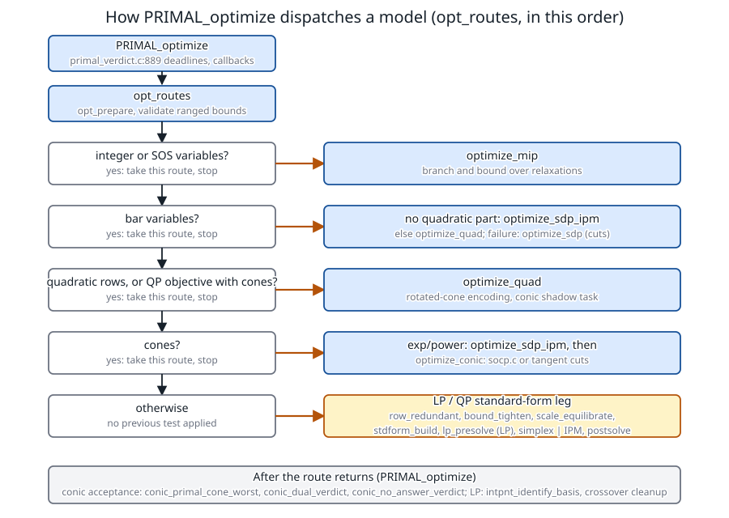

# Architecture: from `PRIMAL_optimize` to the published solution

**Verified against** revision `1f2ddee` plus the presolve correction `2c48c87` (`primal_verdict.c`, `primal_optimize.c`,
`primal_std.c`, `primal_sdptask.c`, `presolve.c`, `stdform.c`, `scaling.c`). The traces below are the `GMB_DBG=1` output of
`PRIMAL_optimize` on three small models, run at `24b408a`.

## Learning objectives and prerequisites

After this chapter you can:

- name, in order, the tests of `opt_routes` and the engine each one selects, and say which model shapes go where;
- follow an LP through the standard-form pipeline (redundant rows, bound tightening, scaling, standard form, presolve, engine selection, postsolve,
  ray publication) with the real function names;
- follow a QP and a mixed SOC/exponential model to their engines and read the debug trace that shows it;
- say what `PRIMAL_optimize` itself does after a route returns (cone acceptance, verdicts, crossover) and where the reference chapters for each stage are.

Prerequisites: the previous chapters; this one is the map that ties them together.

## The dispatch



*Figure: the order of the tests in [`opt_routes`](../primal_optimize.c#L32). Each test is tried only if the previous ones did not apply. Static diagram
drawn from the code by [`figures/make_figures.c`](figures/make_figures.c) at `1f2ddee`; the three traces below check it on one model per branch.*

[`PRIMAL_optimize`](../primal_verdict.c#L889) sets the wall-clock deadlines (`PRIMAL_DPAR_OPTIMIZER_MAX_TIME`, `MIO_MAX_TIME`; the branch and bound obeys the
tighter), fires the begin callback, calls `opt_routes`, then judges the answer. `opt_routes` starts with `opt_prepare` (buffers) and a check that ranged
bounds are not inverted (`PRIMAL_RES_ERR_ARG` otherwise), then:

1. **Integers or SOS** (`vartype != CONT` or `numsos > 0`): `optimize_mip`, a branch and bound over relaxations ([MIP](mixed_integer_optimization.md)).
2. **Bar variables**: a quadratic row or objective sends the model to `optimize_quad`, which carries the bars into its encoded shadow task; otherwise
   `optimize_sdp_ipm` runs the unified interior point of `sdp.c` ([SDP](semidefinite_programming.md)). If it does not return OK, infeasible or unbounded and
   no cones are present, the tangent-cut outer approximation `optimize_sdp` answers; with cones the model falls through to the conic path.
   `GMB_NO_SDP_IPM` forces the cuts.
3. **Quadratic rows, or a QP objective with cones**: `optimize_quad` rewrites the convex quadratics as rotated cones and solves the conic shadow task
   ([QP](quadratic_programming.md#convex-qcqp-rewriting-into-rotated-cones)).
4. **Cones**: with an exponential or power cone and no `GMB_NO_EXP_IPM`, `optimize_sdp_ipm` is tried first (native barrier blocks of `sdp.c`:
   [exponential](exponential_cone.md), [power](power_cone.md)); whatever is left goes to `optimize_conic` ([SOCP](conic-socp.md), with the
   tangent cuts as fallback; since `01b4673` a model with at least 16 three-dimensional SOC blocks and few equalities starts on the sparse solver). A near-optimal point saved by the native route is delivered only if the cuts give no answer. Row presolve of the conic
   rows (`conic_presolve_apply`) runs around that call when presolve level is at least 1.
5. **Otherwise** the LP/QP standard-form leg.

## The LP/QP leg

```text
LP-QP-LEG(task)                                            # primal_optimize.c
 1  min form:  c <- s c,  bounds -> [lx, ux], [lc, uc]                       # s = -1 for maximize
 2  row_redundant                      drop rows implied by the bounds         (GMB_NO_PRESOLVE_ROWS)
 3  bound_tighten                      tighten bounds from the rows, record the row and coefficient   (GMB_NO_BOUND_TIGHTEN)
 4  build_csc;  scale_equilibrate      powers of two, A, c, bounds; Q scaled as D Q D    (PRIMAL_IPAR_SCALING)   [numerical stability]
 5  stdform_build                      min c'x  s.t. A x = b, x >= 0   [presolve chapter for the rules]
 6  lp_presolve (LP only, level >= 1)  empty rows/columns, singletons, (level 2) duplicates
 7  std_route_method                   0 tableau simplex | 1 dense IPM | 2 sparse LP IPM | 3 sparse QP IPM
 8  solve_std_routed  (or solve_std_conc when num_threads > 1, no presolve reduction and method 0 or 1: a race of four engines)
 9  presolve_postsolve, stdform_map_x / map_y, undo the column scaling        # x = D x', y = R y'
10  ray_publish                        measure and publish a Farkas ray if the status is infeasible/unbounded   [certificates]
11  PRIMAL_optimize:  intpnt_identify_basis, intpnt_crossover_cleanup  (LP solved by IPM only)
```

`std_route_method` ([`primal_std.c:158`](../primal_std.c#L158)): for a QP, the sparse QP engine when $n>150$, $m\le600$ and the user did not force a simplex,
else the dense one; for an LP, the sparse interior point when $m\le2000$, $mn>2000$ and no simplex was forced, else the interior point only if the user asked for
`INTPNT`, else the simplex. MIP relaxations always stay on the simplex.

## Three traces

**LP.** $\max3x+2y$, $x+y\le4$, $x\le2$, $x,y\ge0$ (the model of [simplex](simplex.md)): `rc=0`, objective 10. The debug phases are `lp asm`, `lp solve`,
`route`, `verdict`: the model took the LP/QP leg (steps 2–10), and the size ($m=2$, $mn=4$) selected the tableau simplex.

**QP.** $\min\tfrac12(x_1^2+x_2^2)$, $x_1+x_2\ge2$, $x_1\le3$ ([QP](quadratic_programming.md)): `rc=0`, objective 1. The same four phases: `has_qobj` and no cones means the LP/QP leg with
method 1 (dense interior point, $n=2$).

**Mixed cones.** $\min t+w_0$ s.t. $u+v=2$, $w_1=w_2=1$, $(t,u,v)\in\texttt{PEXP}$, $(w_0,w_1,w_2)\in Q_3$: `rc=0`, objective $2+\sqrt2=3.4142135624$. The trace
shows `[phase] sdp_ipm conv`, then the iterations of `sdp_ipm_run` (here the first-attempt Hessian-NT row, with `[augx] it=16 … R_+ block augmented`: the guard of
[SDP](semidefinite_programming.md) re-solved a direction that violated its primal rows), `[route] status=0 rel_pri=5.1e-15 rel_dual=5.6e-17 rel_gap=3.6e-15`,
and then the check that `PRIMAL_optimize` itself runs on a conic-only model:

```text
[condual] cone 0 PEXP rel=0 d= 1 -1 -1 slack=4.8e-15
[condual] cone 1 QUAD rel=0 d= 1 -0.7071 -0.7071 slack=5.4e-15
[cones] task rel_slack=-4.74e-15 pri_slack=-1.42e-14 where=cone 0 PEXP a=0{2 2.00000000136 -1.36e-09}
```

The `condual` lines are the dual cone memberships measured on the published point: $d=(1,-1,-1)$ for the exponential cone is exactly the dual vector found by hand in the
[exponential-cone example](exponential_cone.md#worked-example-solved) and $d=(1,-\tfrac1{\sqrt2},-\tfrac1{\sqrt2})$ is the dual of the Lorentz cone at the primal optimum
$(\sqrt2,1,1)$. The route's own triple does not see cone membership, which is why this gate sits in `PRIMAL_optimize`.

## What `PRIMAL_optimize` does after the route

- **Deadlines and objective cuts.** A fired cap is its own termination code (`TRM_OBJECTIVE_RANGE`, `TRM_MAX_TIME`); the conic verdicts below are skipped for it.
- **Cone acceptance** (conic-only models: cones or bars, no quadratic term): if the route returned OK, `conic_primal_cone_worst` must not be below
  $-\text{tol}\cdot\text{near}$; a point outside its cones is refused (`has_sol=0`) and the model is asked what it is (`conic_no_answer_verdict`). Otherwise
  `conic_dual_verdict` measures that the published reduced costs lie in the dual cones ([certificates](certificates.md)).
- **No answer.** A route that returned `TRM_MAX_ITER` on a conic-only model is asked by `conic_no_answer_verdict`, with LP relaxations that contain or are inside the cones.
- **Crossover** for an LP solved without cones or bars: `intpnt_identify_basis` publishes a basis identified from the interior point.
- Timing and `last_rc` are recorded; with `GMB_DBG` the `[phase]` lines above are printed.

## Source map

| stage | file | functions | chapter |
|---|---|---|---|
| entry, judgement | `primal_verdict.c` | `PRIMAL_optimize`, `conic_*_verdict` | this chapter, [certificates](certificates.md) |
| dispatch, LP/QP leg | `primal_optimize.c` | `opt_routes` | this chapter |
| standard-form drivers, rays | `primal_std.c` | `std_route_method`, `solve_std_routed`, `ray_publish` | [simplex](simplex.md), [certificates](certificates.md) |
| form conversion | `stdform.c` | `stdform_build`, `stdform_map_*` | [presolve](presolve.md) |
| presolve | `presolve.c` | `lp_presolve`, `presolve_postsolve*` | [presolve](presolve.md) |
| scaling | `scaling.c` | `scale_equilibrate` | [numerical stability](numerical_stability.md) |
| simplex | `simplex.c` | tableau, revised, dual | [simplex](simplex.md) |
| LP/QP interior point | `ipm.c` | `ipm_solve_std`, `ipm_solve_std_csc`, `ipm_solve_qp_csc` | [interior point](interior-point.md), [QP](quadratic_programming.md) |
| second-order cones | `socp.c`, `primal_conicopt.c` | `socp_solve`, `optimize_conic` | [SOCP](conic-socp.md) |
| SDP, exp, power | `sdp.c`, `primal_sdptask.c`, `expcone.c` | `sdp_ipm_run`, `optimize_sdp_ipm`, `optimize_sdp` | [SDP](semidefinite_programming.md), [exponential](exponential_cone.md), [power](power_cone.md) |
| MIP | `primal_mip_opt.c`, `primal_mip.c` | `optimize_mip` and cuts | [MIP](mixed_integer_optimization.md) |
| linear algebra | `linalg.c` | LU, Cholesky, AMD, Jacobi | [linear algebra](linear_algebra.md) |

## Costs and failure modes

- The dispatch is first-match: a model with integer variables always goes to branch and bound, even if it also has cones; each node relaxation then calls the continuous route.
- A shape no route represents (an unknown cone type, a quadratic term outside the encoder) returns `PRIMAL_RES_ERR_ARG` rather than a wrong answer.
- Environment switches (`GMB_NO_*`, `GMB_DBG`) are development hooks; the defaults are the behaviour documented in the other chapters.

## Exercise

Which route solves a model with one binary variable and a PSD block, and what does each node of that route call?

*Answer.* The first test of `opt_routes` is the integer test, so `optimize_mip` runs, never `optimize_sdp_ipm` directly; its nodes solve relaxations, which for a
bar-carrying model call `optimize_sdp_ipm` (falling back to `optimize_sdp` when it fails and there are no cones, `primal_mip.c`), as the relaxation solver of the
[MIP chapter](mixed_integer_optimization.md) does.

## References

- J. Nocedal and S. J. Wright, [*Numerical Optimization*](https://doi.org/10.1007/978-0-387-40065-5), 2nd ed., Springer, 2006.
- S. J. Wright, *Primal-Dual Interior-Point Methods*, SIAM, 1997.
- E. D. Andersen and K. D. Andersen, [The Mosek interior point optimizer for linear programming: an implementation of the homogeneous algorithm](https://doi.org/10.1007/978-1-4757-3216-0_8), in *High Performance Optimization*, Springer, 2000, pp. 197–232.
