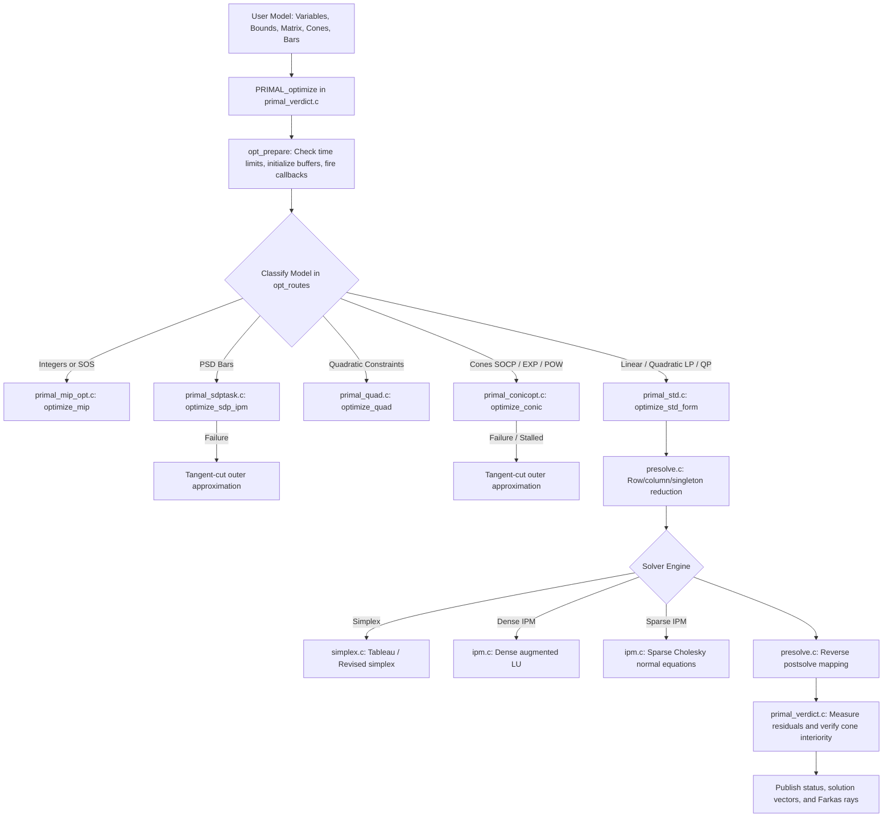

# Solver architecture, dispatch and execution pipeline

PRIMAL is an industrial-grade mathematical optimization solver written in C99
with zero external dependencies beyond standard `libc` and `libm`. It exposes a
`PRIMAL_`-prefixed public API and solves continuous linear (LP), quadratic (QP),
quadratically constrained (QCQP), second-order cone (SOCP), semidefinite (SDP),
exponential and power cone, and mixed-integer (MIP) optimization problems.

This chapter traces the complete execution flow from `PRIMAL_optimize` through
model classification, presolve, algorithmic routing, solver engines, postsolve,
and certificate publication.

## Top-level execution pipeline

## The dispatch sequence in `opt_routes`

When `PRIMAL_optimize(task)` is invoked, `primal_optimize.c:opt_routes` classifies
the model according to its structural features:

1. **Input validation:** Bounds are validated; inverted ranges ($l > u$) return `ERR_ARG`.
2. **Discrete branch (`optimize_mip`):**
   If any variable has `vartype != PRIMAL_VAR_TYPE_CONT` or SOS constraints are present:
   - Dispatches to branch-and-bound in `primal_mip_opt.c`.
   - Node relaxations call continuous conic or LP solvers via `mip_relax_conic` or `mip_relax`.
3. **Semidefinite branch (`optimize_sdp_ipm`):**
   If `task->numbarvar > 0`:
   - If quadratic rows/objective exist, routes to `optimize_quad` (QCQP shadow encoder).
   - Otherwise, dispatches to the unified conic interior-point engine `sdp.c:sdp_ipm_csr`.
   - If the native IPM cannot satisfy convergence criteria, falls back to `optimize_sdp` (tangent cuts).
4. **Quadratic constraint branch (`optimize_quad`):**
   Convex quadratic constraints are transformed via rotated second-order cone epigraphs.
5. **Conic branch (`optimize_conic`):**
   If `task->numcones > 0`:
   - Pure SOCP models with coordinate slack rows and few equalities route to sparse NT/Cholesky (`socp.c`).
   - Mixed models with exponential or power cones route to `sdp.c` (Hessian-NT augmented KKT).
   - Fallback to cutting planes in `primal_conicopt.c`.
6. **Continuous LP/QP branch (`optimize_std_form`):**
   - Transformed to standard equality form in `stdform.c`.
   - Presolve simplifies empty rows/columns and singletons in `presolve.c`.
   - Dispatches to Simplex (`simplex.c`) or Interior Point (`ipm.c`).

## Tracing three model classes through the code

### 1. Tracing a Linear Program (LP)

Consider $\min c^T x$ subject to $l_c \le A x \le u_c, l_x \le x \le u_x$.
1. **Public call:** User calls `PRIMAL_optimize(task)`.
2. **Presolve:** `presolve_reduce_lp` in `presolve.c` eliminates redundant rows,
   tightens singleton bounds, and records an invertible transformation log.
3. **Form conversion:** `stdform_build` converts the reduced model to $\min c^T x$ s.t. $A x = b, x \ge 0$.
4. **Engine selection:**
   - If `optimizer == PRIMAL_OPTIMIZER_PRIMAL_SIMPLEX`, calls `simplex_solve` in `simplex.c`.
   - If `optimizer == PRIMAL_OPTIMIZER_INTPNT`, calls `ipm_solve_std_csc` in `ipm.c`.
5. **Normal equations:** In `ipm.c`, the sparse Cholesky solver factors $A \Theta A^T + \delta I$.
6. **Postsolve:** `presolve_postsolve_lp` replays the transformation log in reverse,
   reconstructing primal variables $x$, dual multipliers $y$, and reduced costs $z$.
7. **Publication:** Solution vectors are copied to task buffers (`task->xx`, `task->y`, `task->slx`, etc.).

### 2. Tracing a Quadratic Program (QP)

Consider $\min \frac{1}{2} x^T Q x + c^T x$ subject to linear constraints.
1. `opt_routes` detects `task->has_qobj == 1` and `task->numcones == 0`.
2. Routes to `primal_std.c:optimize_qp`.
3. Checks if the problem qualifies for **condensed private-slack factorization**
   (`small_qp_condensable`):
   - Small eligible QPs eliminate private box slack rows and factor a reduced $n\times n$ system.
   - Large or general QPs use the sparse augmented KKT system.
4. Regularization is applied if $Q$ has zero eigenvalues along constraint null-spaces.
5. Returns `PRIM_SOL_STA_OPTIMAL` with measured primal/dual objectives:
   $\text{pobj} = c^T x + \frac{1}{2} x^T Q x$, $\text{dobj} = b^T y - \frac{1}{2} x^T Q x$.

### 3. Tracing a Mixed-Cone Model (SOCP + EXP)

Consider a logistic regression model with an $L_2$ norm constraint and exponential entropy terms.
1. `opt_routes` detects `task->numcones > 0` containing both `PRIMAL_CONE_QUAD` and `PRIMAL_CONE_PEXP`.
2. `primal_conicopt.c` identifies mixed cones and routes to `sdp.c:sdp_ipm_csr`.
3. **Augmented KKT assembly:**
   - SOC blocks are formatted as arrow matrices $A(z), A(s)$.
   - PEXP blocks contribute 3×3 Hessian-NT metric blocks `Thin`.
   - Linear constraints form equality coupling rows.
4. **Solve iteration:**
   - Two-sided Jacobi scaling balances the matrix.
   - Dense LU factors the augmented system.
   - Higher-order corrector in `expcone_corrector.c` computes third-derivative contractions for the PEXP blocks.
5. **Acceptance check:**
   - `conic_primal_cone_worst(task)` verifies that the computed point strictly satisfies $t \ge u e^{v/u}$ and $t \ge \|u\|_2$.
   - If verified, `PRIM_SOL_STA_OPTIMAL` is published. If uncentered, the solver retries in secant mode or falls back to tangent cuts.

## File and module organization

| File | Primary Responsibility |
|---|---|
| `primal_verdict.c` | Public entry point `PRIMAL_optimize`, final tolerance and cone acceptance checks |
| `primal_optimize.c` | Algorithmic routing `opt_routes`, LP/QP dispatch, buffer preparation |
| `primal_std.c` | Standard equality form LP/QP driver, simplex vs IPM selection |
| `primal_conicopt.c` | Conic classification, dense vs sparse SOCP, exp/power routing and tangent-cut fallback |
| `primal_sdptask.c` | Semidefinite programming task setup, packed bar representation, bar caps |
| `primal_mip_opt.c` | Branch-and-bound master loop `optimize_mip`, node pruning, cut coordination |
| `primal_mip.c` | MIP cuts (Chvátal–Gomory, Gomory tableau, conflict), candidate feasibility check |
| `presolve.c` | LP presolve reductions and homogeneous ray lifting postsolve |
| `stdform.c` | Equality form conversion, variable splitting, coordinate mapping |
| `scaling.c` | Power-of-2 Ruiz equilibration for constraint and objective scaling |
| `ipm.c` | Primal-dual interior point method for LP and QP (dense LU and sparse Cholesky) |
| `socp.c` | Conic interior point method for second-order cones (dense LU and sparse NT/Cholesky) |
| `sdp.c` | Unified augmented KKT conic solver (PSD, SOC, EXP, POW in one engine) |
| `expcone.c` | Barrier, gradient, Hessian, and dual scaling point for non-symmetric cones |
| `expcone_corrector.c` | Higher-order third-derivative tensor contractions for PEXP blocks |
| `simplex.c` | Primal and dual revised simplex algorithms and basis factorization |
| `linalg.c` | Dense LU, sparse LU (`splu`), AMD ordering (`sym_amd`), sparse Cholesky, Jacobi eigensolver |

## References

- MOSEK ApS, [MOSEK Optimizer API Reference](https://docs.mosek.com/latest/capi/index.html), 2024.
- J. Nocedal and S. J. Wright, [Numerical Optimization](https://doi.org/10.1007/978-0-387-40065-5), Springer, 2nd ed., 2006.
- A. Dax, [A row relaxation method for large scale linear programming](https://doi.org/10.1007/BF02592055), Linear Algebra and its Applications, 1990.
