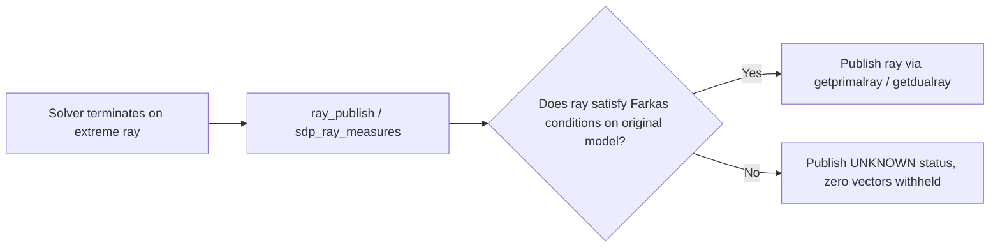

# Certificates of infeasibility and unboundedness

In mathematical optimization, a solver must not simply assert that a problem has
no solution; it must produce an independently checkable **certificate**
(witness) proving that assertion. This chapter derives Farkas' Lemma, recession
directions, PRIMAL's sign and normalization conventions, and explains why a
certificate is published only when verified by direct measurement on the original model.

## Farkas' Lemma and theorems of alternatives

### Linear primal–dual alternatives

For the standard linear inequality system $A x \le b, x \ge 0$, exactly one of
the following two systems has a solution (Farkas' Lemma):
1. **Primal feasible:** There exists $x \in \mathbb{R}^n$ such that $A x \le b, x \ge 0$.
2. **Infeasibility certificate (Dual ray):** There exists $y \in \mathbb{R}^m$ such that:
   $$
   y \ge 0, \quad A^T y \ge 0, \quad b^T y < 0.
   $$

If both held, we would have $0 \le y^T (A x) = (A^T y)^T x \le y^T b < 0$, a direct contradiction.

For PRIMAL's standard min-normalized equality form ($A x = b, x \ge 0$):
- **Primal infeasibility witness:** A vector $y \in \mathbb{R}^m$ satisfying:
  $$
  A^T y \le 0, \qquad b^T y > 0.
  $$
- **Primal unboundedness witness (Primal ray):** A recession direction $\rho \in \mathbb{R}^n$ satisfying:
  $$
  \rho \ge 0, \qquad A \rho = 0, \qquad c^T \rho < 0.
  $$

## Conic Farkas alternatives

For general conic problems $\min c^T x$ subject to $A x = b, x \in \mathcal{K}$:
- **Primal infeasibility:** There exists $y \in \mathbb{R}^m$ such that:
  $$
  -A^T y \in \mathcal{K}^*, \qquad b^T y > 0.
  $$
- **Dual infeasibility (Primal recession):** There exists $\rho \in \mathcal{K}$ such that:
  $$
  A \rho = 0, \qquad c^T \rho < 0.
  $$

## Normalization and sign conventions in PRIMAL

Both rays are normalized by their $\infty$-norm:

$$
\|\rho\|_\infty = \max_j |\rho_j| = 1, \qquad \|y\|_\infty = \max_i |y_i| = 1.
$$

Normalization places the numerical verification on the scale of the user's model
rather than the internal scale of solver presolve or preconditioning.

Dual multipliers $y$ and reduced costs $z$ follow standard sensitivity conventions:
- $y_i > 0$: The constraint is active at its **upper** bound.
- $y_i < 0$: The constraint is active at its **lower** bound.
- $z_j > 0$: The variable is at its **upper** bound.
- $z_j < 0$: The variable is at its **lower** bound.

The dual objective for general models is evaluated as:

$$
\text{dobj} = c_{\mathrm{fix}} - \sum_i y_i b_i^{\mathrm{act}} - \sum_j z_j x_{b,j}^{\mathrm{act}} - \frac{1}{2} x^T Q x.
$$

## Worked examples

### Infeasible example

Consider:

$$
x_1 + x_2 \le 1, \qquad -x_1 - x_2 \le -2, \qquad x_1, x_2 \ge 0.
$$

Adding slack variables gives $x_1 + x_2 + s_1 = 1$ and $-x_1 - x_2 + s_2 = -2$ with $s_1, s_2 \ge 0$.
Summing the two equations yields $s_1 + s_2 = -1$, which is impossible for nonnegative slacks.

In PRIMAL's format:
$A = \begin{bmatrix} 1 & 1 \\ -1 & -1 \end{bmatrix}$, $b = \begin{bmatrix} 1 \\ -2 \end{bmatrix}$.
Choose dual multiplier $y = [1, 1]^T$:
$$
A^T y = \begin{bmatrix} 1 & -1 \\ 1 & -1 \end{bmatrix} \begin{bmatrix} 1 \\ 1 \end{bmatrix} = \begin{bmatrix} 0 \\ 0 \end{bmatrix} \le 0, \qquad
b^T y = 1(1) + (-2)(1) = -1 < 0.
$$
Normalizing by $\|y\|_\infty = 1$ gives the dual ray $y = [1, 1]^T$, certifying primal infeasibility.

### Unbounded example

Consider:

$$
\min -x_1 - 2 x_2 \quad \text{s.t.} \quad -x_1 + x_2 \le 1, \quad x_1, x_2 \ge 0.
$$

Consider direction $\rho = [2, 1]^T \ge 0$.
Checking the constraint row:
$$
A \rho = [-1, 1] \begin{bmatrix} 2 \\ 1 \end{bmatrix} = -2 + 1 = -1 \le 0.
$$
The objective improves along $\rho$:
$$
c^T \rho = [-1, -2] \begin{bmatrix} 2 \\ 1 \end{bmatrix} = -4 < 0.
$$
For any $t \ge 0$, the point $x(t) = t \rho$ remains feasible and $c^T x(t) = -4 t \to -\infty$.
Normalizing $\rho$ by $\|\rho\|_\infty = 2$ gives the primal ray $\rho^* = [1, 0.5]^T$, certified by `PRIMAL_getprimalray`.

## Verification in PRIMAL implementation

1. **Simplex ray generation (`simplex.c`):**
   - Phase-I simplex terminates with an artificial objective $> 0$ when an LP is infeasible,
     extracting the dual ray directly from the basis inverse row.
   - When the primal ratio test finds no exiting basic variable, the pivot direction yields
     the primal ray $\rho$.
2. **Presolve ray lifting (`presolve.c`):**
   When presolve eliminates singleton rows, empty columns, or duplicate constraints,
   `presolve_postsolve_dir` lifts the ray back to original coordinates using a homogeneous
   adjoint pass ($y_i = -\sum_k A_{kj} y_k / A_{ij}$ without constant shifts).
3. **Measurement before publication (`primal_verdict.c`):**
   In `ray_publish`, the candidate ray is evaluated against the user's unscaled constraint matrices.
   If $\|A^T y\|_\infty > \text{tol}$ or $b^T y \le 0$, the certificate is rejected and the solver
   reports status `PRIM_UNKNOWN`.

| Problem Type | Status Code | Vector availability |
|---|---|---|
| LP / QP Infeasible | `PRIM_PRIMAL_INFEAS_CER` | `PRIMAL_getdualray` |
| LP / QP Unbounded | `PRIM_DUAL_INFEAS_CER` | `PRIMAL_getprimalray` |
| Conic Infeasible (no PSD) | `PRIM_PRIMAL_INFEAS_CER` | `PRIMAL_getdualray` |
| Conic Unbounded (no PSD) | `PRIM_DUAL_INFEAS_CER` | `PRIMAL_getprimalray` |
| PSD Bar / Mixed SDP | `PRIM_UNKNOWN` (in `prosta`) | None (compressed bar format has no vector image) |
| Tangent-cut outer approx | `PRIM_UNKNOWN` (in `prosta`) | None (tangent cut lifting is not certified) |
| MIP infeasible | `PRIM_UNKNOWN` (in `prosta`) | None (relaxation rays do not certify integer infeasibility) |

## References

- J. Farkas, [Über die Theorie der einfachen Ungleichungen](https://doi.org/10.5169/seals-840954), Journal für die reine und angewandte Mathematik, 1902.
- A. Schrijver, [Theory of Linear and Integer Programming](https://www.wiley.com/en-us/Theory+of+Linear+and+Integer+Programming-p-9780471982326), Wiley, 1998.
- S. Boyd and L. Vandenberghe, [Convex Optimization](https://web.stanford.edu/~boyd/cvxbook/), Section 5.8 (Theorems of alternatives).
