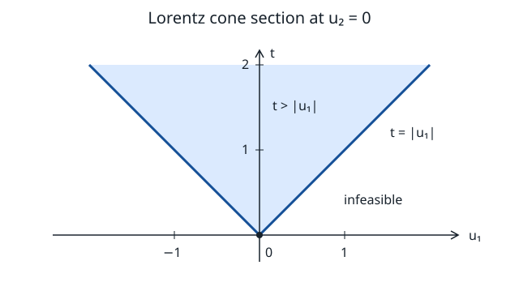
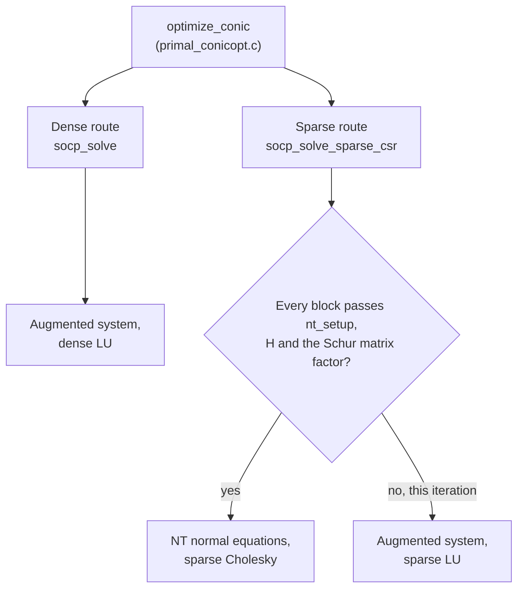

# Second-order cone programming

**Verified against** revision `1f2ddee` (`socp.c`, `socp.h`, `primal_conicopt.c`).

## Learning objectives and prerequisites

After this chapter you can:

- state the Lorentz and rotated cones and the Jordan algebra on them, and test
  whether a point is strictly interior;
- derive the Newton system of the conic interior point in its augmented form and in the
  Nesterov–Todd normal-equations form, and carry one affine step out by hand;
- say which solver PRIMAL runs for a given model, how it decides, per iteration, between
  the NT Cholesky direction and the sparse LU direction, and what recovery it has;
- name the tests that check each route.

Prerequisites: [interior point for LP](interior-point.md) (the same predictor–corrector),
[dual cones](mathematical_foundations.md), [linear algebra](linear_algebra.md).

## Geometry and Jordan algebra

The Lorentz cone is $Q_k=\{(t,u)\in\mathbb R\times\mathbb R^{k-1}:t\ge\|u\|_2\}$. A
rotated cone $\{2ab\ge\|u\|_2^2,\ a,b\ge0\}$ maps onto it through
$\bigl((a+b)/\sqrt2,\,(a-b)/\sqrt2,\,u\bigr)$.



*Figure: the section $u_2=0$ of $Q_3$, the region $t\ge|u_1|$. The boundary is the two rays
$t=\pm u_1$ above the origin; both axes use the same scale. A boundary point is where
a Jordan eigenvalue vanishes, see below.*

For $v=(v_0,\bar v)$ and $z=(z_0,\bar z)$ define the Jordan product and the arrow matrix

$$
v\circ z=(v_0z_0+\bar v^\top\bar z,\ v_0\bar z+z_0\bar v),\qquad
L(v)=\begin{bmatrix}v_0&\bar v^\top\\\bar v&v_0I\end{bmatrix},
\qquad L(v)z=v\circ z .
$$

The identity is $e=(1,0)$. The Jordan eigenvalues of $v$ are $v_0\pm\|\bar v\|_2$, and
$v$ is strictly interior exactly when both are positive, that is $\det v=v_0^2-\|\bar
v\|^2>0$. For an orthant block the product is componentwise and the identity is the
all-ones vector. The *quadratic representation* is $P(v)=2L(v)^2-L(v\circ v)$.

## The model and the Newton system

PRIMAL's SOCP engines solve

$$
\min_xc^\top x\quad\text{s.t.}\quad Ex=d,\quad s=Gx+h\in K,
$$

where $K$ is a product of orthant blocks ($\mathbb R_+$, dimension 1) and Lorentz blocks.
The multiplier of $Ex=d$ is $y$ and the multiplier of the cone is
$\lambda\in K^*=K$. With $r_p=Ex-d$, $r_g=Gx+h-s$ and $r_d=c+E^\top y-G^\top\lambda$,
the KKT conditions are $r_p=r_g=r_d=0$ and $s\circ\lambda=0$. Linearizing
complementarity at an interior point gives $L(\lambda)\Delta s+L(s)\Delta\lambda=q$, and
$\Delta s=r_g+G\Delta x$. The **augmented system**, in the block-row order the code
assembles (`socp_solve`), is

$$
\begin{bmatrix}L(\lambda)G&0&L(s)\\E&0&0\\0&E^\top&-G^\top\end{bmatrix}
\begin{bmatrix}\Delta x\\\Delta y\\\Delta\lambda\end{bmatrix}=
\begin{bmatrix}q-L(\lambda)r_g\\-r_p\\-r_d\end{bmatrix}.
$$

The predictor has $q=-s\circ\lambda$. The centering parameter is
$\sigma=(\mu_{\rm aff}/\mu)^3$ clamped to $[10^{-8},1]$, with
$\mu=s^\top\lambda/K_{\rm tot}$ ($K_{\rm tot}$ the total cone dimension) and $\mu_{\rm aff}$
the same quantity at the affine trial point. The corrector reuses the factor with
$q=-s\circ\lambda+\sigma\mu e$; the term $\sigma\mu e$ acts on the *identity element*, so for a
Lorentz block it enters the first coordinate only.

### Nesterov–Todd scaling and the normal equations

For interior blocks there is a unique *scaling point* $w$ with $P(w)\lambda=s$, given by
the spectral square root and inverse. In the convention of `nt_setup`,

$$
a=s^{1/2},\qquad w=P(a)\bigl(P(a)\lambda\bigr)^{-1/2},\qquad P(w)\lambda=s .
$$

Using $w$ to scale the complementarity equation lets one eliminate $\Delta\lambda$ and
$\Delta s$:

$$
\Delta\lambda=-\lambda+\sigma\mu\,s^{-1}-P(w)^{-1}\Delta s+\text{corr},
\qquad
\bigl(H\bigr)\,\Delta x+E^\top\Delta y=\text{rhs},\quad H=G^\top P(w)^{-1}G .
$$

$H$ is symmetric positive definite for a strictly interior point. PRIMAL factors it by sparse
Cholesky and, when equalities are present, solves for $\Delta y$ with the Schur complement
$EH^{-1}E^\top$ (a second Cholesky), then recovers $\Delta x=H^{-1}(\text{rhs}-E^\top\Delta y)$,
$\Delta s=r_g+G\Delta x$ and $\Delta\lambda$ from the first equation. This is the *NT
direction*; the augmented system above is the same step computed without scaling.

## One iteration, with the recovery PRIMAL has

```text
SOCP-STEP(x, y, s, lambda)                       # socp_solve (dense) / socp_solve_sparse_impl
 1  r_p, r_g, r_d <- residuals;  mu <- s'lambda / K
 2  f_p <- max(|r_p|/max(1,|d|), |r_g|/max(1,|h|));  f_d <- |r_d| / max(1,|c|)
 3  gap <- |c'x - dual objective| / (1 + |c'x|)
 4  if f_p, f_d <= tol and gap <= tol_gap:  return optimal
 5  keep the feasible iterate with the smallest gap; if gap rises past 1e-2 after 20 its, return it
 6  build the direction operator   (dense LU | NT Cholesky | sparse LU, see below)
 7  predictor (q = -s o lambda) -> step lengths -> mu_aff -> sigma
 8  corrector (centering; second-order term in the sparse route)
 9  step lengths by the cone ratio test:  tau = clamp(1 - 0.01 mu, 0.99, 0.99995)
10  if a corrector length < 0.1 * tau * affine length:  use the affine direction
11  if both lengths are <= 1e-13 for more than 5 iterations:  stop;  else update the iterate
```

The step length for a cone block (`socp_step_len`) is the largest $\alpha\le1$ with
$s+\alpha\Delta s$ still in the cone: for a Lorentz block the first positive root of the
quadratic $\|\bar s+\alpha\Delta\bar s\|^2-(s_0+\alpha\Delta s_0)^2=0$ (1 if there is none), for an
orthant block the usual ratio, with 0 if a coordinate is already negative.

### Worked Newton step

Minimize $t$ over $(t,x_1,x_2)\in Q_3$ with $x_1+x_2=1$. In the model above:
$x=(t,x_1,x_2)$, $c=(1,0,0)$, $E=(0,1,1)$, $d=1$, $G=I$, $h=0$. The code starts at
$x=0$, $y=0$, $s=\lambda=e=(1,0,0)$, so $\mu=\tfrac13$,

$$
r_p=E x-d=-1,\qquad r_g=-s=-(1,0,0),\qquad r_d=c-\lambda=0 .
$$

At $\lambda=e$, $L(\lambda)=I$. The predictor ($q=-e$) gives $q-L(\lambda)r_g=-e+e=0$, so the
system reads $\Delta x+\Delta\lambda=0$, $\Delta x_1+\Delta x_2=1$ and
$(0,\Delta y,\Delta y)-\Delta\lambda=0$. Hence $\Delta\lambda=(0,\Delta y,\Delta y)$,
$\Delta x=-\Delta\lambda$, and $E\Delta x=-2\Delta y=1$ gives

$$
\Delta y=-\tfrac12,\quad\Delta\lambda=(0,-\tfrac12,-\tfrac12),\quad
\Delta x=(0,\tfrac12,\tfrac12),\quad\Delta s=r_g+G\Delta x=(-1,\tfrac12,\tfrac12).
$$

**Check.** $L(\lambda)\Delta s+L(s)\Delta\lambda=\Delta s+\Delta\lambda=(-1,0,0)=q$.
**Step lengths.** $s+\alpha\Delta s=(1-\alpha,\alpha/2,\alpha/2)$ stays in $Q_3$ while
$1-\alpha\ge\alpha/\sqrt2$, i.e. $\alpha\le2-\sqrt2\approx0.5858$. And
$\lambda+\alpha\Delta\lambda=(1,-\alpha/2,-\alpha/2)$ stays in the cone up to $\alpha=\sqrt2$,
so $\alpha_d=1$. At the affine trial point
$\mu_{\rm aff}=\frac13\bigl[(\sqrt2-1)\cdot1-2\cdot\tfrac{2-\sqrt2}{2}\cdot\tfrac12\bigr]\approx0.04044$,
$\mu_{\rm aff}/\mu\approx0.1213$ and $\sigma=(0.1213)^3\approx1.79\cdot10^{-3}$. The values
$2-\sqrt2$, $0.04044$, $0.1213$ and $1.79\cdot10^{-3}$ are reproduced by `socp_step_len`.

## PRIMAL routing and the three direction operators



**Dense route** (`socp_solve`, `socp.c`). Before iterating it drops variables that appear in
no row, no cone and have zero cost (a structurally singular KKT otherwise), and equality
rows that are dependent on the others (modified Gram–Schmidt with relative tolerance
$10^{-10}$; their multiplier is 0). It starts at $s=\lambda=(1,0,\dots,0)$ per Lorentz block
(all ones for orthant blocks). The KKT matrix of size $N=n+p+K_{\rm tot}$ is formed densely and
factored by LU; if that fails, a diagonal shift of $10^{-10},10^{-8},\dots,10^{-5}$ is tried
before the status is "singular". It also keeps the best *feasible* iterate and returns it if
the gap later diverges.

**Sparse route** (`socp_solve_sparse_impl`, reached through `socp_solve_sparse_csr` from
`primal_conicopt.c`). *Per iteration* it uses the NT Cholesky direction unless any of
these holds, in which case that iteration uses the sparse **augmented LU** (`splu_factor`) instead:

- `GMB_NO_NT` is set, or a block has $s_i\le10^{-300}$ or $\lambda_i\le10^{-300}$;
- `nt_setup` rejects a block: dimension above 32 (`NT_MAXK`), or the test
  $\det(P(a)\lambda)>10^{-12}\,\|P(a)\lambda\|^2$ fails (the point is on the cone boundary);
- the scaling is ill conditioned (some entry above $10^{16}$);
- the Cholesky of $H$ fails and the repair shift needed is above $10^{-4}\max|H|$
  (`spchol_factor_fail` reports it), or the diagonal condition estimate of $H$ or of the Schur
  matrix exceeds $10^{10}$.

Close to the optimum both $s$ and $\lambda$ approach the cone boundary and the NT direction
becomes unavailable, so a solve typically ends on the LU direction.

**Corrector.** The dense solver takes the centered corrector described above. The
*production sparse* solver adds a **second-order** term: the shift
$-(W^{-1}\Delta s_a)\circ(W\Delta\lambda_a)$ in balanced NT coordinates, computed by
`socp_nt_corrector` (for the LU direction the raw Jordan product
$-\Delta s_a\circ\Delta\lambda_a$ is used). It is described and checked in
[the corrector note](socp-mehrotra-correction.md).

**Boundary recovery.** At $\mu\sim10^{-17}$ a block can lie on its boundary to within rounding,
so a step length of 0 repeats. After two consecutive blocked steps, at most five times per
solve, the flattened blocks are pushed back into the interior by about ten times the current
residual (floor $10^{-9}$) and the iteration continues.

**Fixed coordinates.** A fixed variable is substituted into the equality and cone right-hand
sides, and its bound multipliers are lifted back from stationarity
([fixed reduction](socp-fixed-reduction.md)).

**Which route.** `optimize_conic` (`primal_conicopt.c`) chooses the sparse route for large
models, and since `01b4673` also for a smaller model that has at least 16 three-dimensional
Lorentz blocks, at most 4 equalities, at least 96 KKT rows, no PSD or nonlinear parts and
coordinate slack rows with a single entry. That sparse attempt does not retry the dense route.
Otherwise the dense route runs. The opt-in [symmetric KKT](socp-symmetric-kkt.md)
(`GMB_SOCP_LDL`, experimental) is a third operator for the sparse route. Mixed models with
PSD or exponential blocks use the [unified conic route](semidefinite_programming.md).

**Tests.** `T72`/`T73` check the NT direction against the dense path; `T283` the NT
setup on dimensions 1, 3, 8 and 32; `T286` and `T287` the boundary recovery and the exact
ratio-test crossings; `T289` the second-order corrector against an independent
eigendecomposition; `T290`/`T291` the sparse LU and the fixed reduction.

## Worked example, solved

The Newton step above starts the solve of $\min t$ s.t. $x_1+x_2=1$,
$(t,x_1,x_2)\in Q_3$. By Cauchy–Schwarz $1\le\sqrt2\|(x_1,x_2)\|_2$, so $t\ge1/\sqrt2$, attained at
$(t,x_1,x_2)=(1/\sqrt2,\tfrac12,\tfrac12)$. **Optimality by substitution:** with
$y=-1/\sqrt2$ and $\lambda=(1,-1/\sqrt2,-1/\sqrt2)$,
$r_d=c+E^\top y-\lambda=(1,0,0)+(0,-\tfrac1{\sqrt2},-\tfrac1{\sqrt2})-\lambda=0$,
$\lambda\in Q_3$ (it lies on the boundary: $1=\|(1/\sqrt2,1/\sqrt2)\|$), and
$s^\top\lambda=\tfrac1{\sqrt2}-\tfrac1{2\sqrt2}-\tfrac1{2\sqrt2}=0$. The dual objective $-dy=1/\sqrt2$ equals
the primal value. `PRIMAL_optimize` returns $x=(0.707106780,\,0.5,\,0.5)$, $y=-0.707106781$,
primal and dual objective $0.70710678$ and primal infeasibility $6\cdot10^{-10}$, through the
conic route (dense `socp_solve`, converged after four Newton steps). The [benchmark
family](../bench/conic_bench.c) extends this model to many blocks.

## Costs and numerical limits

Dense: $O(N^3)$ work and $O(N^2)$ storage per iteration with $N=n+p+K_{\rm tot}$. Sparse: the cost
of the Cholesky factors of $H$ and $EH^{-1}E^\top$, which depends on fill, plus
$O(\sum_kk_k^3)$ for the per-block NT data. Near the cone boundary one Jordan eigenvalue goes
to zero, so $s^{-1}$ and $P(w)^{-1}$ amplify rounding; the guards above exist for this. A rejected
direction or an iteration cap alone gives **no certificate**; infeasibility is reported only with
a vector that measures ([certificates](certificates.md)).

## Exercise

For the optimal point of the worked example, compute the Jordan eigenvalues of $s=(t,x_1,x_2)=
(1/\sqrt2,\tfrac12,\tfrac12)$ and of $\lambda$. What does this say about the NT scaling at the
exact optimum?

*Answer.* $s$: $s_0\pm\|\bar s\|=\tfrac1{\sqrt2}\pm\tfrac1{\sqrt2}=\sqrt2$ and $0$. $\lambda$:
$1\pm1=2$ and $0$. Both lie on the boundary, so $\det s=\det\lambda=0$, $s^{-1}$ does not exist
and `nt_setup` reports the block as degenerate: at (or numerically near) the optimum the sparse
solver switches to the augmented LU direction.

## References

- S. Boyd and L. Vandenberghe, [*Convex Optimization*](https://web.stanford.edu/~boyd/cvxbook/), Cambridge University Press, 2004, section 4.4.2 and chapter 11.
- Y. Nesterov and M. J. Todd, [Self-scaled barriers and interior-point methods for convex programming](https://doi.org/10.1287/moor.22.1.1), *Mathematics of Operations Research* 22(1):1–42, 1997.
- S. Mehrotra, [On the implementation of a primal-dual interior point method](https://doi.org/10.1137/0802028), *SIAM Journal on Optimization* 2(4):575–601, 1992.
- F. Alizadeh and D. Goldfarb, [Second-order cone programming](https://doi.org/10.1007/s10107-002-0339-5), *Mathematical Programming* 95(1):3–51, 2003.
