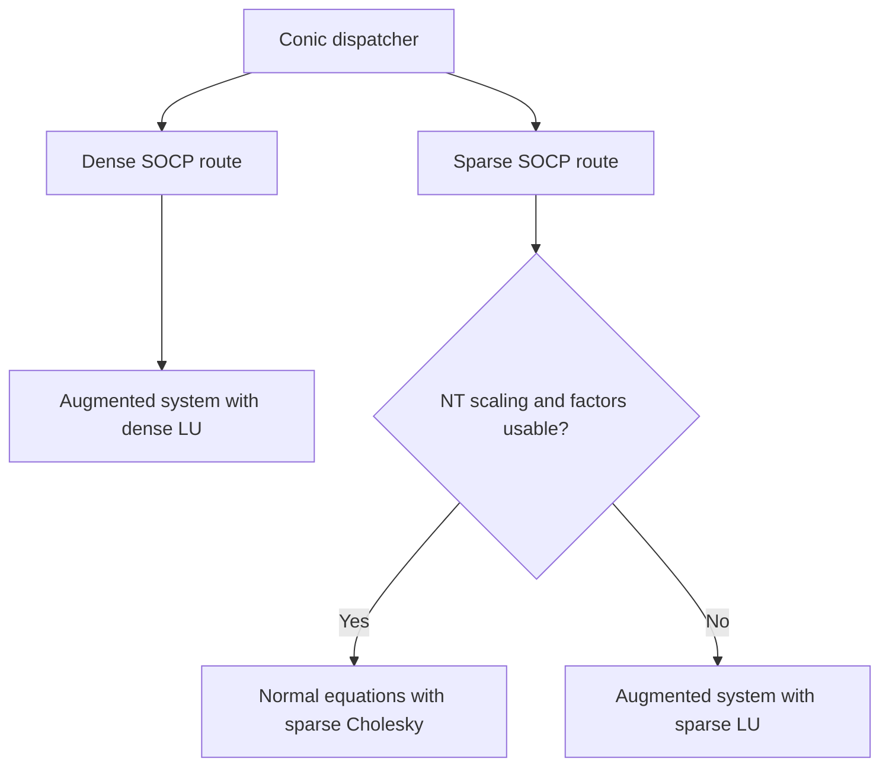

# Second-order cone programming

The second-order cone models a bound on a Euclidean norm. For example,
minimizing an upper bound on a residual norm gives
`minimize t subject to (t, Ax − b) ∈ Q`.

## Geometry and Jordan algebra

The Lorentz cone is $Q_k=\{(t,u)\in\mathbb R\times\mathbb R^{k-1}:t\ge\|u\|_2\}$.
The rotated cone $2ab\ge\|u\|_2^2$, $a,b\ge0$, maps into the Lorentz
cone through $((a+b)/\sqrt 2,(a-b)/\sqrt 2,u)$.

Setting $u_2=0$ in $Q_3$ gives the shaded region $t\ge |u_1|$.
The boundary consists of the two rays $t=\pm u_1$ above the origin.
Both axes use the same scale.

For $v=(v_0,\bar v)$ and $z=(z_0,\bar z)$, define

$$
v\circ z=(v_0 z_0+\bar v^T\bar z,\ v_0\bar z+z_0\bar v),
\qquad
L(v)=\begin{bmatrix}v_0&\bar v^T\\\bar v&v_0 I\end{bmatrix}.
$$

The identity is $e=(1,0)$ and the Jordan eigenvalues of $v$ are
$v_0\pm\|\bar v\|_2$. A point is strictly interior when both are positive.
For an orthant block the product is componentwise and the identity is the
all-ones vector. The quadratic representation is
$P(v)=2L(v)^2-L(v\circ v)$.

## KKT equations and the augmented Newton system

PRIMAL's SOCP routines use the internal model

$$
\min_x c^Tx,\qquad Ex=d,\qquad s=Gx+h\in K.
$$

The equality multiplier is $y$ and the cone multiplier is $\lambda\in K^*=K$.
With $r_p=Ex-d$, $r_g=Gx+h-s$ and $r_d=c+E^Ty-G^T\lambda$,
the KKT conditions require zero residuals and $s\circ\lambda=0$.
At an interior iterate the complementarity equation is linearized as
$L(\lambda)\Delta s+L(s)\Delta\lambda=q$.
Eliminating $\Delta s=r_g+G\Delta x$ gives the unregularized system
assembled by the dense route, in its actual block row order.

$$
\begin{bmatrix}
L(\lambda)G&0&L(s)\\
E&0&0\\
0&E^T&-G^T
\end{bmatrix}
\begin{bmatrix}\Delta x\\\Delta y\\\Delta\lambda\end{bmatrix}
=
\begin{bmatrix}q-L(\lambda)r_g\\-r_p\\-r_d\end{bmatrix}.
$$

The affine predictor uses $q=-s\circ\lambda$. The dense routine computes
primal and dual affine step lengths, estimates $\mu_{\rm aff}$, and clamps
$(\mu_{\rm aff}/\mu)^3$ to $[10^{-8},1]$. Here the code takes
$\mu=s^T\lambda/k_{\rm total}$, with $k_{\rm total}$ the total cone
dimension. It reuses the LU for a centered solve with
$q=-s\circ\lambda+\sigma\mu e$.

## Nesterov–Todd scaling and the sparse route

For interior SOC blocks, the spectral square root and inverse give the
scaling point directly. In the convention used by `nt_setup`,

$$
a=s^{1/2},\qquad w=P(a)\bigl(P(a)\lambda\bigr)^{-1/2},
\qquad P(w)\lambda=s.
$$

The sparse NT direction eliminates the cone variables using
$H=G^TP(w)^{-1}G$. It solves with a sparse Cholesky factor of $H$ and,
when equalities are present, the Schur complement $EH^{-1}E^T$.
These expressions describe the unregularized blocks. The implementation
checks the factors and applies numerical safeguards.

The sparse predictor–corrector also computes an affine direction and chooses
centering from the predicted complementarity. Its production corrector uses
a second-order term formed from the affine cone directions. See
[the SOCP corrector note](socp-mehrotra-correction.md) for the implementation
and its independent checks.

## PRIMAL routing and fallback

- [primal_conicopt.c](../primal_conicopt.c) selects the dense or sparse route.
  The sparse route also covers smaller models with many three-dimensional SOC
  blocks, coordinate slack rows and few equalities. A failed early sparse
  attempt on those models can retry dense LU.
- [socp.c](../socp.c) implements `socp_solve` for dense LU and
  `socp_solve_sparse_csr` for the sparse path. Within the sparse path the
  augmented sparse-LU fallback is selected by iteration when NT setup or
  factor checks fail.
- The [symmetric augmented KKT](socp-symmetric-kkt.md) is an opt-in backend.
  Mixed models with PSD or exponential blocks also have distinct
  [unified conic routes](sdp.md).

## Worked example

Minimize $t$ with $(t,x_1,x_2)\in Q_3$ and $x_1+x_2=1$.
Cauchy–Schwarz gives $1\le\sqrt{2}\|(x_1,x_2)\|_2$, so
$t\ge1/\sqrt 2$. The point
$(t,x_1,x_2)=(1/\sqrt 2,1/2,1/2)$ attains this bound.

With $x$ ordered as $(t,x_1,x_2)$, take $G=I$, $h=0$, $E=(0,1,1)$ and
$c=(1,0,0)$. The multipliers $y=-1/\sqrt 2$ and
$\lambda=(1,-1/\sqrt 2,-1/\sqrt 2)$ satisfy
$c+E^Ty-\lambda=0$, $\lambda\in Q_3$ and $s^T\lambda=0$.
The dual objective $-dy$ equals the primal value. The
[benchmark family](../bench/conic_bench.c) extends this model to many blocks.
Current measurements are in the [README](../README.md#benchmarks).

## Cost and numerical limits

For augmented dimension $N=n+p+k_{\rm total}$, dense LU costs
$O(N^3)$ work and $O(N^2)$ storage. Sparse costs depend on fill in the
factors and on the equality Schur complement. Near the cone boundary
one Jordan eigenvalue approaches zero, so inverses and scaling can
amplify rounding errors. A rejected direction or iteration limit alone
gives no certificate. See [certificates](certificates.md).

## References

- S. Boyd and L. Vandenberghe, [Convex Optimization](https://web.stanford.edu/~boyd/cvxbook/), 2004.
- Y. Nesterov and M. J. Todd, [Self-Scaled Barriers and Interior-Point Methods for Convex Programming](https://doi.org/10.1287/moor.22.1.1), 1997.
- S. Mehrotra, [On the Implementation of a Primal-Dual Interior Point Method](https://doi.org/10.1137/0802028), 1992.
