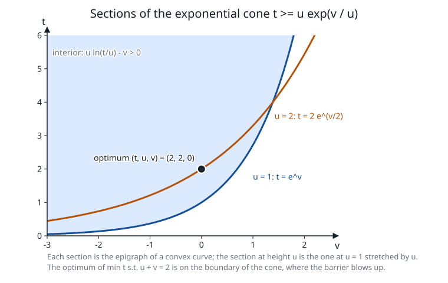

# The exponential cone

**Verified against** revision `1f2ddee` (`expcone.c`, `expcone.h`,
`expcone_corrector.c`, `sdp.c`, `primal_sdptask.c`). Numbers below were produced
by programs linked with the functions they quote.

## Learning objectives and prerequisites

After this chapter you can:

- state the exponential cone and its dual and test a point for membership;
- write the 3-self-concordant barrier, its gradient and Hessian, and recover the
  *scaling point* $W$ of a dual vector $s$ by a one-dimensional Newton iteration;
- explain why this cone cannot use the Nesterov–Todd scaling of the symmetric cones,
  what PRIMAL uses instead, and what the higher-order correction adds;
- follow a model with an exponential cone through the routes of PRIMAL, including the
  retry in secant mode and the tangent-cut fallback.

Prerequisites: [conic duality](mathematical_foundations.md), [SOCP](conic-socp.md) and
[SDP](semidefinite_programming.md) (the same predictor–corrector and the same KKT engine).

## The cone and its dual

PRIMAL's cone `PEXP` acts on three members $(t,u,v)$ of the variable vector:

$$
\mathcal K_{\exp}=\operatorname{cl}\{(t,u,v):\ t\ge u\,e^{v/u},\ u>0\},\qquad
\operatorname{int}\mathcal K_{\exp}=\{u>0,\ t>0,\ \psi:=u\ln(t/u)-v>0\}.
$$

Only $u$ and $t$ are restricted in sign; $v$ is free ([`primal.h`](../primal.h#L188): "$x_1\ge x_2e^{x_3/x_2}$,
$x_2\ge0$"). The closure adds the ray $\{(t,0,v):t\ge0,\ v\le0\}$ where $u=0$. The cone is
convex because $(u,v)\mapsto u\,e^{v/u}$ is the perspective of $e^{v}$. `DEXP` is *minus* this
cone, $x\in\text{DEXP}\iff-x\in\text{PEXP}$ (`primal_sdptask.c` encodes it with $z_a=-x_{\text{mem}[a]}$);
it is what the header of `primal.h` calls "dual", but it is a mirror image, not $\mathcal K^*_{\exp}$.



*Figure: the sections of $\mathcal K_{\exp}$ at heights $u=1$ (shaded above the curve $t=e^v$) and
$u=2$ (curve $t=2e^{v/2}$) in the $(v,t)$ plane. Each section is the epigraph of a convex curve, and the section at
height $u$ is the one at $u=1$ stretched by $u$ in both axes. The black point is the optimum
$(t,u,v)=(2,2,0)$ of the example below, which lies on the boundary. Analytic figure by
[`figures/make_figures.c`](figures/make_figures.c) at `1f2ddee`; the generator tests 40 boundary points on
both sides with `expcone_barrier` and checks the optimum against `PRIMAL_optimize`.*

The cone is not self-dual. Its dual is

$$
\mathcal K_{\exp}^*=\{s:\ s_0>0,\ s_2<0,\ s_1-s_2+s_2\ln(-s_2/s_0)\ge0\}\ \cup\ \{(s_0,s_1,0):s_0,s_1\ge0\},
$$

and `expcone_dual_in` ([`expcone.c:238`](../expcone.c#L238)) tests its interior after dividing $s$ by
$\|s\|_1$, so the test does not depend on the scale of the pair. A pair $(z,s)\in\mathcal K\times\mathcal K^*$
has $\langle z,s\rangle\ge0$, with equality exactly when both lie on the boundary on complementary faces.

## Barrier, gradient and Hessian

The barrier is the 3-self-concordant barrier of Nesterov and Chares,

$$
f(t,u,v)=-\ln\psi-\ln t-\ln u,\qquad\psi=u\ln(t/u)-v,
$$

implemented in [`pexp_core`](../expcone.c#L36). With $\psi_t=u/t$, $\psi_u=\ln(t/u)-1$, $\psi_v=-1$:

$$
g=\nabla f=\Bigl(-\tfrac{\psi_t}{\psi}-\tfrac1t,\ -\tfrac{\psi_u}{\psi}-\tfrac1u,\ \tfrac1\psi\Bigr),\qquad
H=\frac{\nabla\psi\nabla\psi^\top}{\psi^2}-\frac{\nabla^2\psi}{\psi}+\operatorname{diag}\!\Bigl(\tfrac1{t^2},\tfrac1{u^2},0\Bigr),
$$

with $\nabla^2\psi$ having the nonzero entries $\psi_{tt}=-u/t^2$, $\psi_{tu}=1/t$, $\psi_{uu}=-1/u$.
Because $f(\lambda z)=f(z)-3\ln\lambda$ it satisfies $\langle g,z\rangle=-3$ and $Hz=-g$.

**Numbers.** At $z=(3,1,\tfrac12)$: $\psi=\ln3-\tfrac12=0.5986123$, $f=-0.5854711$,
$g=(-0.8901768,\,-1.1647348,\,1.6705304)$ and

$$
H=\begin{pmatrix}0.60680&-0.46511&-0.93022\\-0.46511&2.69767&-0.27519\\-0.93022&-0.27519&2.79067\end{pmatrix}.
$$

Evaluated with `expcone_barrier`, `expcone_grad`, `expcone_hess`: $\langle g,z\rangle=-3.0000000000$ and
$|Hz+g|\le2.2\cdot10^{-16}$, the two identities above.

**Why $\nu=3$.** The comment in [`expcone.c`](../expcone.c#L25) records that an earlier barrier
$-\ln(t-ue^{v/u})-\ln u$ has parameter 2 but is *not* self-concordant (along random lines
$|f'''|/(2f''^{3/2})$ reaches 2.54 near the boundary, instead of staying $\le1$), and gives the geometric argument that no
barrier of this cone can have $\nu<3$ (the faces $t=0$ and $u=0$ meet at $(0,0,-1)$). Without
self-concordance the Newton steps lost centrality: the max-entropy family fell to the tangent cuts at
$N=30,\dots,300$ before the change. These statements are the code's own record; this chapter does not
reprove them.

## Scaling point of a dual vector

For $s\in\operatorname{int}\mathcal K^*$ there is a unique $W\in\operatorname{int}\mathcal K$ with $-\nabla f(W)=s$
([`expcone_dual_point`](../expcone.c#L274)); it replaces the NT point, which does not exist for a
non-symmetric cone. Solve the three equations of $-g=s$ in order:

$$
s_2=-\tfrac1{\psi_w}\ \Rightarrow\ \psi_w=-\tfrac1{s_2};\qquad
s_0=\tfrac{1-u_ws_2}{t_w}\ \Rightarrow\ t_w=\tfrac{1-u_ws_2}{s_0}.
$$

Writing $a=1/u_w$, the second row becomes a scalar equation

$$
\gamma(a)=a-s_2\ln\frac{a-s_2}{s_0}+s_2-s_1=0,\qquad
\gamma'(a)=1-\frac{s_2}{a-s_2}>0,\quad\gamma''(a)=\frac{s_2}{(a-s_2)^2}<0 .
$$

$\gamma$ is increasing and concave, and $\gamma(0)=-(s_1-s_2+s_2\ln(-s_2/s_0))<0$ exactly when $s$ is in the
interior of the dual cone. Newton's method from $a=0$ therefore increases monotonically to the unique root, after which
$u_w=1/a$, $t_w=(1-u_ws_2)/s_0$ and $v_w=u_w\ln(t_w/u_w)+1/s_2$.

**Check.** Take $s=-g(z)=(0.8901768,\,1.1647348,\,-1.6705304)$ for the $z$ above. Newton on $\gamma$ from $a=0$ gives
$a=0,\ 0.8918529,\ 0.9991239,\ 0.9999999447,\ 1.0000000000$ with $\gamma=-1.78,\,-0.177,\,-1.4\cdot10^{-3},\,-9\cdot10^{-8},\,-4\cdot10^{-16}$:
monotone, and $u_w=1$. `expcone_dual_point` returns $W=(3,1,0.5)=z$ to ten digits, as it must on the central path where
$s=-\mu g(z)$ up to the factor $\mu$.

## The Newton row of a cone block

On the central path $s=-\mu\nabla f(z)$ and $\langle z,s\rangle=\nu\mu$. A non-symmetric cone has no Jordan product, so PRIMAL
keeps the cone equation in the KKT matrix and builds a row (header of [`expcone.h`](../expcone.h)):

$$
\Theta_{\rm in}\,\Delta z+\Delta s/\text{scale}=r_t,\qquad
\text{scale}=\tfrac{\langle z,s\rangle}{\nu},\quad s_n=\tfrac{s}{\text{scale}},\quad
r_t=\frac{-s-\sigma\mu\,\nabla f(z)}{\text{scale}},
$$

where $\Theta_{\rm in}=M(z,s_n)$ is either the barrier Hessian $H_z$ or the Hessian-NT chain
$H_s^{-1/2}(H_s^{1/2}H_zH_s^{1/2})^{1/2}H_s^{-1/2}$ with $H_s=\nabla^2f_*(s_n)=(\nabla^2f(W))^{-1}$. The chain is used when
$s_n$ is in the interior of the dual cone ([`expcone_scaling`](../expcone.c#L530) returns which branch). Two devices keep the
block of order 1: $M$ is evaluated at the $\mu$-free direction $s_n$, and the whole row is divided by scale. The result is that
$\Theta_{\rm in}$ depends only on the iterate, never on $\sigma$ or $\mu$: predictor and corrector share the matrix and
differ in $r_t$. At a paired point the chain equals $\nabla^2f(z)$ (tests `T78`, `T80`).

The step lengths come from membership tests: `expcone_maxstep` bisects (50 halvings) on `expcone_barrier` for the primal,
and `expcone_dual_maxstep` bisects on `expcone_dual_in` for the dual, since testing the dual in $\mathcal K$ would clamp it
to zero ([`sdp.c:146`](../sdp.c#L146)). Because the cones are not self-dual, primal and dual step lengths differ.

## One iteration, with the cone row and the corrector

```text
EXP-BLOCK-ITERATION(z, s in the interior; shared KKT with the other blocks)
 1  gap <- <z, s>;  scale <- gap / 3;  s_n <- s / scale
 2  if s_n in int K*:  Theta_in <- Hessian-NT chain(H_z, H_s)   else:  Theta_in <- H_z
 3  predictor (sigma = 0):  r_t <- (-s) / scale;  solve the KKT system -> dz_a, ds_a
 4  eta <- -1/2 D^3 f(z)[u, dz_a]  with  H u = ds_a                 # higher-order term (below)
 5  sigma <- from the predicted complementarity, as in SDP step 9-10
 6  corrector:  r_t <- (-s - sigma mu grad f(z) - eta) / scale;  same matrix, new right side
 7  steps: ap <- expcone_maxstep, ad <- expcone_dual_maxstep, then the fraction to the boundary
 8  accept only if the merit  |rp| + |rd| + |mu_trial - sigma mu|  falls (4-iterate window)
```

**Higher-order term.** [`expcone_pexp_correction`](../expcone_corrector.c#L55) contracts the third derivative of the barrier
with the affine directions analytically: it solves $Hu=\Delta s_a$ by a $3\times3$ Cholesky, then evaluates
$\eta=-\tfrac12D^3f(z)[u,\Delta z_a]$ from the closed forms of $\psi$ and its derivatives; no finite differences are used. For the
orthant analogue $f=-\ln z$ this gives $\eta=\Delta s_a\Delta z_a/z$, the familiar Mehrotra cross product.
Test `T299` checks it against an independent Taylor-jet computation of $f$ at 30 points and checks the homogeneity
identity $\eta(z,v)=Hv$ for $\Delta s=Hz$. The scaling data are cached between predictor and corrector
(`expcone_scale_cached`) and invalidated each outer iteration.

**When it is on.** `sdp_ipm_csr_corrected` is selected only for a model that has a `PEXP` block and a
SOC/RQUAD block and no PSD block ([`primal_sdptask.c:568`](../primal_sdptask.c#L568)); pure exponential, power-only and PSD
models use the plain engine, and `GMB_NO_EXP_HIGHER` forces it off. In the same build the sparse KKT is tried for mixed models with order at
least 128 when both forms of the orthant block stay under 10% density; if that run does not return OPTIMAL, the run is repeated
with the original routing (`[retry] original KKT routing`).

## Routes in PRIMAL

```text
PRIMAL_optimize
  -> optimize_sdp_ipm               exp/power cones are native blocks of sdp_ipm_run   (unless GMB_NO_EXP_IPM)
       first attempt: Hessian-NT row
       if not solved and nb = 0:    retry in SECANT mode (Dahl-Andersen primal-dual secant scaling),
                                    iterate restored if that fails too                   (unless GMB_NO_EXP_RETRY)
  -> optimize_conic                 tangent-cut outer approximation, the fallback
```

The tangent-cut route replaces the cone by supporting hyperplanes ([tangent cuts](tangent-cuts.md)); a near-optimal
point saved by the native route is published only if the cuts do not answer.

## Worked example, solved

$$
\min t\quad\text{s.t.}\quad u+v=2,\quad(t,u,v)\in\mathcal K_{\exp}.
$$

On the constraint $v=2-u$, so $t\ge g(u)=u\,e^{(2-u)/u}=u\,e^{2/u-1}$. Then $g'(u)=e^{2/u-1}(1-2/u)$ vanishes at $u=2$, where $g(2)=2$: the optimum is
$(t,u,v)=(2,2,0)$ with value 2, on the boundary ($\psi=2\ln1-0=0$).

*Optimality by substitution.* The dual is $\max2y$ s.t. $s=c-A^\top y=(1,-y,-y)\in\mathcal K^*$. Complementarity
$\langle z,s\rangle=2\cdot1+2\cdot(-y)=0$ forces $y=1$ and $s=(1,-1,-1)$. This is in the closed dual cone: $s_0>0$, $s_2<0$,
and $s_1-s_2+s_2\ln(-s_2/s_0)=-1+1-\ln1=0$, on its boundary. Dual value $2y=2=$ primal value.

*PRIMAL.* `PRIMAL_optimize` takes the native route and returns $x=(2.00000000,\ 2.00000000,\ 0.00000000)$, objective $2.0000000000$ for
primal and dual and $y=-1$ (the public sign is the opposite of the $y=1$ above, see [SDP](semidefinite_programming.md)). The
debug trace shows 44 iterations (it=0..43) where a problem of three variables would take a handful on the interior:
the optimum is on the boundary, so $\operatorname{cond}(\nabla^2f(z))$ grows to $1.4\cdot10^{10}$ (it=3), the dual step lengths in the first iterations are
0.38–0.92 and $\mu$ is not monotone (it=20..23 rises from $3.8\cdot10^{-7}$ to $1.5\cdot10^{-6}$). The final measures are
rel_pri $3.0\cdot10^{-13}$, rel_dual 0, rel_gap $2.1\cdot10^{-15}$, and the cone check prints the solution as
$(2,\ 1.99999999997,\ 3.3\cdot10^{-11})$.

## Costs and failure modes

- **Per iteration**: one $3\times3$ evaluation (barrier, Hessian, chain, $3\times3$ Cholesky) per exponential block,
  plus the KKT factorization, which dominates ([SDP](semidefinite_programming.md) for the dense and sparse forms).
- **Boundary optima** make $H_z$ and $H_s$ ill-conditioned (condition numbers of $10^{6}$–$10^{11}$ appear in the trace) and
  slow the method, as in the example. That is the intrinsic cost of a barrier method at a boundary optimum.
- **Not solved is not infeasible.** A failed native run triggers the secant retry, then the cuts; no infeasibility is claimed
  without a measured certificate ([certificates](certificates.md)).
- **Dual vectors** must be in the dual cone, not in $\mathcal K$: a dual step tested against the primal cone would be clamped to 0.

## Exercise

For $z=(3,1,\tfrac12)$ verify that $\langle g(z),z\rangle=-3$ (by homogeneity of $f$, or from the formula for $g$), and then check that
$s=-g(z)$ satisfies the interior condition of the dual cone.

*Answer.* By homogeneity, $f(\lambda z)=f(z)-3\ln\lambda$, so
$\tfrac{d}{d\lambda}f(\lambda z)|_{\lambda=1}=\langle g,z\rangle=-3$; the formula for $g$ gives the same number (the
program behind the numbers above evaluated $-3.0000000000$). For the dual condition,
$s=(0.8901768,\,1.1647348,\,-1.6705304)$ has $s_0>0$, $s_2<0$ and
$s_1-s_2+s_2\ln(-s_2/s_0)=1.7837058>0$ (this is $-\gamma(0)$), so $s\in\operatorname{int}\mathcal K^*$.

## References

- Yu. Nesterov, [Towards non-symmetric conic optimization](https://doi.org/10.1080/10556788.2011.567270), *Optimization Methods and Software* 27(4–5):893–917, 2012.
- R. Chares, *Cones and interior-point algorithms for structured convex optimization involving powers and exponentials*, Ph.D. thesis, Université catholique de Louvain, 2009.
- A. Skajaa and Y. Ye, [A homogeneous interior-point algorithm for nonsymmetric convex conic optimization](https://doi.org/10.1007/s10107-014-0773-1), *Mathematical Programming* 150:391–422, 2015.
- J. Dahl and E. D. Andersen, [A primal-dual interior-point algorithm for nonsymmetric exponential-cone optimization](https://doi.org/10.1007/s10107-021-01631-4), *Mathematical Programming* 194:341–370, 2022.
