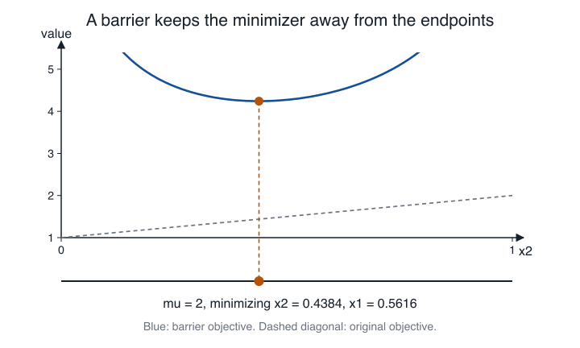

# Interior-point method

An interior-point method uses derivatives to approach a constrained optimum from
the interior of its inequality domain. For example, minimizing $x$ over
$0\le x\le1$ gives the boundary solution $x=0$. Introducing the barrier
$-\mu(\ln x+\ln(1-x))$ produces a smooth objective on $0<x<1$. Its derivative
is $1-\mu/x+\mu/(1-x)$. Setting it to zero gives $x=(3-\sqrt5)/2$ at $\mu=1$.
As $\mu$ decreases, the minimizer moves toward zero while each finite step of
this example has positive slacks.

The animation labels the variable $x_2$ and plots the objective with an added
constant of 1. The constant raises the curve without moving the minimizer.

The [primal–dual interior-point chapter](interior_point.md) derives the Newton
equations PRIMAL solves and compares this feasible teaching example with an
infeasible-start solver trace.
