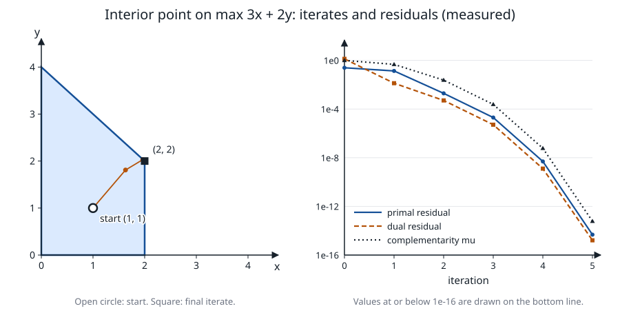
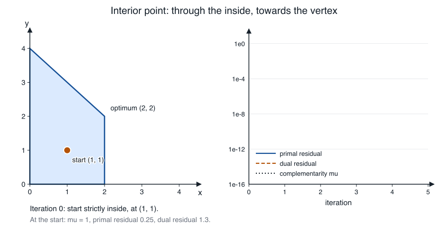

# Primal–dual interior point for linear programming

**Verified against** revision `1f2ddee` (`ipm.c`, `primal_std.c`,
`primal_optimize.c`, `primal_verdict.c`).

## Learning objectives and prerequisites

After this chapter you can:

- derive the primal–dual Newton system from the optimality conditions and from
  the central path, and eliminate variables to get the normal equations;
- carry out one Mehrotra predictor–corrector step by hand and check the three
  Newton equations by substitution;
- tell the two LP engines of PRIMAL apart (dense augmented, sparse normal
  equations), say when each runs, and read the measured trace of a solve;
- explain what the *private bound-row elimination* removes from the normal
  equations and how its result is checked.

Prerequisites: the LP in standard form and LP duality
([mathematical foundations](mathematical_foundations.md)), Cholesky and LU
([linear algebra](linear_algebra.md)). For a quadratic objective continue with
[quadratic programming](quadratic_programming.md).

## From optimality conditions to Newton's method

For $\min c^\top x$ s.t. $Ax=b$, $x\ge0$, the dual is $\max b^\top y$ s.t.
$A^\top y+z=c$, $z\ge0$. A point is optimal exactly when

$$
Ax=b,\qquad A^\top y+z=c,\qquad x_jz_j=0\ \ (j=1,\dots,n),\qquad x,z\ge0 .
$$

The last condition is *complementarity*. An interior-point method relaxes it to
$x_jz_j=\mu$ with $\mu>0$. For each $\mu$ the solution of the relaxed system is
the point of the **central path**; it is also the minimizer of the barrier
problem $\min c^\top x-\mu\sum_j\log x_j$ subject to $Ax=b$, because the
stationarity condition of that problem is $c-\mu X^{-1}\mathbf1=A^\top y$, that
is $z=\mu X^{-1}\mathbf1$. As $\mu\to0$ the path ends at an optimal pair. The
duality measure is

$$
\mu=\frac{x^\top z}{n}.
$$

PRIMAL never follows the path exactly. It applies Newton's method to the
system with a *target* $\sigma\mu$ and keeps $x,z>0$.

### The Newton equations

Define the residuals $r_p=Ax-b$ and $r_d=c-A^\top y-z$, and let
$X=\operatorname{diag}(x)$, $Z=\operatorname{diag}(z)$. Newton's method for
$F(x,y,z)=0$ with $F=(Ax-b,\ A^\top y+z-c,\ XZ\mathbf1-\sigma\mu\mathbf1)$ gives

$$
A\Delta x=-r_p,\qquad A^\top\Delta y+\Delta z=r_d,\qquad
Z\Delta x+X\Delta z=q,\qquad q=\sigma\mu\mathbf1-x\odot z .
$$

Eliminate $\Delta z=r_d-A^\top\Delta y$ from the third equation and set
$\Theta=XZ^{-1}$ (diagonal). Then

$$
\Delta x=g+\Theta A^\top\Delta y,\qquad g=Z^{-1}q-\Theta r_d,
$$

and the first equation becomes the **normal equations**

$$
\boxed{A\Theta A^\top\,\Delta y=-r_p-Ag}\ .
$$

The matrix $A\Theta A^\top$ is symmetric positive definite when $A$ has full row
rank and $\Theta\succ0$. The alternative is to keep $\Delta x$ as an unknown and
solve the symmetric indefinite **augmented system**. Substituting
$\Delta z=X^{-1}(q-Z\Delta x)$ into the second equation gives

$$
\begin{pmatrix}-D&A^\top\\A&0\end{pmatrix}
\begin{pmatrix}\Delta x\\\Delta y\end{pmatrix}=
\begin{pmatrix}r_d-X^{-1}q\\-r_p\end{pmatrix},\qquad D=X^{-1}Z,
$$

which PRIMAL's dense engine uses with a small diagonal regularization (see
below). Both give the same direction in exact arithmetic.

### Mehrotra predictor–corrector

One factorization serves two solves, because the matrix depends only on the
current point.

1. **Predictor.** Solve with $\sigma=0$, i.e. $q=-x\odot z$. This is the
   affine-scaling direction $(\Delta x_a,\Delta y_a,\Delta z_a)$.
2. **Step lengths.** $\alpha_p^a=\min(1,\min_{\Delta x_{a,j}<0}-x_j/\Delta x_{a,j})$
   and likewise $\alpha_d^a$ for $z$. The complementarity the affine step
   would reach is
   $\mu_a=\frac1n\sum_j(x_j+\alpha_p^a\Delta x_{a,j})(z_j+\alpha_d^a\Delta z_{a,j})$.
3. **Centering.** $\sigma=(\mu_a/\mu)^3$, clamped to $[10^{-8},1]$. A good affine
   step ($\mu_a\ll\mu$) means little centering is needed.
4. **Corrector.** Solve again with
   $q=\sigma\mu\mathbf1-x\odot z-\Delta x_a\odot\Delta z_a$. The last term is the
   second-order term: $(x+\Delta x)\odot(z+\Delta z)$ contains
   $\Delta x\odot\Delta z$, which the corrector approximates by its value on the
   affine direction.
5. **Step.** $\alpha_p=\min(1,\tau\,\alpha_p^{\max})$ and
   $\alpha_d=\min(1,\tau\,\alpha_d^{\max})$ with $\tau=\max(0.99,1-\mu)$ capped at
   $0.999999$, a fraction of the distance to the boundary. If the corrector step
   has collapsed (either length below $0.1\times$ its affine counterpart),
   PRIMAL falls back to the affine direction. The primal step $\alpha_p$
   moves $x$; the dual step $\alpha_d$ moves $y$ and $z$.

```text
IPM(A, b, c, tol)                        # one run of ipm_solve_std / ipm_solve_std_csc
 1  (x, y, z) <- starting point, x > 0, z > 0
 2  for it = 0 .. max_iter - 1:
 3      r_p <- A x - b;  r_d <- c - A'y - z;  mu <- x'z / n
 4      f_p <- max|r_p| / max(1, |b|_inf);  f_d <- max|r_d| / max(1, |c|_inf)
 5      gap <- |x'z| / (1 + |c'x|)
 6      if a deadline passed:                     stop, status "no convergence"
 7      if an objective cut is proven:            stop, TRM_OBJECTIVE_RANGE
 8      if f_p <= tol_p and f_d <= tol_d and gap <= tol_gap:  stop, optimal
 9      factor the system for Theta (regularization raised if the factor fails)
10      predictor -> alpha_a, mu_a, sigma
11      corrector -> direction; step lengths; affine fallback
12      if both step lengths are below 1e-13 for more than 5 iterations: stop
13      x <- x + alpha_p dx;  z <- z + alpha_d dz;  y <- y + alpha_d dy
```

## Worked example: one affine step

Take $A=(1,1)$, $b=1$, $c=(1,2)$ and the point $x=(\tfrac12,\tfrac12)$, $y=0$,
$z=(1,2)$. Then $r_p=0$, $r_d=c-0-z=0$ and $\mu=\frac{0.5+1}{2}=\tfrac34$.

- $q=-x\odot z=(-\tfrac12,-1)$ and $g=Z^{-1}q=(-\tfrac12,-\tfrac12)$.
- $\Theta=\operatorname{diag}(\tfrac12,\tfrac14)$, so $A\Theta A^\top=\tfrac34$ and
  $-r_p-Ag=1$, giving $\Delta y=\tfrac43$.
- $\Delta x=g+\Theta A^\top\Delta y=(\tfrac16,-\tfrac16)$ and
  $\Delta z=r_d-A^\top\Delta y=(-\tfrac43,-\tfrac43)$.

**Check the three equations.** $A\Delta x=\tfrac16-\tfrac16=0=-r_p$.
$A^\top\Delta y+\Delta z=(\tfrac43,\tfrac43)-(\tfrac43,\tfrac43)=0=r_d$.
$Z\Delta x+X\Delta z=(1\cdot\tfrac16+\tfrac12\cdot(-\tfrac43),\
2\cdot(-\tfrac16)+\tfrac12\cdot(-\tfrac43))=(-\tfrac12,-1)=q$.

**Step lengths.** $z_1+\alpha\Delta z_1=0$ at $\alpha=\tfrac34$, so
$\alpha_d^a=\tfrac34$; $x_2-\alpha/6>0$ for every $\alpha\le1$, so
$\alpha_p^a=1$. Then $x+\Delta x=(\tfrac23,\tfrac13)$ and
$z+\tfrac34\Delta z=(0,1)$, hence $\mu_a=\tfrac1n\cdot\tfrac13=\tfrac16$ and
$\sigma=(\mu_a/\mu)^3=(\tfrac29)^3=\tfrac{8}{729}\approx0.011$.

## Measured trace of a solve

The figure uses the LP of the [simplex chapter](simplex.md), maximize $3x+2y$
with $x+y\le4$, $x\le2$, in standard form ($m=2$, $n=4$), solved by the dense
engine `ipm_solve_std` with its default start $x=z=\mathbf1$, $y=0$ and
tolerances $10^{-8}$. Each point is the iterate after $k$ iterations, obtained by
capping the engine at $k$ (it is deterministic). The numbers are saved in
[`figures/lp-central-path-trace.csv`](figures/lp-central-path-trace.csv).



*Figure: left, the iterates in the $(x,y)$ plane; they start at $(1,1)$, are
interior at every iteration and approach the optimal vertex $(2,2)$ from inside
without touching an edge. Right, base-10 logarithm of the primal residual, the
dual residual and the complementarity $\mu$ per iteration: all three fall
together. After a slow first step each iteration gains between one and
six orders of magnitude, more and more as the method approaches the solution. Measured at `1f2ddee` with
[`figures/make_figures.c`](figures/make_figures.c), which also checks that the
final point equals the optimum PRIMAL reports.*



*Animation: the iterations of the table below, one Newton step at a time. The
point stays inside the polygon, the residuals and $\mu$ are drawn as they
fall, and the last steps drop by several orders of magnitude at once on the logarithmic scale: the
fast local convergence of the final iterations. Measured with `ipm_solve_std` at
`1f2ddee` by [`figures/make_animations.c`](figures/make_animations.c), which
checks the final point against the optimum PRIMAL reports.*

| iteration | $(x,y)$ | primal residual | dual residual | $\mu$ |
|---:|---|---:|---:|---:|
| 0 | (1, 1) | 2.5e-1 | 1.3e0 | 1.0e0 |
| 1 | (1.630, 1.810) | 1.4e-1 | 1.3e-2 | 4.7e-1 |
| 2 | (1.962, 2.030) | 2.0e-3 | 5.1e-4 | 2.4e-2 |
| 3 | (1.99962, 2.00030) | 2.0e-5 | 5.2e-6 | 2.5e-4 |
| 4 | (1.9999999, 2.0000001) | 4.9e-9 | 1.3e-9 | 6.0e-8 |
| 5 | (2, 2) | 4.7e-15 | 1.6e-15 | 6.1e-14 |

`PRIMAL_optimize` itself runs the simplex method on this LP, because its
product $m\cdot n$ is far below the interior-point threshold below. The figure
calls the engine directly to show how the method behaves.

## PRIMAL implementation

### Which engine runs

`std_route_method` (`primal_std.c`) decides, in this order:

1. A problem with a quadratic objective goes to the sparse QP engine when
   $n>150$, $m\le600$ and no simplex optimizer was selected, otherwise to the dense engine
   ([quadratic programming](quadratic_programming.md)).
2. An LP with $m\le2000$ and $m\cdot n>2000$ goes to the **sparse LP engine**
   `ipm_solve_std_csc`, unless the caller selected a simplex optimizer
   (`PRIMAL_IPAR_OPTIMIZER`). Until `a09509a` the threshold was
   $m\cdot n>10^4$.
3. Otherwise the **simplex method**, or the dense engine `ipm_solve_std` if the
   caller selected `PRIMAL_OPTIMIZER_INTPNT`.

`GMB_LP_SPARSE` forces the sparse engine below the threshold. The data are the
standard form built by `stdform_build` after scaling and presolve
([problem formulations](problem_formulations.md), [presolve](presolve.md)).
The default tolerances are $10^{-8}$ for the primal residual, the dual
residual and the relative gap, and the iteration cap is 400
(`PRIMAL_DPAR_INTPNT_TOL_PFEAS`, `..._DFEAS`, `..._REL_GAP`,
`PRIMAL_IPAR_INTPNT_MAX_ITERATIONS`). Both engines return one of four codes:
optimal, no convergence, out of memory, singular system.

### Dense engine: augmented system

`ipm_solve_std` (`ipm.c`) starts at $x=z=\mathbf1$, $y=0$ (or at a supplied
point clamped to $x\ge10^{-8}$, $z\ge10^{-2}$). Each iteration it builds
$N\times N$ with $N=n+m$ and factors it by dense LU with partial pivoting:

$$
K=\begin{pmatrix}-(D+\delta I)&A^\top\\A&-\delta I\end{pmatrix},\qquad D=\operatorname{diag}(z_j/x_j),\quad \delta=10^{-8}.
$$

If the factorization fails, $\delta$ is multiplied by 100 and the build is
retried, up to five times; then the status is "singular". The right-hand side is
$(r_d+r_c\oslash x,\ -r_p)$, where $r_c=x\odot z-\sigma\mu\mathbf1+\text{second-order term}$, and
$\Delta z=-(r_c+z\odot\Delta x)\oslash x$. The number of correctors follows
`PRIMAL_IPAR_INTPNT_MAX_NUM_COR` (default: one, Mehrotra's). Cost: $O((n+m)^3)$
time per iteration and $(n+m)^2$ memory.

### Sparse engine: normal equations

`ipm_solve_std_csc` forms $K=A\Theta A^\top+\delta I$ and factors it with a sparse
Cholesky (`spchol_*`, [linear algebra](linear_algebra.md)). The weights are
regularized in the manner of Vanderbei,

$$
\Theta_j=\frac{x_j+d_p}{z_j+d_d},\quad d_p=\delta(1+\bar x),\ d_d=\delta(1+\bar z),\quad \delta=10^{-6},
$$

with $\bar x,\bar z$ the mean of $x,z$, so that $\Theta$ stays bounded as
$x_j\to0$ or $z_j\to0$. The right-hand side uses
$g_j=q_j/(z_j+d_d)-\Theta_jr_{d,j}$. The code starts from Mehrotra's least-squares
point: $x=\mathbf1+A^\top u$ with $(AA^\top+\delta I)u=b-A\mathbf1$, and
$y=(AA^\top+\delta I)^{-1}Ac$, $z=c-A^\top y$ (with $\delta=10^{-9}$ here), followed by
positivity shifts. If a
factorization fails, $\delta$ is multiplied by 100, up to six attempts. The
fill-reducing ordering of $K$ is computed once per solve and reused while the
sparsity pattern is unchanged, since $\Theta$ changes only the values. Cost:
assembly $O(\sum_j k_j^2)$ for $k_j$ nonzeros in column $j$, plus the Cholesky
factorization, whose fill depends on the structure of $A$.

### Eliminating private bound rows

After standard-form conversion, a variable with two finite bounds appears in a
row $x+s=u-l$ with a **private slack** $s$ that occurs nowhere else
(`stdform.c`). Such a row has two entries, a coefficient $a$ in a *shared*
column $j$ and $b_s$ in its private column. Its normal-equation row has the
diagonal entry $d=\theta_ja^2+r$, $r=\theta_sb_s^2+\delta$, and couples to other
rows only through column $j$. The eliminated rows form a diagonal block, so the
Schur complement is cheap: eliminating the row changes the shared column's weight
from $\theta_j$ to

$$
\theta_j-\frac{\theta_j^2a^2}{d}=\theta_j\,\frac{r}{d},
$$

and the second form is the one the code evaluates because it avoids subtracting
nearly equal numbers. `lp_normal_reduce` (`ipm.c`) applies this when

- a row has exactly two entries and one of them is a column with a single
  nonzero, and each shared column is eliminated through at most one row;
- at least $m/3$ and fewer than $m$ rows qualify;
- the reduced system has at most 256 rows (it is factored dense).

Otherwise `lp_normal_factor` factors the full $K$. After solving the reduced
system, `lp_normal_solve` reconstructs the eliminated multipliers and
**checks the residual** of the full normal equations
20 20 12 61 79 80 81 702 33 98 100 204 250 395 398 399 400 701A\Theta A^\top+\delta I)\Delta y=\text{rhs} by row: row  accepted if its
residual is at most ^{-9} +|\text{rhs}_i| the absolute values of
the terms that form it. If the check fails, it factors the full matrix and solves again
(`lp_normal_full_solve`). `T303` tests an LP in which the cheaper variable of
each pair sits at its upper bound, so the reduction and the bounds are active.
The same elimination, with a Hessian, is the QP route of
[quadratic programming](quadratic_programming.md).

### Stopping, failure and what follows

The tests in the pseudocode compare scaled residuals with the tolerances. The
objective cuts (`PRIMAL_DPAR_LOWER_OBJ_CUT`, which fires only on a primal feasible
point, and the upper cut on the dual side, LP only) and the wall-clock cap are
read inside the loop. A run that stops
for any other reason is "not solved": **a stopped interior-point run is not
evidence of infeasibility**, so no certificate status follows from the
iteration alone. The last iterate is offered to the same measurement that
validates a Farkas or recession vector ([certificates](certificates.md)), and
only a vector that measures is published.

For a solved LP, `PRIMAL_optimize` then calls `intpnt_identify_basis` and
`intpnt_crossover_cleanup` (`primal_verdict.c`): every variable and row gets a
status key (basic, at lower, at upper) from the published point, with relative
tolerance $10^{-7}$, and if the basic set is not a nonsingular basis it is
repaired with a crash basis. This is a classification of the interior point,
not a simplex crossover.

## Costs, conditioning and failure modes

- **Conditioning.** Near the solution some $x_j\to0$ while $z_j$ stays positive
  and vice versa, so $\Theta_j$ spreads over many orders of magnitude and
  $A\Theta A^\top$ becomes ill conditioned. The normal equations square the
  condition number of the scaled matrix. The $\delta$ terms, the escalation
  loop and the residual check on the eliminated system exist for this.
- **Dense columns.** A column of $A$ with many nonzeros couples all the rows it
  touches, so it fills $K$. The dense engine does not form $K$.
- **Iteration count.** In practice it grows slowly with the size of the
  problem; the example above converges in five iterations, and the cap is 400.
- **Primal–dual infeasible starts.** The iterates need not be feasible; the
  residuals fall together, as in the figure, but a badly scaled model can stall
  with both step lengths near zero (the "no progress" exit).
- **Time and memory.** See the cost lines above; see also
  [numerical stability](numerical_stability.md) for scaling.

## Exercise

For the worked step compute $\mu$, $\mu_a$ and $\sigma$ again, but with the
dual step length replaced by the fraction-to-boundary value $\tau\alpha_d^a$ for
$\tau=0.99$. How does $\sigma$ change, and why is the affine step length used
for $\mu_a$ in the algorithm?

*Answer sketch.* $z+0.99\cdot\tfrac34\Delta z=(0.01,1.01)$, so
$\mu_a=\tfrac12(\tfrac23\cdot0.01+\tfrac13\cdot1.01)\approx0.172$ and
$\sigma\approx(0.172/0.75)^3\approx0.012$, almost the same as $8/729$. The
algorithm uses the full affine ratio because $\mu_a$ only measures how much
progress a pure Newton step could make; the safety fraction is applied once, to
the final step.

## References

- S. Mehrotra, [On the implementation of a primal-dual interior point method](https://doi.org/10.1137/0802028), *SIAM Journal on Optimization* 2(4):575–601, 1992.
- S. Boyd and L. Vandenberghe, [*Convex Optimization*](https://web.stanford.edu/~boyd/cvxbook/), Cambridge University Press, 2004, chapters 10–11.
- J. Nocedal and S. J. Wright, [*Numerical Optimization*](https://doi.org/10.1007/978-0-387-40065-5), 2nd ed., Springer, 2006, chapter 14 (primal–dual interior-point methods, including the predictor–corrector algorithm).
- S. J. Wright, *Primal–Dual Interior-Point Methods*, SIAM, 1997.
- R. J. Vanderbei, [Symmetric quasidefinite matrices](https://doi.org/10.1137/0805005), *SIAM Journal on Optimization* 5(1):100–113, 1995.
