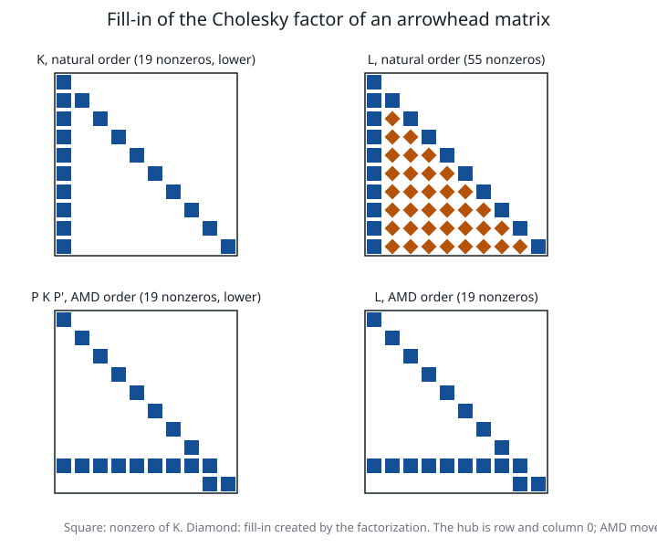

# Linear algebra for Newton and basis systems

**Verified against** revision `1f2ddee` (`linalg.c`, `linalg.h` and the call
sites named below). The reference list of every kernel is
[the kernel inventory](linear-algebra.md).

## Learning objectives and prerequisites

After this chapter you can:

- eliminate a block from a saddle-point system and say what the Schur
  complement costs and what it hides;
- choose a factorization from the structure of a matrix, and name the kernel PRIMAL
  uses for each case;
- explain fill-in, predict it on a small graph, and read a measured
  comparison of a natural and an AMD ordering;
- say which kernels are used by the production routes and which are
  experimental or only exercised by tests.

Prerequisites: Gaussian elimination, symmetric positive definite matrices
([foundations](mathematical_foundations.md)), and the Newton systems of
[interior point](interior-point.md).

## Block elimination

The Newton systems of an interior-point method have the saddle-point form

$$
\begin{pmatrix}M&-A^\top\\A&\delta I\end{pmatrix}
\begin{pmatrix}u\\y\end{pmatrix}=\begin{pmatrix}f\\g\end{pmatrix},
\qquad M\succ0 .
$$

The first block row gives $u=M^{-1}(f+A^\top y)$. Substituting into the second,

$$
\boxed{(AM^{-1}A^\top+\delta I)\,y=g-AM^{-1}f},\qquad u=M^{-1}(f+A^\top y).
$$

The matrix $S=AM^{-1}A^\top+\delta I$ is the **Schur complement**. The inverse
notation means *triangular solves with a factor of $M$*, never an explicit inverse. With
$\delta=0$ and $A$ of full row rank, $S$ is symmetric positive definite. If $A$ has
dependent rows, $S$ is singular; a positive $\delta$ makes it definite but changes the
equations, so residuals must be measured against the *intended* system, not the shifted one.

**Augmented system against normal equations.** Keeping $u$ as an unknown gives the
symmetric *indefinite* augmented matrix above; eliminating it gives the positive
definite $S$. The normal equations are cheaper and smaller ($m\times m$) but their condition
number is the square of that of the scaled $A$, and a column of $A$ with many nonzeros makes
$S$ dense. The augmented system keeps $A$'s structure and its conditioning but needs a
factorization that tolerates indefiniteness (LU, or LDL with 2×2 pivots).

**Worked example.** $M=\operatorname{diag}(2,3)$, $A=(1,1)$, $f=(2,0)$, $g=2$,
$\delta=0$. Then $AM^{-1}A^\top=\tfrac12+\tfrac13=\tfrac56$ and
$g-AM^{-1}f=2-\tfrac12\cdot2=1$, so $y=\tfrac65$ and
$u=M^{-1}(f+A^\top y)=\bigl(\tfrac{2+6/5}{2},\tfrac{6/5}{3}\bigr)=(\tfrac85,\tfrac25)$.
**Check by substitution:** $Mu-A^\top y=(\tfrac{16}5-\tfrac65,\ \tfrac65-\tfrac65)=(2,0)=f$ and
$Au=\tfrac85+\tfrac25=2=g$.

## Choosing a factorization

| Matrix | Factorization | Kernel in `linalg.c` | Production call sites |
|---|---|---|---|
| general, dense | LU with partial pivoting | `dmat_lu_factor`, `dmat_lu_solve` | dense augmented IPM and QP reduction (`ipm.c`), dual simplex duals (`simplex.c`), dense SOCP and SDP paths (`socp.c`, `sdp.c`), `primal_verdict.c`, `primal_misc.c`, `primal_quad.c` |
| same, compensated sweeps | LU, Neumaier-compensated substitutions | `dmat_lu_solve_comp` | the degenerate PSD/SOC path of `sdp.c` only |
| symmetric positive definite, dense | Cholesky | `dmat_cholesky`, `dmat_chol_solve` | the small PEXP corrector (`expcone_corrector.c`) |
| symmetric positive definite, sparse | left-looking sparse Cholesky, optional AMD ordering | `spchol_factor`, `spchol_factor_ord`, `spchol_factor_perm`, `spchol_factor_dense`, `spchol_factor_fail` | sparse LP and QP normal equations and the condensed QP (`ipm.c`), SOCP normal equations (`socp.c`), `PRIMAL_computesparsecholesky` (`primal_misc.c`) |
| general, sparse | sparse LU, row pivoting, column ordering | `splu_factor`, `splu_factor_ord` | the augmented SOCP fallback (`socp.c`) and the sparse KKT of `sdp.c` |
| quasi-definite, sparse | LDL with regularization | `spqd_analyze`, `spqd_factor`, `spqd_solve` | **experimental** symmetric SOCP KKT, only with `GMB_SOCP_LDL` ([symmetric SOCP KKT](socp-symmetric-kkt.md)) |
| symmetric indefinite | LDL with static 2×2 pivots; dense Bunch–Kaufman | `spldl_factor`; `dmat_ldl_bk` | **no production call site** at this revision; exercised by `test_primal.c` |
| symmetric, dense | Jacobi eigenvalues | `dmat_eig_jacobi`, `dmat_eig_jacobi_twosided` | QCQP encoding, PSD step checks, SDP, the 3×3 metrics of the exp/power cones; the two-sided form only for the experimental HSD path |

Dense LU and Cholesky cost $\tfrac23n^3$ and $\tfrac13n^3$ flops and $n^2$ storage.
`dmat_lu_factor` returns `NULL` only for an *exactly* zero pivot (below $10^{-300}$), so
the pointer test is the singularity test; near-singularity is the caller's business
(the IPM engines raise a diagonal shift $\delta$ by a factor of 100 and retry, five or six
times). `spchol_factor_fail` also reports the pivot that failed: that value is the
smallest diagonal shift that would make the matrix positive definite, and
`socp.c` uses it to repair a normal-equations matrix by exactly that amount.

## Fill-in and ordering

Sparse Cholesky of $K=LL^\top$ computes column $j$ of $L$ from column $j$ of $K$ and the
earlier columns it depends on (left-looking):

```text
SPARSE-CHOLESKY(K)                         # K = L L', lower triangle in CSC
 1  for j = 1 .. n:
 2      w <- K(:, j)                       # scatter column j into a dense work vector
 3      for each k < j with L(j, k) != 0:
 4          w <- w - L(j, k) * L(:, k)
 5      if w_j <= 0:  return failure       # not positive definite; the caller shifts and retries
 6      L(j, j) <- sqrt(w_j);   L(i, j) <- w_i / L(j, j)  for i > j with w_i != 0
 7      append (i, j) to the row lists used in step 3
```

Step 4 can write nonzeros where $K$ had zeros: *fill-in*. Think of $K$ as a graph with an
edge for each off-diagonal nonzero. Eliminating a vertex joins all its remaining neighbours
by edges. On a star graph with the hub eliminated first the leaves become a clique; with
the hub last there is no fill.

The ordering is a permutation $P$ chosen *before* factoring, so that $PKP^\top=LL^\top$
has little fill. `sym_amd` is an approximate minimum-degree ordering: it always
eliminates a vertex of (approximately) smallest degree next. The permutation travels with
the factor: `spchol_solve_ord` applies it, and the natural-order solves
(`spchol_solve`, `spchol_solve_all`) **refuse** an ordered factor, because reading an
ordered factor in natural order would silently answer the permuted system.



*Figure: the pattern of a 10×10 arrowhead matrix (a star graph: one hub, nine leaves)
and of its Cholesky factor. With the hub first the factor is a full lower triangle, 55
nonzeros against 19 in the matrix; the 36 diamonds are fill-in. The AMD ordering moves the
hub to position 8 and the factor has exactly the matrix's 19 nonzeros. Both factors give
the same solution of $Ku=r$ (the generator checks it, and the residual of the ordered
solve is below $10^{-12}$). Measured with `spchol_factor` and `spchol_factor_ord` by
[`figures/make_figures.c`](figures/make_figures.c) at `1f2ddee`.*

The same two calls on the five-point Laplacian of a $g\times g$ grid (plus $0.1I$, natural
row-by-row order) give, from [`figures/ordering-fill.csv`](figures/ordering-fill.csv):

| grid | $n$ | nonzeros of $K$ (lower) | $L$, natural order | $L$, AMD |
|---|---:|---:|---:|---:|
| 10×10 | 100 | 280 | 1 009 | 656 |
| 20×20 | 400 | 1 160 | 8 019 | 3 729 |
| 30×30 | 900 | 2 640 | 27 029 | 10 351 |
| 40×40 | 1 600 | 4 720 | 64 039 | 21 504 |

The natural order grows roughly like $n^{1.5}$ and AMD stays about three times lower at
the largest size. The interior-point engines compute the ordering **once per solve** and
reuse it while the sparsity pattern of $K$ is unchanged (`spchol_order` +
`spchol_factor_perm`), because the weights $\Theta$ change values but not the pattern; a comment in `ipm.c`
records that the ordering dominated the cost of an iteration on a 400×200 LP before it
was cached. In the QP engine, when more than a quarter of the lower triangle of $K$ is
nonzero the ordering is skipped, and when the triangle is full a dense factor is used
(`spchol_from_dense`).

## Residual checks at the call sites

A reduced solve is accepted only after the *original* equations are checked, with a
residual scaled by the size of its terms:

- `lp_normal_solve` (bound-row elimination of the LP normal equations) and
  `qp_solve_condensed` (the condensed QP) rebuild the eliminated components and test the
  full system to $10^{-9}$; on failure they refactor the unreduced matrix
  ([interior point](interior-point.md), [quadratic programming](quadratic_programming.md)).
- `socp.c` selects a sparse direction and may retry the augmented formulation with
  sparse LU when the normal-equations direction is rejected ([SOCP](conic-socp.md)).

## Costs, conditioning and failure modes

- **Dense**: cubic time, quadratic memory; the right choice below a few hundred rows.
- **Sparse**: work $\sim\sum_j\text{nnz}(L_{:,j})^2$, so it follows fill, not size.
- **Squaring.** Normal equations square the condition number; the shifts $\delta$ and
  the residual checks above exist to survive it.
- **Not positive definite.** The sparse Cholesky assumes positive definiteness and fails
  on a non-positive pivot; regularization is the caller's job.
- **Duplicate positions** in a sparse LU column are a silent error (the elimination reads
  the *first* match for a pivot and the *last* value for an update); callers merge them
  (`tri3_to_csc` in `socp.c`).
- Not provided: iterative refinement, supernodal or multifrontal factorization.

## Exercise

Eliminate the hub of a star graph on $n$ vertices (one hub, $n-1$ leaves, hub first) and
count the nonzeros of the lower triangle of $L$ when (a) the hub is first and (b) the hub
is last. Check $n=10$ against the figure.

*Answer.* (a) Eliminating the hub joins all $n-1$ leaves, so $L$ is a full lower
triangle: $n(n+1)/2$ nonzeros ($55$ for $n=10$). (b) With the hub last no leaf is
joined to another: $L$ keeps the pattern of $K$, $n$ diagonal entries plus $n-1$ for the hub
row, $2n-1$ nonzeros ($19$). AMD found an ordering of type (b).

## References

- G. H. Golub and C. F. Van Loan, *Matrix Computations*, 4th ed., Johns Hopkins University Press, 2013.
- T. A. Davis, [*Direct Methods for Sparse Linear Systems*](https://doi.org/10.1137/1.9780898718881), SIAM, 2006.
- P. R. Amestoy, T. A. Davis and I. S. Duff, [An approximate minimum degree ordering algorithm](https://doi.org/10.1137/S0895479894278952), *SIAM Journal on Matrix Analysis and Applications* 17(4):886–905, 1996.
- S. Boyd and L. Vandenberghe, [*Convex Optimization*](https://web.stanford.edu/~boyd/cvxbook/), Cambridge University Press, 2004, appendix C.
