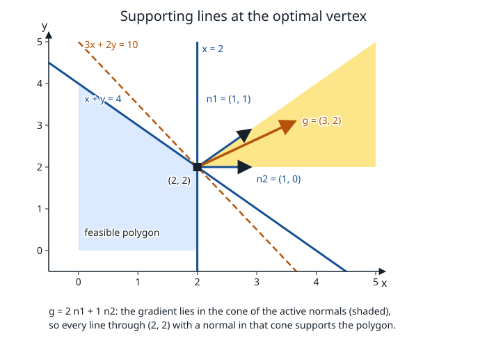

# Mathematical foundations

**Verified against** revision `1f2ddee` (`primal.h`, `stdform.c`, `ipm.c`,
`primal_solution.c`).

## Learning objectives and prerequisites

After this chapter you can:

- test whether a quadratic form is convex, and whether a matrix is positive
  semidefinite;
- construct the dual of a cone and prove the self-duality of the orthant, the
  Lorentz cone and the positive semidefinite cone;
- state weak duality, strong duality and the KKT conditions, with the
  assumptions each one needs;
- verify a primal–dual optimum by substitution, and read PRIMAL's multipliers
  (which use the opposite sign from this text).

Prerequisites: linear algebra (eigenvalues of symmetric matrices, rank) and
multivariable calculus (gradient, Hessian). Notation: vectors are columns,
$\langle x,y\rangle=x^\top y$ and $\langle X,Y\rangle=\operatorname{tr}(X^\top Y)$
for matrices.

## Norms, quadratic forms and positive semidefinite matrices

The norms used in this documentation are $\|x\|_2=\sqrt{x^\top x}$,
$\|x\|_1=\sum_i|x_i|$ and $\|x\|_\infty=\max_i|x_i|$, and the Frobenius norm
$\|X\|_F=\sqrt{\langle X,X\rangle}$. PRIMAL measures residuals in $\|\cdot\|_\infty$
and scales them by $\max(1,\|b\|_\infty)$ or $\max(1,\|c\|_\infty)$
([interior point](interior-point.md)).

A **quadratic form** is $x\mapsto x^\top Qx$ with $Q=Q^\top$. $Q$ is
*positive semidefinite* ($Q\succeq0$) when $v^\top Qv\ge0$ for every $v$, and
*positive definite* ($Q\succ0$) when the inequality is strict for $v\ne0$. For a
symmetric matrix the following are equivalent:

1. $Q\succeq0$;
2. every eigenvalue of $Q$ is nonnegative (the spectral theorem writes
   $Q=V\Lambda V^\top$ with $V$ orthogonal, so $v^\top Qv=\sum_r\lambda_r(V^\top v)_r^2$);
3. $Q=R^\top R$ for some $R$ (a Cholesky factor when $Q\succ0$).

**Convexity.** A set is convex if it contains the segment between any two of its
points. A function is convex if its epigraph is convex. A twice differentiable
function is convex on an open convex domain iff its Hessian is positive
semidefinite there. For $f(x)=\tfrac12x^\top Qx+c^\top x$ the gradient is
$Qx+c$ and the Hessian is the constant matrix $Q$, so $f$ is convex iff $Q\succeq0$
and strictly convex iff $Q\succ0$ (then the minimizer over a convex set is unique
when it exists).

## Cones and dual cones

A *cone* contains every nonnegative multiple of each of its points. The **dual
cone** is $K^*=\{z:\langle z,s\rangle\ge0\ \forall s\in K\}$.

- **Orthant.** $\mathbb{R}^n_+$ is self-dual: $z^\top s\ge0$ for all $s\ge0$
  forces each $z_i\ge0$ (take $s=e_i$).
- **Lorentz cone** $\{(a,u):a\ge\|u\|_2\}$ is self-dual. If $(a,u)$ and $(b,v)$ are
  in the cone, Cauchy–Schwarz gives $ab+u^\top v\ge ab-\|u\|\|v\|\ge0$. If
  $(a,u)$ is outside the cone, $a<\|u\|$, and $(\|u\|,-u)$ is in the cone with
  $\langle(a,u),(\|u\|,-u)\rangle=a\|u\|-\|u\|^2<0$ (for $u=0$ the vector $(1,0)$ does the same, since then $a<0$).
  See the [Lorentz section](conic-socp.md#geometry-and-jordan-algebra).
- **Positive semidefinite cone** $\mathbb{S}^n_+$ is self-dual under the trace
  inner product. If $Y\succeq0$ and $X\succeq0$, then
  $\operatorname{tr}(XY)=\operatorname{tr}(X^{1/2}YX^{1/2})\ge0$. If $Y$ has a
  negative direction $v^\top Yv<0$, then $X=vv^\top\succeq0$ gives
  $\operatorname{tr}(XY)<0$.
- The exponential and power cones are *not* self-dual; their duals are written out in
  [the exponential cone](exponential_cone.md) and [the power cone](power_cone.md).

**Supporting hyperplane.** If $x_0$ is on the boundary of a convex set $C$ there
is a vector $g\ne0$ with $g^\top x\le g^\top x_0$ for every $x\in C$; the line
$g^\top x=g^\top x_0$ *supports* $C$. For a polyhedron at a vertex, the admissible
$g$ form the cone spanned by the normals of the active constraints.

*Figure: the polygon of the [simplex chapter](simplex.md) and its optimal vertex
$(2,2)$, where the rows $x+y\le4$ and $x\le2$ are active, with normals
$n_1=(1,1)$ and $n_2=(1,0)$. Every line through $(2,2)$ whose normal lies in the
shaded cone spanned by $n_1$ and $n_2$ supports the polygon. The objective
gradient $g=(3,2)$ is in that cone, $g=2n_1+1\,n_2$, so the line $3x+2y=10$
(dashed) supports the polygon at the optimum. The multipliers $2$ and $1$ are the
dual solution. Analytic figure produced by
[`figures/make_figures.c`](figures/make_figures.c) at `1f2ddee`, which also checks
that PRIMAL reports multipliers of magnitude 2 and 1.*

## Duality and the KKT conditions

**Lagrangian and weak duality.** For $\min f(x)$ s.t. $Ax=b$, $x\ge0$, define
$\mathcal L(x,y,z)=f(x)-y^\top(Ax-b)-z^\top x$ with $z\ge0$. For feasible $x$,
$\mathcal L(x,y,z)\le f(x)$, so $g(y,z)=\inf_x\mathcal L(x,y,z)\le p^\star$:
every dual value is a lower bound. (For an LP the infimum is $-\infty$ unless the stationarity condition
$A^\top y+z=c$ below holds.)

For an LP, $f=c^\top x$, the stationarity condition is $A^\top y+z=c$, and for any
feasible pair
$$
c^\top x-b^\top y=(A^\top y+z)^\top x-y^\top Ax=z^\top x\ge0 .
$$
This is the **duality gap**, and it is computable from the two points alone: a
numerical certificate. It generalizes to a cone $K$: replace $z\ge0$ by $z\in K^*$
and $x\ge0$ by $x\in K$; the gap is $\langle x,z\rangle\ge0$.

**Strong duality.** For an LP, if either problem has a finite optimum then both
attain it and the optimal values are equal. For a convex problem with convex
constraints it holds when a constraint qualification such as Slater's condition (a strictly
feasible point) is satisfied. Without such an assumption the gap can be positive.

**KKT conditions.** A point $(x,y,z)$ is a KKT point if
$$
\nabla f(x)-A^\top y-z=0,\quad Ax=b,\quad x\ge0,\quad z\ge0,\quad x_iz_i=0 .
$$
For convex $f$ these conditions are *sufficient* for a global minimum. They are
*necessary* only under a qualification (for linear constraints they hold at
every minimizer). If $f$ is not convex a KKT point can be a maximum or a saddle.

## Worked primal–dual pair

Minimize $x_1+2x_2$ subject to $x_1+x_2=1$, $x\ge0$. The feasible set is the
segment from $(1,0)$ to $(0,1)$. At $x=(1,0)$ take $y=1$ and $z=(0,1)$:

- stationarity: $c-A^\top y-z=(1,2)-(1,1)-(0,1)=0$;
- feasibility: $Ax=1=b$, $x\ge0$, $z\ge0$;
- complementarity: $x^\top z=1\cdot0+0\cdot1=0$.

The primal and dual objectives are $c^\top x=1=b^\top y$, so both are optimal. At any
other feasible point the gap against the same dual point is $x_2$: with
$x=(1-t,t)$, $c^\top x-b^\top y=1+t-1=t$.

**What PRIMAL reports.** Run through `PRIMAL_optimize`, this model returns
$x=(1,0)$, primal and dual objective 1 and both infeasibility measures 0. The
multipliers come out as $y=-1$ and $\texttt{slx}=(0,-1)$: the *opposite* sign. The
convention in `primal.h` is $c+Qx+A^\top y+z=0$, with $y_i<0$ for a row active at its
lower bound and $z_j<0$ for a variable at its lower bound, so PRIMAL's $(y,z)$ is
the negative of the pair above. Only the sign differs; the stationarity check
$c+A^\top y+z=(1,2)+(-1,-1)+(0,-1)=0$ holds with PRIMAL's numbers. The getters
(`PRIMAL_gety`, `PRIMAL_getslx`, `PRIMAL_getsux`, ...) split $y$ and $z$ by sign
into `slc`/`suc` and `slx`/`sux`.

## Where these equations enter PRIMAL

[`stdform.c`](../stdform.c) builds the equality and orthant form to which the
equations above apply ([problem formulations](problem_formulations.md)).
[`ipm.c`](../ipm.c) solves the perturbed complementarity equations $x_iz_i=\mu$
([interior point](interior-point.md)), and [`primal_verdict.c`](../primal_verdict.c) and
[`primal_solution.c`](../primal_solution.c) compute the public measurements
(`PRIMAL_getprimalinfeas`, `PRIMAL_getdualinfeas`, the objectives). A public residual is
measured on the *original* model, so compare it with an internal residual only after
checking the maps in [problem formulations](problem_formulations.md).

## Exercise

Change the second cost of the worked pair to 1: minimize $x_1+x_2$ over the same
set. Describe the optimal face and all corresponding multipliers.

*Answer.* The objective equals $x_1+x_2=1$ on the whole segment, so every feasible
point is optimal: the optimal face is the segment. The dual point $y=1$, $z=0$
satisfies $A^\top y+z=(1,1)=c$, so it is dual feasible, and $x^\top z=0$ holds for
every feasible $x$, so complementarity is satisfied everywhere on the face. The
multiplier is unique, $y=1$ ($y=-1$ in PRIMAL's convention) with $z=0$, while the
primal solution is not. PRIMAL publishes one point of the face, $x=(1,0)$, with
$y=-1$, $z=0$ and objective 1.

## References

- S. Boyd and L. Vandenberghe, [*Convex Optimization*](https://web.stanford.edu/~boyd/cvxbook/), Cambridge University Press, 2004, chapters 2–5.
- R. T. Rockafellar, [*Convex Analysis*](https://doi.org/10.1515/9781400873173), Princeton University Press, 1970 (section 11, separation theorems and supporting hyperplanes).
- J. Nocedal and S. J. Wright, [*Numerical Optimization*](https://doi.org/10.1007/978-0-387-40065-5), 2nd ed., Springer, 2006, chapter 12 (KKT conditions).
