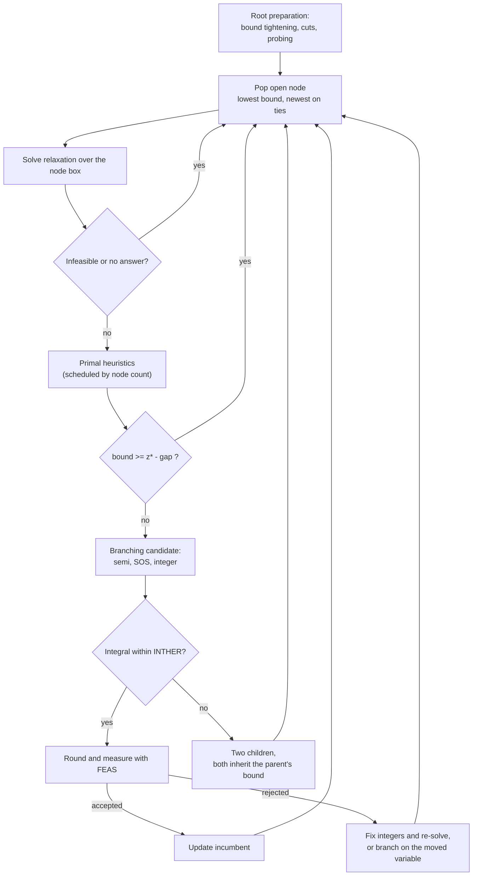
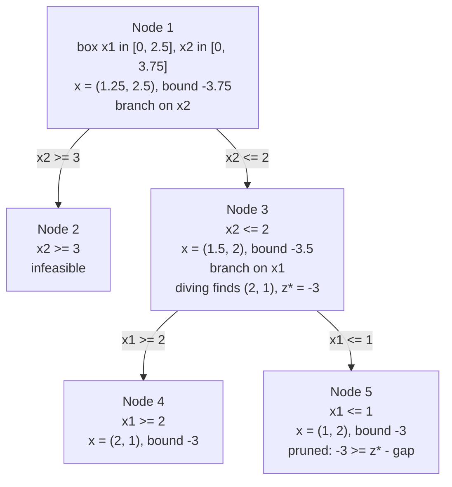
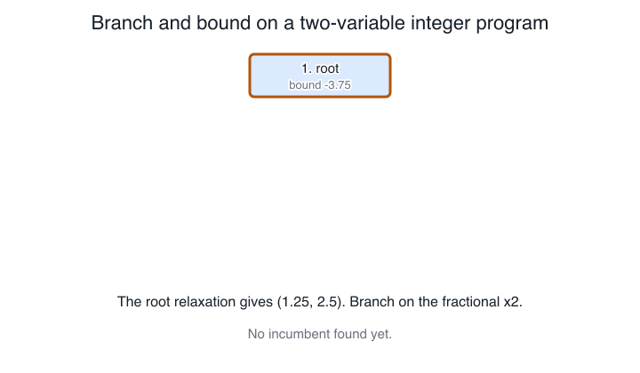

# Mixed-integer optimization

**Verified against** revision `1f2ddee` (`primal_mip.c`, `primal_mip_opt.c`,
`primal_std.c`, `simplex.c`).

## Learning objectives and prerequisites

After this chapter you can:

- state the mixed-integer program PRIMAL solves and say which parts of the
  search are the textbook algorithm and which are PRIMAL-specific;
- follow one node of the search: relaxation, pruning test, branching rule,
  children;
- explain why the integrality tolerance and the feasibility tolerance are two
  different numbers, and what PRIMAL does when a rounded point fails the second;
- name the cuts and heuristics that are on by default and the ones that are
  opt-in, and say when each applies;
- reproduce the five-node trace of the worked example with the public API.

Prerequisites: [LP duality and bounds](mathematical_foundations.md), the
[simplex method](simplex.md) (the relaxation solver) and the
[architecture overview](architecture.md).

## Mathematical formulation

PRIMAL solves

$$
\min_x \; c^\top x \quad \text{s.t.} \quad l_c \le A x \le u_c,\quad
l_x \le x \le u_x,\quad x \in \mathcal{K},\quad
x_j \in \mathbb{Z}\ \ \forall j \in \mathcal{I},
$$

where $\mathcal{I}\subseteq\lbrace 1,\dots,n\rbrace$ indexes the integer variables and
$\mathcal{K}$ is the product of the nonnegative orthant, second-order,
exponential/power cones and positive semidefinite bars (see
[problem formulations](problem_formulations.md)). Semi-continuous
($x\in\lbrace 0\rbrace \cup[l,u]$) and semi-integer variables, SOS1/SOS2 sets and
[disjunctive constraints](disjunctive_constraints.md) are handled by the same
search.

**Relaxation and bound.** Dropping the integrality restrictions gives the
*relaxation*. Its optimal value $z_{\mathrm{LP}}$ is a lower bound on the MIP
optimum, because the relaxation minimizes over a superset. Every node of the
search tree carries a box $[l_x,u_x]$ tighter than its parent's, and the bound
of a node is the optimal value of the relaxation over that box.

## Branch and bound

The search keeps a pool of open nodes and a best known integer-feasible value
$z^*$ (the *incumbent*, $+\infty$ at the start).

```text
BRANCH-AND-BOUND(model)
 1  tighten bounds, add cuts, probe binaries          # root preparation
 2  pool <- { root box };  z* <- +inf
 3  while pool not empty and nodes < MIP_MAX_NODES:
 4      node <- the open node with the lowest bound    # best-bound; ties: newest
 5      (status, x, z) <- solve relaxation over node.box
 6      handle relaxation status as described below
 7      run the primal heuristics scheduled for this node count
 8      if z >= z* - gap: discard node                 # pruned by bound
 9      choose what to branch on:                      # semi, SOS, then integer
10      if x is integral within INTHER:
11          round, test with FEAS; if it measures: z* <- min(z*, objective); discard node
12          otherwise repair (fix integers, re-solve) or branch on the moved variable
13      else split the box at floor(x_j), floor(x_j)+1; push both children with bound z
14  publish incumbent, or a status explaining why there is none
```

An infeasible relaxation proves that the node has no integer-feasible point.
In [`primal_mip_opt.c`](../primal_mip_opt.c), a relaxation that gives no answer
is also skipped, and an unbounded root is passed to an integer-feasibility
heuristic. Failure to compute a relaxation solution supplies no mathematical
proof of infeasibility or bound for that node.

The test in line 8 uses

$$
\text{gap} = \max(\varepsilon_{\mathrm{abs}},\ \varepsilon_{\mathrm{rel}}(1+|z^*|)),
$$

where `MIP_TOL_ABS_GAP` sets $\varepsilon_{\mathrm{abs}}$ (default $0$) and
`MIP_TOL_REL_GAP` sets $\varepsilon_{\mathrm{rel}}$ (default $10^{-4}$).
A node is therefore pruned when its bound is
within one relative part in $10^4$ of the incumbent, not only when it is
strictly worse.



### Node selection

PRIMAL expands the node with the lowest bound (`primal_mip_opt.c`, the loop
at the head of the search). Among equal bounds the most recently created node
wins, which keeps the search close to depth-first when bounds tie. The pool is
an array scanned linearly, so selection costs $O(\text{open nodes})$.

### Branching rule

The candidate is chosen in this order (`optimize_mip`):

1. a **semi-continuous or semi-integer** variable with $0 < x_j < l_j$:
   children $x_j = 0$ and $x_j \ge l_j$;
2. a violated **SOS1/SOS2** set: the members are ordered by weight and split
   into two sets, each forcing the other side to zero;
3. a fractional **integer** variable. The default is the largest
   $\min(f, 1-f)$ with $f=x_j-\lfloor x_j\rfloor$. At the first 200 nodes
   with at least two candidates, *strong branching* overrides it: the three
   candidates with the largest fraction are tried, both children of each are
   solved, and the candidate whose *lower* child bound is highest is chosen
   (`sb_worker` in `primal_mip.c`; candidates are scored over threads when
   `num_threads > 1`, with a fixed tie-break so the result is deterministic).

For an integer variable the children are $x_j\le\lfloor v\rfloor$ and
$x_j\ge\lfloor v\rfloor+1$, taking the floor of $v$ itself, not of
$v+\text{INTHER}$. A value that is integral within the tolerance would
otherwise produce a child equal to its parent; `T84` and `T95` exercise this.
A side that is empty or leaves the box unchanged is not created.

## The two tolerances

| Parameter | Default | Role |
|---|---|---|
| `PRIMAL_DPAR_MIP_TOL_INTHER` | $10^{-5}$ | $x_j$ counts as integer if its distance to an integer is below this |
| `PRIMAL_DPAR_MIP_TOL_FEAS` | $10^{-6}$ | a rounded point must satisfy every row and bound within this |

They answer different questions. INTHER decides **whether to branch**. FEAS
decides **whether a point may be published**. Using one number for both is
unsound whenever a variable that is *almost* integral multiplies a large
coefficient. Take the big-$M$ row $a^\top x \le b + M(1-z)$ with
$M=10^6$ and binary $z$. A relaxation value $z=1-5\cdot10^{-6}$ is within
INTHER of 1, but the relaxation allows $a^\top x\le b+5$. Publishing the
rounded point $z=1$ would break the row by 5.

`mip_point_measures` (`primal_mip.c`) is the single predicate that every
incumbent has to pass: bounds and integrality, rows within FEAS, quadratic
rows, cones; a semi-continuous variable that is inactive is exempt from its
lower bound. When a rounded relaxation point fails it, `optimize_mip` does
**fix and re-solve**: the integers are pinned at their rounded values and the
node relaxation is solved again so the continuous variables absorb the shift.
The result becomes an incumbent only if it then measures. If nothing can be
pinned or refined the node is dropped (the log says
`MIP leaf rejected: ...`). The diving heuristic is stricter still: it judges
integrality with FEAS, not INTHER, because it delivers a point.

## Root preparation

Everything below runs once, before the first node, in `optimize_mip` and
`mip_build_cuts`. When the model has cones, quadratic rows or PSD bars
(`use_conic`) none of the LP-derived cuts are generated, because adding rows
that are valid only for a polyhedral relaxation corrupted the conic
relaxation on CBLIB `kpart_diw.15.4.29` (210 cuts made the root fail).

**Bound tightening** (`bound_tighten`; off with `GMB_NO_BOUND_TIGHTEN`) shrinks
the variable box from the rows.

**Cuts.** They go into a *copy* of the task used only by the relaxations; the
user's model keeps its rows.

| Cut | When it applies | Default |
|---|---|---|
| Chvátal–Gomory | a row whose variables are all integer and nonnegative, with a non-integer coefficient or right-hand side | on |
| Cover | a knapsack row $a^\top x\le u$ over binaries, $a_j>0$: a cover $C$ gives $\sum_{j\in C}x_j\le \lvert C\rvert-1$ | on |
| Clique | the same rows: $\lbrace j: a_j>u/2\rbrace$ is a clique | on |
| Tableau Gomory (`mip_gomory_round`) | all variables integer with integer bounds, integer rows and integer matrix; **one** round, because after a cut the slacks have fractional coefficients | on, when applicable |
| CMIR, LIPRO | see `T188`, `T190` | **off** unless `GMB_MIP_CMIR`, `GMB_MIP_LIPRO` are set |
| Pairwise-probing conflict | pairs of binaries that cannot both be 1 | **off** unless `GMB_MIP_CONFLICT` is set (`T251`) |

All cuts are switched off by `GMB_NO_MIP_CUTS`. A rank-one CG cut rounds *one
row at a time*; it does not search for a combination of rows (see the
exercise).

**Cut check.** After the cuts are built, the root relaxation is solved with
and without them. If the optimum *with* cuts is larger (min form) by more than
$10^{-9}$, all cuts are dropped and the log reads
`MIP: cuts discarded (node relaxation worsened)`. The check exists because a
cut slicing the relaxation optimum once made the LP solver stall at a
suboptimal point (a binary knapsack with the cover $x_0+x_1\le1$ returned
$-8.5$ instead of $-9$). A consequence worth knowing: a cut that legitimately
raises the root bound is dropped as well. The worked example below generates
two Gomory cuts and discards them. Disable the check with
`GMB_NO_MIP_CUT_CHECK`.

**Probing** (off with `GMB_NO_MIP_PROBING`). For each of the first 20 binary
variables PRIMAL solves the relaxation with the variable at 0 and at 1. If one
side is infeasible the variable is fixed to the other (`T165`).

### Primal heuristics

The heuristics in the table run after a node's relaxation, on a schedule
keyed to the node counter `nodes`. They are enabled by default. Each has a
`GMB_NO_MIP_<NAME>` switch and can improve the incumbent when its candidate
passes the feasibility checks.

| Heuristic | Runs at node | Needs an incumbent | Test |
|---|---|---|---|
| Root rounding and repair (round, pin the integers, re-solve) | 1, only while there is no incumbent | no | — |
| Fractional diving | 1, and `nodes % 8 == 3` | no | `T252` |
| RINS | 1, and `nodes % 8 == 0` | yes | `T179` |
| RENS | 1, and `nodes % 8 == 4` | no | — |
| Feasibility pump | 1, and `nodes % 8 == 2` | no | `T184` |
| Local search | 1, and `nodes % 8 == 6` | yes | `T186` |

A caller can also supply a starting incumbent with `PRIMAL_putxx`; it is
accepted only if it passes `mip_point_measures` (`T59`).

#### Shared-capacity integer covers

Some allocation problems have demand rows $r$ and shared capacities $s$.
An integer decision $x_{rs}$ contributes $a_{rs}x_{rs}$ toward demand $d_r$
and consumes $x_{rs}$ units of capacity $b_s$. Here $0\le x_{rs}\le u_{rs}$,
$\sum_s a_{rs}x_{rs}\ge d_r$, and $\sum_r x_{rs}\le b_s$.
Solving the demand rows independently may exhaust a resource that another
row needs. A nonnegative price $\lambda_s$ raises the effective cost of
each unit taken from capacity $s$.

For one demand row, let $F_k(h)$ be the cheapest way for items $k$ onward
to cover at least $h$ residual units. The final state has
$F_{n+1}(0)=0$ and $F_{n+1}(h)=+\infty$ for $h>0$. For integer amounts,
the recurrence is

$$
F_k(h)=\min_{0\le q\le u_k,\ q\in\mathbb Z}
\left[q(c_k+\lambda_{s(k)})+F_{k+1}(\max(0,h-qa_k))\right].
$$

Storing the minimizing $q$ at each state recovers the selected plan.
With demand $d_r$, $k_r$ items and maximum item count $U_r$, this takes
$O(k_r(d_r+1)(U_r+1))$ time and $O(k_r(d_r+1))$ space for the traceback.
Rows expressed in half units are scaled to integers before the recurrence.

Every integer plan $z_r$ for demand $r$ gives an upper bound on that row's
minimum priced cost. The price master maximizes
$\sum_r\theta_r-\sum_s b_s\lambda_s$ under
$\theta_r\le\sum_s(c_{rs}+\lambda_s)z_{rs}$ for each plan generated so far.
After solving the master, the row dynamic programs find any cheaper plans
at those prices and add their inequalities.

**In PRIMAL**, [`mip_cover_incumbent`](../primal_mip_cover.c) tries this at
the root of eligible single-threaded linear integer minimizations without
a warm incumbent. It visits demands in several orders, reconstructing
each row's plan against the remaining stock. It passes the assembled point
to `mip_point_measures` on the original model. The prices rank plans and
the verified point supplies an objective cutoff for branch and bound.
The tree still determines the solution status.

In `T327`, two demands need 5 and 5.5 units, and only one cheap unit is
available. That unit supplies 5.5 to either row and costs 1. Giving it to
the second row leaves two items of 2.5 for the first, at cost 2 each.
The total cost is 5, and both demand rows and the shared stock are feasible.

### Exact dynamic programming for choice sequences

Some binary models choose exactly one option $x_g$ from each ordered
group $g$. An option can forbid choices in the following two groups.
It also supplies $a_{rg}(x_g)\ge0$ units of resource $r$. Cumulative
requirements are

$$
z_r + \sum_{i=1}^g a_{ri}(x_i) \ge d_{rg},
\qquad 0\le z_r\le U_r.
$$

Here $z_r$ is a reserve with a nonnegative price $p_r$ per unit. Binary
weights $1,2,4,\ldots$ represent every integer up to $U_r$. For a fixed
sequence of choices the least feasible reserve is

$$
z_r^*=\max\left(0,\ \max_g\left[d_{rg}-\sum_{i=1}^g a_{ri}(x_i)\right]\right).
$$

This eliminates the reserve decision from each transition. The solver
keeps the cumulative supply $S_r$ and the largest deficit $H_r$ so far.
On choosing $x_g$, add $a_{rg}(x_g)$ to $S_r$ and set
$H_r\gets\max(H_r,d_{rg}-S_r)$. Drop the state if $H_r>U_r$.
Two partial sequences with identical $(S,H)$ and identical permitted
continuations can use the same suffix, so only the cheaper prefix
is needed. At the final layer, add $\sum_r p_r H_r$ to each surviving
prefix cost and reconstruct the choices and reserve bits from the
least-cost state.

For example, T328 chooses one of two options in each of three groups.
The options with positive supply give 2, 3 and 2 units, at prices 2, 4
and 1. The first and third of those options are incompatible. The
requirements are 2 after the first group and 5 after the third,
with up to 3 units in reserve at a price of 3 per unit. Choosing the
first two supply options satisfies both requirements without a reserve,
at total cost 6. If the middle option instead costs 9, the best plan
takes the third supply option and buys 3 reserve units for a total of 10.

[`mip_plan_solve`](../primal_mip_plan.c) checks every finite row
before applying this recurrence. In particular, it checks that
a resource's coefficients agree across all of its prefixes and groups
choices by their compatibility with the next two groups. A completed
search supplies the proof of optimality. The original model checks the
reconstructed point before PRIMAL publishes it. Frontiers can grow
exponentially with the number of resources and the ranges of their
cumulative supplies and deficits. PRIMAL bounds the frontier size and
falls back to branch and bound if the bound is reached or the model
falls outside the recognized form.

### Small integer D-optimal designs

D-optimal experimental design allocates integer weights $w_k$ to maximize
the determinant of an information matrix $M(w)=M_0+\sum_k w_k A_k$.
A conic formulation introduces a diagonal matrix $D$ with positive entries,
an upper triangular matrix $T$ with $T_{ii}=D_{ii}$, and log variables $v_i$.
The constraints and minimization objective are

$$
\begin{bmatrix}D&T\\T^\top&M(w)\end{bmatrix}\succeq0,\qquad
(D_{ii},1,v_i)\in\mathcal K_{\exp},\qquad
\min -\sum_i v_i.
$$

The Schur complement gives $M(w)\succeq T^\top D^{-1}T$. The determinant
on the right is $\det D$, because $\det T=\prod_iD_{ii}$.
The exponential constraints give $v_i\le\log D_{ii}$. Thus the conic
objective is bounded below by $-\log\det M(w)$ for every feasible allocation.

For a positive definite $M(w)=LL^\top$, set $D_{ii}=L_{ii}^2$,
$T=\mathrm{diag}(L_{ii})L^\top$ and $v_i=\log D_{ii}$. This makes
the Schur complement zero and attains the bound. For example, with
$M=\mathrm{diag}(1+w_0,\,1+2w_1)$ and $w_0+w_1\le3$, allocations
$(0,3),(1,2),(2,1),(3,0)$ give determinants 7, 10, 9 and 4.
The optimum is $(1,2)$, at objective $-\log 10$.

[`mip_logdet_solve`](../primal_mip_logdet.c) recognizes the identities from
the task's linear equalities, bounds and cones. For small bounded integer
boxes it enumerates allocations and bounds the largest determinant,
including a margin for floating-point rounding. In dimension six it
reuses minors indexed by column subsets, taking $O(d2^d)$ operations per
determinant. The enumeration itself can grow exponentially in the
number of integer weights.

If $A_k+\eta I\succeq0$ for all $k$, a budget $B$ can be filled in the
determinant bound. Given $w$ with $\sum_k w_k\le B$, extend it to $u\ge w$
with $\sum_k u_k=B$ inside the integer box. Then

$$
M(u)+\eta B I-M(w)=\sum_k(u_k-w_k)(A_k+\eta I)
+\eta\left(\sum_k w_k\right)I\succeq0 .
$$

PRIMAL derives $\eta$ from a bound on the row sums of $A_k-a_ka_k^\top$.
Only the determinant bound uses this shift. The lift uses the original
matrix and must satisfy the original rows, bounds, integrality, PSD and
exponential constraints. T330 also exercises an instance in which a
negative contribution makes the optimal allocation leave budget unused.

For larger designs, PRIMAL bounds a box of integer allocations before
enumerating its points. Let $W=M(u)+\eta B I$. For any invertible $Q$
and positive semidefinite $W$, the arithmetic–geometric mean inequality
applied to the eigenvalues of $QWQ^\top$ gives

$$
\det W\le
\frac{\left(\mathrm{tr}(QWQ^\top)/d\right)^d}{(\det Q)^2}.
$$

With $Q$ fixed, the trace is affine in the weights. Its maximum in a box
with fixed total budget comes from filling capacity in decreasing order
of the trace coefficients, starting at the lower bounds. PRIMAL uses
pairwise exchanges of real weights to find a useful reference Cholesky
factor and takes its triangular inverse as $Q$. The upper bound uses the
original coefficients with a rounding margin. Any invertible $Q$ gives
a valid bound, so the exchange iterations can stop before convergence.
The search records a bound for every terminal box and verifies the
reconstructed optimum against their maximum.

### Partitions encoded by a PSD matrix

Some models use binary indicators $x_{ij}$ for pairs of vertices.
A positive semidefinite matrix $X$ has diagonal 1 and two possible
off-diagonal values $a$ and $b$, with $a$ near 1 and $b<0$.
The model sets $X_{ij}=a$ when $x_{ij}=1$.

If $x_{ij}=x_{jk}=1$ but $x_{ik}=0$, the corresponding principal
minor equals $(1-b)(1+b-2a^2)$. When this is negative, such a triple
violates positive semidefiniteness. The indicators therefore define
groups. Selecting one vertex from each of $k+1$ distinct groups
produces a principal submatrix with all off-diagonal entries equal
to $b$. Its quadratic form on the all-ones vector is negative
when $1+kb<0$, so at most $k$ groups are possible.

For a vertex set $S$, let $C(S)=\sum_{i<j,\ i,j\in S}c_{ij}$
be its within-group cost. A constraint with terms only on edges
incident to a vertex can be tested using the group containing that
vertex. After filtering groups by those constraints, use

$$
F_g(U)=\min_{S\subseteq U,\ \min U\in S}
\left[C(S)+F_{g-1}(U\setminus S)\right].
$$

The minimum uses only admissible groups. $F_g(\varnothing)=0$,
and $F_1(U)$ is the cost of one admissible group or $+\infty$.
Anchoring each chosen group at the first remaining vertex avoids
counting group permutations. The time bound is $O(k3^n)$ and the
stored choices take $O(k2^n)$ space.

[`mip_partition_solve`](../primal_mip_partition.c) uses this path for
small models with explicit pair-to-matrix equalities. It checks every
row and the smallest PSD eigenvalue after reconstructing the
partition. T331 covers a five-vertex model whose optimum moves from
4 to 6 when the group of vertex zero must have at least four members.

### Cardinality-constrained portfolios with separate risk blocks

A portfolio can impose different risk limits on disjoint groups of
assets. Let $x$ be the nonnegative weights and $y$ the binary selection
variables. Each weight has a bound $x_j \le y_{g(j)}$. The cardinality
constraint $\sum_i y_i\le K$ limits how many indicators can be active.
An indicator can control several weights when an asset appears in
more than one group.

Fix the state of any shared indicator. Drop the total-weight constraint
$\sum_j x_j\le B$ from the search and enumerate the allowed supports of
each group separately. For every group and each quota $k$, store its
best feasible return and an upper bound on the return of any support
using at most $k$ indicators. The maximum sum of the group upper bounds
over splits of $K$ bounds the original portfolio return. If the sum of
the best reconstructed weights satisfies $\sum_j x_j\le B$ and closes
the gap, it certifies the optimum of the original problem.

The three risk limits yield different upper bounds for a fixed support.

- **Second-order cone.** If $\lVert Ax\rVert_2\le r$ and
  $c-A^Tu\le\epsilon\mathbf 1$, then
  $c^Tx\le r\lVert u\rVert_2+\epsilon B$ for any original feasible
  point and $\epsilon\ge 0$. A nonnegative least-squares direction
  provides a useful $u$.
- **Paired exponential cones.** A pair with arguments $1+z$ and $1-z$
  contributes at least
  $\phi(z)=(1+z)\log(1+z)+(1-z)\log(1-z)$ to the shared risk limit.
  The Taylor coefficients of $\phi(\sqrt v)$ are positive for
  $0\le v<1$, so its tangent in $v$ gives a lower bound. Applying
  those tangents componentwise yields an ellipsoidal relaxation.
  Evaluating the original entropy sum when scaling the candidate
  restores feasibility.
- **Arrow PSD matrix.** Consider a matrix with top-left entry $h>0$,
  first column below it $Ax$, and lower-right block $D(s)=D_0+sD_1$.
  Testing the quadratic form on vectors supported by the first
  coordinate and a direction $u$ in the lower block yields
  $(u^TAx)^2\le h\,u^TD(s)u$. The right-hand side is affine in $s$,
  so its maximum on the allowed interval gives a bound valid even at
  a singular endpoint. The solver uses a Cholesky factor at interior
  values of $s$ to find feasible candidates and tight directions.

For example, suppose two weights share an indicator and can reach
$1/4$ in the SOC block and $1/8$ in the exponential block. With
returns $1$ and $2$, selecting that indicator can earn $1/2$.
A third weight with its own indicator is limited to $1/4$ at return
$1$. With $K=1$ and $B=1$, the first indicator is optimal and uses
$3/8$ of the budget. Tightening $B$ to $1/5$ rules out that point and
the upper bound alone can no longer certify the answer.

[`mip_portfolio_solve`](../primal_mip_portfolio.c) checks the CBF
matrix and row structure before using this route. It handles one
shared indicator and blocks of at most 16 weights, so the enumeration
scales by the sum of the block support counts. It verifies the
original rows, bounds, integrality, cones and PSD eigenvalues before
publishing. A structure mismatch, an infeasible reconstructed point,
a search limit or an open gap returns control to branch and bound.
T332 covers the shared indicator, a binding budget and an extra row.

### Binary selection in affine PSD constraints

Two structures allow PRIMAL to certify an integer optimum by inspecting
small subsets of binary variables. Both reconstruct the full matrix and
validate the original constraints before returning a solution.

In the first structure, choose at most $K$ matrices $H_j$ and minimize
$t$ subject to the arrow constraint

$$
\begin{pmatrix} A_S & b \\ b^T & t \end{pmatrix}\succeq 0,
\qquad A_S=I+\sum_{j\in S} H_j.
$$

For $A_S\succ 0$, the Schur complement gives the optimum for this
support as $b^T A_S^{-1}b$. The input matrices can be rounded versions
of rank-one matrices. PRIMAL constructs $u_j$ from a pivot column of
$H_j$ and sets $e_j$ to a bound on the maximum absolute row sum of
$H_j-u_ju_j^T$. As this difference is symmetric, its spectral norm is
at most $e_j$. If $E$ is the sum of the $K$ largest $e_j$, then

$$
(1-E)I \preceq A_S \preceq (1+E)I+\sum_{j\in S}u_ju_j^T.
$$

The right-hand side gives a cheaper lower bound on the objective.
For any vector $y$, its contribution is
$2b^Ty-(1+E)\lVert y\rVert^2-\sum_{j\in S}(u_j^Ty)^2$.
To bound all completions of a partial support, subtract the largest
remaining squared inner products up to the unused budget. PRIMAL
chooses $y$ with a Woodbury solve on the partial support, so this
linear system has dimension at most $K$. Any $y$ gives a valid bound.

A support that survives is evaluated with the original matrices.
If $r=b-A_Sy$, completing the square gives

$$
b^TA_S^{-1}b =
2b^Ty-y^TA_Sy+r^TA_S^{-1}r.
$$

The final term lies between $0$ and $\lVert r\rVert^2/(1-E)$.
Each surviving support therefore supplies an interval, with a
rounding margin. The smallest lower bound over the complete search
proves the gap to the best original feasible point.

In the second structure, the items form disjoint groups and at most
one item can be selected from each group. The only continuous variable
$s$ has a finite upper bound and a PSD coefficient in the affine matrix.
Increasing $s$ enlarges the matrix in PSD order, so testing each support
at the upper endpoint covers the entire allowable interval. PRIMAL sorts
items by positive cost and enumerates supports in a priority queue.
Each step either replaces the last item with the next allowable one
or appends that item. Both operations have nondecreasing cost and
together cover all allowable supports. Negative principal minors and checked
negative Rayleigh quotients exclude infeasible supports. The first
feasible support provides the global optimum.

[`mip_psd_select_solve`](../primal_mip_psd_select.c) handles these
structures with up to 32 and 64 binary choices, respectively.
Both searches can be exponential in the worst case and honor the
node and time budgets. T333 covers the original matrix check, a
rounded rank-one update and the exclusion of shared groups.

## The relaxation solver and the slack-basis start

For an LP relaxation PRIMAL solves the standard form with the simplex method:
`optimize_mip` calls `mip_relax` (`primal_sdptask.c`), which reaches
`solve_std_routed` with `STD_METHOD_MIP_SLACK` (`primal_std.c`). Since
`b452e46` an eligible node starts from the slack basis. The standard form is
eligible if its last $m$ columns are private slack columns: column $n-m+i$ has
a single entry, equal to 1, in row $i$, a zero cost, and $b_i\ge0$. Then
`simplex_solve_std_slack` runs the tableau simplex with those columns as the
initial identity basis, so phase 1 and the artificial columns are skipped. The
result is used only after `mip_slack_solution` has checked primal feasibility
($|Ax-b|\le10^{-8}(1+|b|)$, $x\ge-10^{-9}$), dual feasibility
($a_j^\top y-c_j\le10^{-9}(1+|c_j|)$) and
$|p_{obj}-d_{obj}|\le10^{-9}(1+|p_{obj}|+|d_{obj}|)$. If the model is not
eligible, or the check fails, the previous path runs: a crash basis with the
revised simplex, then the tableau with phase 1.
`GMB_SIMPLEX_TABLEAU` disables both the slack start and the revised method.

## What PRIMAL publishes

| Outcome | `PRIMAL_optimize` returns | Solution status |
|---|---|---|
| Tree exhausted, incumbent found | `OK` | `INTEGER_OPTIMAL` |
| Node cap or time cap with open nodes | `TRM_MAX_ITER` (1007) or `TRM_MAX_TIME` (1008) | `PRIM_FEAS` when an incumbent exists |
| Root relaxation infeasible | `ERR_INFEASIBLE` | `UNKNOWN`, problem status `PRIM_INFEAS` |
| Unbounded relaxation | `ERR_UNBOUNDED` only if an integer point was found | no ray is published |

A feasible point found before the cap is a feasible point, not a proof; PRIMAL
does not call it `INTEGER_OPTIMAL`. An infeasible integer problem carries no
Farkas vector, because branch and bound does not produce one
([certificates](certificates.md)). For a model with PSD bars an incumbent is
accepted by pinning the integers and solving the SDP again.

## Worked example

$$
\min -x_1-x_2 \quad\text{s.t.}\quad 2x_1+x_2\le5,\ \ -4x_1+4x_2\le5,\ \
x_1,x_2\in\mathbb{Z}_{\ge0}.
$$

Reproduce it with the public API (see the program in [the verification
note](#verification) below). The numbers are what the solver reports at
`1f2ddee`, with a trace line added in a scratch copy at each node.

| Node | Box $x_1\times x_2$ | Relaxation | Bound | Decision |
|---|---|---|---|---|
| 1 | $[0,2.5]\times[0,3.75]$ | $(1.25,\,2.5)$ | $-3.75$ | branch on $x_2$ |
| 2 | $[0,2.5]\times[3,3.75]$ | infeasible | — | discarded |
| 3 | $[0,2.5]\times[0,2]$ | $(1.5,\,2)$ | $-3.5$ | branch on $x_1$ |
| 4 | $[2,2.5]\times[0,2]$ | $(2,\,1)$ | $-3$ | integral |
| 5 | $[0,1]\times[0,2]$ | $(1,\,2)$ | $-3$ | pruned by bound |

- The root box is already tighter than the declared bounds because bound
  tightening derived $x_1\le2.5$ and $x_2\le3.75$.
- The root relaxation is the intersection of the two rows:
  $2x_1+x_2=5$, $-4x_1+4x_2=5$ gives $(1.25,2.5)$ and $z=-3.75$.
- Strong branching looked at both candidates and chose $x_2$ (fraction
  $0.5$); the textbook rule would choose it too.
- Node 2 is the right child $x_2\ge3$. It is expanded before node 3 because
  both children inherit the parent's bound $-3.75$ and the newest wins ties.
  Substituting $x_2\ge 3$ into the second row forces $x_1\ge1.75$, and then
  $2x_1+x_2\ge6.5>5$.
- Node 3 is where the incumbent $(2,1)$ with $z=-3$ appears: **diving**
  is scheduled at `nodes % 8 == 3`. With `GMB_NO_MIP_DIVING` set the same
  incumbent is found one node later, at node 4.
- Nodes 4 and 5 have the same bound $-3$; node 5 satisfies
  $-3\ge z^*-\text{gap}=-3-4\cdot10^{-4}$ and is pruned.
- The two points $(1,2)$ and $(2,1)$ are both optimal; the solver publishes
  $(2,1)$. The search ends after **5 nodes** with `INTEGER_OPTIMAL` and
  $z^*=-3$. Capping `MIP_MAX_NODES` at 3 or 4 returns `TRM_MAX_ITER` with the
  incumbent as `PRIM_FEAS`; capping at 5 returns `OK`.
- The default run also prints `MIP: 2 Gomory cuts` followed by
  `MIP: cuts discarded (node relaxation worsened)`: the example satisfies the
  conditions of `mip_gomory_applicable`, and the cuts raise the root bound,
  which the cut check treats as a reason to drop them.



*Figure: the search tree of the worked example. Nodes are numbered in the
order PRIMAL solves them. A solid edge is a child; the label under each node
gives its relaxation and bound. Read it with the table above: the incumbent
exists from node 3, which is why the last node is pruned.*



*Animation: one frame per processed node. The incumbent becomes finite at
node 3. At node 5 the relaxation bound cannot improve that incumbent within
the configured gap, so the search ends.*

## Costs and failure modes

- **Node count is the dominant cost.** Every node solves a relaxation;
  strong branching adds up to six solves per node for the first 200 nodes.
- **The best-bound pool is scanned linearly**, so trees with very many open
  nodes pay $O(\text{open})$ per selection.
- **The node cap** (`PRIMAL_IPAR_MIP_MAX_NODES`, default 100000) and the time
  cap (`PRIMAL_DPAR_MIO_MAX_TIME`, `T175`) end the search with a feasible
  point at best.
- **Big-$M$ rows** are the usual source of nearly integral relaxations
  that do not measure; the two-tolerance design in `T95` exists for them.
- **Conic relaxations lose all LP-derived cuts**, so a MISOCP or MISDP tree is
  weaker than the same model written as an LP.

## Verification

The trace above was produced with this program against `libprimal.a` built at
`1f2ddee`, plus one `fprintf` per node in a scratch copy of
`primal_mip_opt.c` (not part of the repository). Without the extra line the
program prints, for caps 1 to 6, the status and incumbent quoted below.

```c
#include <math.h>
#include <stdio.h>
#include "primal.h"
int main(void) {
    for (int cap = 1; cap <= 6; cap++) {
        PRIMALenv_t env; PRIMALtask_t t;
        PRIMAL_makeenv(&env, NULL); PRIMAL_maketask(env, 0, 0, &t);
        PRIMAL_appendvars(t, 2); PRIMAL_appendcons(t, 2);
        for (int j = 0; j < 2; j++) {
            PRIMAL_putvarbound(t, j, PRIMAL_BK_LO, 0.0, INFINITY);
            PRIMAL_putvartype(t, j, PRIMAL_VAR_TYPE_INT);
            PRIMAL_putcj(t, j, -1.0);
        }
        PRIMAL_putarow(t, 0, 2, (int[]){0, 1}, (double[]){2, 1});
        PRIMAL_putconbound(t, 0, PRIMAL_BK_UP, -INFINITY, 5.0);
        PRIMAL_putarow(t, 1, 2, (int[]){0, 1}, (double[]){-4, 4});
        PRIMAL_putconbound(t, 1, PRIMAL_BK_UP, -INFINITY, 5.0);
        PRIMAL_putintparam(t, PRIMAL_IPAR_MIP_MAX_NODES, cap);
        int rc = PRIMAL_optimize(t);
        double x[2] = {0, 0}, obj = 0; PRIMALsolstae ss;
        PRIMAL_getxx(t, PRIMAL_SOL_ITG, x);
        PRIMAL_getprimalobj(t, PRIMAL_SOL_ITG, &obj);
        PRIMAL_getsolsta(t, PRIMAL_SOL_ITG, &ss);
        printf("cap=%d rc=%d solsta=%d x=(%g,%g) obj=%g\n",
               cap, rc, (int)ss, x[0], x[1], obj);
        PRIMAL_deletetask(&t); PRIMAL_deleteenv(&env);
    }
    return 0;
}
```

Output at `1f2ddee`: caps 1 and 2 return `rc=1007` with no incumbent; caps 3
and 4 return `rc=1007, solsta=2` with $x=(2,1)$; caps 5 and 6 return `rc=0,
solsta=9` with $x=(2,1)$ and $z=-3$.

## Exercise

A rank-one Chvátal–Gomory cut may combine rows. Find nonnegative weights
$u=(u_1,u_2)$ for the two rows of the example such that $u^\top A$ is integral
and the cut reads $x_2\le2$. Show that adding it moves the root relaxation to
$(1.5,2)$ with $z=-3.5$, so that it replaces node 2 of the tree. Then explain
why `mip_build_cuts`, which rounds one row at a time, does not find it.

*Answer sketch.* $u=(1/3,1/6)$ gives $u^\top A=(0,1)$ and right-hand side
$5/3+5/6=5/2$, so $x_2\le\lfloor5/2\rfloor=2$.

## References

- L. A. Wolsey, [*Integer Programming*](https://www.wiley.com/en-us/Integer+Programming-p-9781119726081), 2nd ed., Wiley, 2020.
- J. P. Vielma, [Mixed integer linear programming formulation techniques](https://doi.org/10.1137/130915303), *SIAM Review* 57(1):3–57, 2015.
- T. Achterberg, [Constraint Integer Programming](https://opus4.kobv.de/opus4-zib/frontdoor/index/index/docId/1113), Ph.D. thesis, TU Berlin, 2007.
- T. Achterberg, T. Koch, A. Martin, [Branching rules revisited](https://doi.org/10.1016/j.orl.2004.04.002), *Operations Research Letters* 33(1):42–54, 2005 (strong branching).
