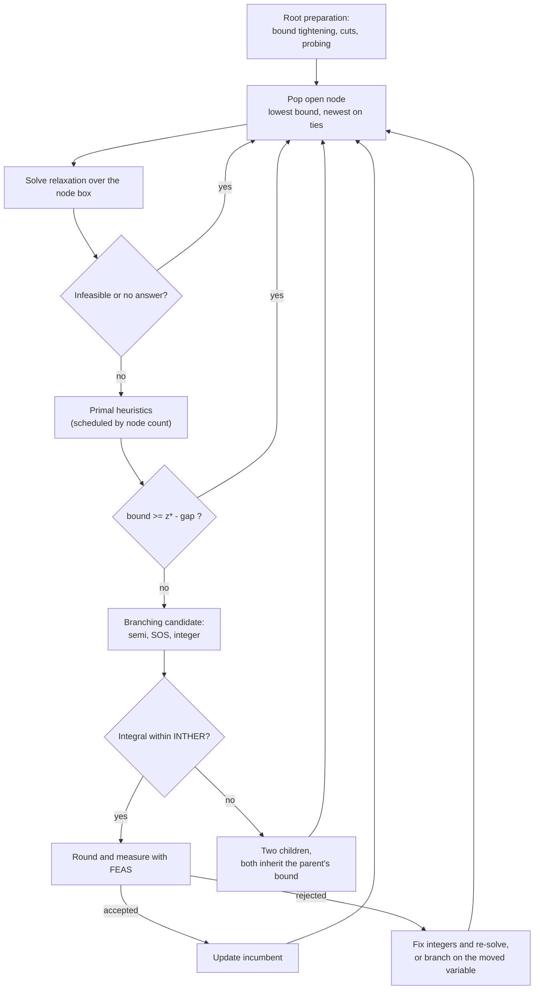
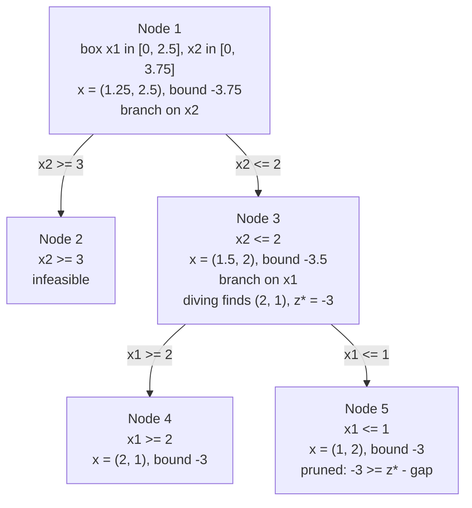

# Mixed-integer optimization

**Verified against** revision `1f2ddee` (`primal_mip.c`, `primal_mip_opt.c`,
`primal_std.c`, `simplex.c`).

## Learning objectives and prerequisites

After this chapter you can:

- state the mixed-integer program PRIMAL solves and say which parts of the
  search are the textbook algorithm and which are PRIMAL-specific;
- follow one node of the search: relaxation, pruning test, branching rule,
  children;
- explain why the integrality tolerance and the feasibility tolerance are two
  different numbers, and what PRIMAL does when a rounded point fails the second;
- name the cuts and heuristics that are on by default and the ones that are
  opt-in, and say when each applies;
- reproduce the five-node trace of the worked example with the public API.

Prerequisites: [LP duality and bounds](mathematical_foundations.md), the
[simplex method](simplex.md) (the relaxation solver) and the
[architecture overview](architecture.md).

## Mathematical formulation

PRIMAL solves

$$
\min_x \; c^\top x \quad \text{s.t.} \quad l_c \le A x \le u_c,\quad
l_x \le x \le u_x,\quad x \in \mathcal{K},\quad
x_j \in \mathbb{Z}\ \ \forall j \in \mathcal{I},
$$

where $\mathcal{I}\subseteq\{1,\dots,n\}$ indexes the integer variables and
$\mathcal{K}$ is the product of the nonnegative orthant, second-order,
exponential/power cones and positive semidefinite bars (see
[problem formulations](problem_formulations.md)). Semi-continuous
($x\in\{0\}\cup[l,u]$) and semi-integer variables, SOS1/SOS2 sets and
[disjunctive constraints](disjunctive-constraints.md) are handled by the same
search.

**Relaxation and bound.** Dropping the integrality restrictions gives the
*relaxation*. Its optimal value $z_{\mathrm{LP}}$ is a lower bound on the MIP
optimum, because the relaxation minimizes over a superset. Every node of the
search tree carries a box $[l_x,u_x]$ tighter than its parent's, and the bound
of a node is the optimal value of the relaxation over that box.

## Branch and bound

The search keeps a pool of open nodes and a best known integer-feasible value
$z^*$ (the *incumbent*, $+\infty$ at the start).

```text
BRANCH-AND-BOUND(model)
 1  tighten bounds, add cuts, probe binaries          # root preparation
 2  pool <- { root box };  z* <- +inf
 3  while pool not empty and nodes < MIP_MAX_NODES:
 4      node <- the open node with the lowest bound    # best-bound; ties: newest
 5      (status, x, z) <- solve relaxation over node.box
 6      if status = infeasible, or no answer: discard node
 7      run the primal heuristics scheduled for this node count
 8      if z >= z* - gap: discard node                 # pruned by bound
 9      choose what to branch on:                      # semi, SOS, then integer
10      if x is integral within INTHER:
11          round, test with FEAS; if it measures: z* <- min(z*, objective); discard node
12          otherwise repair (fix integers, re-solve) or branch on the moved variable
13      else split the box at floor(x_j), floor(x_j)+1; push both children with bound z
14  publish incumbent, or a status explaining why there is none
```

The test in line 8 uses

$$
\text{gap} = \max\bigl(\texttt{MIP\_TOL\_ABS\_GAP},\ \texttt{MIP\_TOL\_REL\_GAP}\,(1+|z^*|)\bigr),
$$

with defaults $0$ and $10^{-4}$. A node is therefore pruned when its bound is
within one relative part in $10^4$ of the incumbent, not only when it is
strictly worse.



### Node selection

PRIMAL expands the node with the lowest bound (`primal_mip_opt.c`, the loop
at the head of the search). Among equal bounds the most recently created node
wins, which keeps the search close to depth-first when bounds tie. The pool is
an array scanned linearly, so selection costs $O(\text{open nodes})$.

### Branching rule

The candidate is chosen in this order (`optimize_mip`):

1. a **semi-continuous or semi-integer** variable with $0 < x_j < l_j$:
   children $x_j = 0$ and $x_j \ge l_j$;
2. a violated **SOS1/SOS2** set: the members are ordered by weight and split
   into two sets, each forcing the other side to zero;
3. a fractional **integer** variable. The default is the largest
   $\min(f, 1-f)$ with $f=x_j-\lfloor x_j\rfloor$. At the first 200 nodes
   with at least two candidates, *strong branching* overrides it: the three
   candidates with the largest fraction are tried, both children of each are
   solved, and the candidate whose *lower* child bound is highest is chosen
   (`sb_worker` in `primal_mip.c`; candidates are scored over threads when
   `num_threads > 1`, with a fixed tie-break so the result is deterministic).

For an integer variable the children are $x_j\le\lfloor v\rfloor$ and
$x_j\ge\lfloor v\rfloor+1$, taking the floor of $v$ itself, not of
$v+\text{INTHER}$. A value that is integral within the tolerance would
otherwise produce a child equal to its parent; `T84` and `T95` exercise this.
A side that is empty or leaves the box unchanged is not created.

## The two tolerances

| Parameter | Default | Role |
|---|---|---|
| `PRIMAL_DPAR_MIP_TOL_INTHER` | $10^{-5}$ | $x_j$ counts as integer if its distance to an integer is below this |
| `PRIMAL_DPAR_MIP_TOL_FEAS` | $10^{-6}$ | a rounded point must satisfy every row and bound within this |

They answer different questions. INTHER decides **whether to branch**. FEAS
decides **whether a point may be published**. Using one number for both is
unsound whenever a variable that is *almost* integral multiplies a large
coefficient. Take the big-$M$ row $a^\top x \le b + M(1-z)$ with
$M=10^6$ and binary $z$. A relaxation value $z=1-5\cdot10^{-6}$ is within
INTHER of 1, but the relaxation allows $a^\top x\le b+5$. Publishing the
rounded point $z=1$ would break the row by 5.

`mip_point_measures` (`primal_mip.c`) is the single predicate that every
incumbent has to pass: bounds and integrality, rows within FEAS, quadratic
rows, cones; a semi-continuous variable that is inactive is exempt from its
lower bound. When a rounded relaxation point fails it, `optimize_mip` does
**fix and re-solve**: the integers are pinned at their rounded values and the
node relaxation is solved again so the continuous variables absorb the shift.
The result becomes an incumbent only if it then measures. If nothing can be
pinned or refined the node is dropped (the log says
`MIP leaf rejected: ...`). The diving heuristic is stricter still: it judges
integrality with FEAS, not INTHER, because it delivers a point.

## Root preparation

Everything below runs once, before the first node, in `optimize_mip` and
`mip_build_cuts`. When the model has cones, quadratic rows or PSD bars
(`use_conic`) none of the LP-derived cuts are generated, because adding rows
that are valid only for a polyhedral relaxation corrupted the conic
relaxation on CBLIB `kpart_diw.15.4.29` (210 cuts made the root fail).

**Bound tightening** (`bound_tighten`; off with `GMB_NO_BOUND_TIGHTEN`) shrinks
the variable box from the rows.

**Cuts.** They go into a *copy* of the task used only by the relaxations; the
user's model keeps its rows.

| Cut | When it applies | Default |
|---|---|---|
| Chvátal–Gomory | a row whose variables are all integer and nonnegative, with a non-integer coefficient or right-hand side | on |
| Cover | a knapsack row $a^\top x\le u$ over binaries, $a_j>0$: a cover $C$ gives $\sum_{j\in C}x_j\le |C|-1$ | on |
| Clique | the same rows: $\{j: a_j>u/2\}$ is a clique | on |
| Tableau Gomory (`mip_gomory_round`) | all variables integer with integer bounds, integer rows and integer matrix; **one** round, because after a cut the slacks have fractional coefficients | on, when applicable |
| CMIR, LIPRO | see `T188`, `T190` | **off** unless `GMB_MIP_CMIR`, `GMB_MIP_LIPRO` are set |
| Pairwise-probing conflict | pairs of binaries that cannot both be 1 | **off** unless `GMB_MIP_CONFLICT` is set (`T251`) |

All cuts are switched off by `GMB_NO_MIP_CUTS`. A rank-one CG cut rounds *one
row at a time*; it does not search for a combination of rows (see the
exercise).

**Cut check.** After the cuts are built, the root relaxation is solved with
and without them. If the optimum *with* cuts is larger (min form) by more than
$10^{-9}$, all cuts are dropped and the log reads
`MIP: cuts discarded (node relaxation worsened)`. The check exists because a
cut slicing the relaxation optimum once made the LP solver stall at a
suboptimal point (a binary knapsack with the cover $x_0+x_1\le1$ returned
$-8.5$ instead of $-9$). A consequence worth knowing: a cut that legitimately
raises the root bound is dropped as well. The worked example below generates
two Gomory cuts and discards them. Disable the check with
`GMB_NO_MIP_CUT_CHECK`.

**Probing** (off with `GMB_NO_MIP_PROBING`). For each of the first 20 binary
variables PRIMAL solves the relaxation with the variable at 0 and at 1. If one
side is infeasible the variable is fixed to the other (`T165`).

### Primal heuristics

All are on by default; each has a `GMB_NO_MIP_<NAME>` switch. They run after a
node's relaxation, on a schedule keyed to the node counter `nodes`, and they
only ever *improve the incumbent*, so they change the path of the search but
not its optimum.

| Heuristic | Runs at node | Needs an incumbent | Test |
|---|---|---|---|
| Root rounding and repair (round, pin the integers, re-solve) | 1, only while there is no incumbent | no | — |
| Fractional diving | 1, and `nodes % 8 == 3` | no | `T252` |
| RINS | 1, and `nodes % 8 == 0` | yes | `T179` |
| RENS | 1, and `nodes % 8 == 4` | no | — |
| Feasibility pump | 1, and `nodes % 8 == 2` | no | `T184` |
| Local search | 1, and `nodes % 8 == 6` | yes | `T186` |

A caller can also supply a starting incumbent with `PRIMAL_putxx`; it is
accepted only if it passes `mip_point_measures` (`T59`).

## The relaxation solver and the slack-basis start

For an LP relaxation PRIMAL solves the standard form with the simplex method:
`optimize_mip` calls `mip_relax` (`primal_sdptask.c`), which reaches
`solve_std_routed` with `STD_METHOD_MIP_SLACK` (`primal_std.c`). Since
`b452e46` an eligible node starts from the slack basis. The standard form is
eligible if its last $m$ columns are private slack columns: column $n-m+i$ has
a single entry, equal to 1, in row $i$, a zero cost, and $b_i\ge0$. Then
`simplex_solve_std_slack` runs the tableau simplex with those columns as the
initial identity basis, so phase 1 and the artificial columns are skipped. The
result is used only after `mip_slack_solution` has checked primal feasibility
($|Ax-b|\le10^{-8}(1+|b|)$, $x\ge-10^{-9}$), dual feasibility
($a_j^\top y-c_j\le10^{-9}(1+|c_j|)$) and
$|p_{obj}-d_{obj}|\le10^{-9}(1+|p_{obj}|+|d_{obj}|)$. If the model is not
eligible, or the check fails, the previous path runs: a crash basis with the
revised simplex, then the tableau with phase 1.
`GMB_SIMPLEX_TABLEAU` disables both the slack start and the revised method.

## What PRIMAL publishes

| Outcome | `PRIMAL_optimize` returns | Solution status |
|---|---|---|
| Tree exhausted, incumbent found | `OK` | `INTEGER_OPTIMAL` |
| Node cap or time cap with open nodes | `TRM_MAX_ITER` (1007) | `PRIM_FEAS` when an incumbent exists |
| Root relaxation infeasible | `ERR_INFEASIBLE` | `UNKNOWN`, problem status `PRIM_INFEAS` |
| Unbounded relaxation | `ERR_UNBOUNDED` only if an integer point was found | no ray is published |

A feasible point found before the cap is a feasible point, not a proof; PRIMAL
does not call it `INTEGER_OPTIMAL`. An infeasible integer problem carries no
Farkas vector, because branch and bound does not produce one
([certificates](certificates.md)). For a model with PSD bars an incumbent is
accepted by pinning the integers and solving the SDP again.

## Worked example

$$
\min -x_1-x_2 \quad\text{s.t.}\quad 2x_1+x_2\le5,\ \ -4x_1+4x_2\le5,\ \
x_1,x_2\in\mathbb{Z}_{\ge0}.
$$

Reproduce it with the public API (see the program in [the verification
note](#verification) below). The numbers are what the solver reports at
`1f2ddee`, with a trace line added in a scratch copy at each node.

| Node | Box $x_1\times x_2$ | Relaxation | Bound | Decision |
|---|---|---|---|---|
| 1 | $[0,2.5]\times[0,3.75]$ | $(1.25,\,2.5)$ | $-3.75$ | branch on $x_2$ |
| 2 | $[0,2.5]\times[3,3.75]$ | infeasible | — | discarded |
| 3 | $[0,2.5]\times[0,2]$ | $(1.5,\,2)$ | $-3.5$ | branch on $x_1$ |
| 4 | $[2,2.5]\times[0,2]$ | $(2,\,1)$ | $-3$ | integral |
| 5 | $[0,1]\times[0,2]$ | $(1,\,2)$ | $-3$ | pruned by bound |

- The root box is already tighter than the declared bounds because bound
  tightening derived $x_1\le2.5$ and $x_2\le3.75$.
- The root relaxation is the intersection of the two rows:
  $2x_1+x_2=5$, $-4x_1+4x_2=5$ gives $(1.25,2.5)$ and $z=-3.75$.
- Strong branching looked at both candidates and chose $x_2$ (fraction
  $0.5$); the textbook rule would choose it too.
- Node 2 is the right child $x_2\ge3$. It is expanded before node 3 because
  both children inherit the parent's bound $-3.75$ and the newest wins ties.
  Substituting $x_2\ge 3$ into the second row forces $x_1\ge1.75$, and then
  $2x_1+x_2\ge6.5>5$.
- Node 3 is where the incumbent $(2,1)$ with $z=-3$ appears: **diving**
  is scheduled at `nodes % 8 == 3`. With `GMB_NO_MIP_DIVING` set the same
  incumbent is found one node later, at node 4.
- Nodes 4 and 5 have the same bound $-3$; node 5 satisfies
  $-3\ge z^*-\text{gap}=-3-4\cdot10^{-4}$ and is pruned.
- The two points $(1,2)$ and $(2,1)$ are both optimal; the solver publishes
  $(2,1)$. The search ends after **5 nodes** with `INTEGER_OPTIMAL` and
  $z^*=-3$. Capping `MIP_MAX_NODES` at 3 or 4 returns `TRM_MAX_ITER` with the
  incumbent as `PRIM_FEAS`; capping at 5 returns `OK`.
- The default run also prints `MIP: 2 Gomory cuts` followed by
  `MIP: cuts discarded (node relaxation worsened)`: the example satisfies the
  conditions of `mip_gomory_applicable`, and the cuts raise the root bound,
  which the cut check treats as a reason to drop them.



*Figure: the search tree of the worked example. Nodes are numbered in the
order PRIMAL solves them. A solid edge is a child; the label under each node
gives its relaxation and bound. Read it with the table above: the incumbent
exists from node 3, which is why the last node is pruned.*

## Costs and failure modes

- **Node count is the dominant cost.** Every node solves a relaxation;
  strong branching adds up to six solves per node for the first 200 nodes.
- **The best-bound pool is scanned linearly**, so trees with very many open
  nodes pay $O(\text{open})$ per selection.
- **The node cap** (`PRIMAL_IPAR_MIP_MAX_NODES`, default 100000) and the time
  cap (`PRIMAL_DPAR_MIO_MAX_TIME`, `T175`) end the search with a feasible
  point at best.
- **Big-$M$ rows** are the usual source of nearly integral relaxations
  that do not measure; the two-tolerance design in `T95` exists for them.
- **Conic relaxations lose all LP-derived cuts**, so a MISOCP or MISDP tree is
  weaker than the same model written as an LP.

## Verification

The trace above was produced with this program against `libprimal.a` built at
`1f2ddee`, plus one `fprintf` per node in a scratch copy of
`primal_mip_opt.c` (not part of the repository). Without the extra line the
program prints, for caps 1 to 6, the status and incumbent quoted below.

```c
#include <math.h>
#include <stdio.h>
#include "primal.h"
int main(void) {
    for (int cap = 1; cap <= 6; cap++) {
        PRIMALenv_t env; PRIMALtask_t t;
        PRIMAL_makeenv(&env, NULL); PRIMAL_maketask(env, 0, 0, &t);
        PRIMAL_appendvars(t, 2); PRIMAL_appendcons(t, 2);
        for (int j = 0; j < 2; j++) {
            PRIMAL_putvarbound(t, j, PRIMAL_BK_LO, 0.0, INFINITY);
            PRIMAL_putvartype(t, j, PRIMAL_VAR_TYPE_INT);
            PRIMAL_putcj(t, j, -1.0);
        }
        PRIMAL_putarow(t, 0, 2, (int[]){0, 1}, (double[]){2, 1});
        PRIMAL_putconbound(t, 0, PRIMAL_BK_UP, -INFINITY, 5.0);
        PRIMAL_putarow(t, 1, 2, (int[]){0, 1}, (double[]){-4, 4});
        PRIMAL_putconbound(t, 1, PRIMAL_BK_UP, -INFINITY, 5.0);
        PRIMAL_putintparam(t, PRIMAL_IPAR_MIP_MAX_NODES, cap);
        int rc = PRIMAL_optimize(t);
        double x[2] = {0, 0}, obj = 0; PRIMALsolstae ss;
        PRIMAL_getxx(t, PRIMAL_SOL_ITG, x);
        PRIMAL_getprimalobj(t, PRIMAL_SOL_ITG, &obj);
        PRIMAL_getsolsta(t, PRIMAL_SOL_ITG, &ss);
        printf("cap=%d rc=%d solsta=%d x=(%g,%g) obj=%g\n",
               cap, rc, (int)ss, x[0], x[1], obj);
        PRIMAL_deletetask(&t); PRIMAL_deleteenv(&env);
    }
    return 0;
}
```

Output at `1f2ddee`: caps 1 and 2 return `rc=1007` with no incumbent; caps 3
and 4 return `rc=1007, solsta=2` with $x=(2,1)$; caps 5 and 6 return `rc=0,
solsta=9` with $x=(2,1)$ and $z=-3$.

## Exercise

A rank-one Chvátal–Gomory cut may combine rows. Find nonnegative weights
$u=(u_1,u_2)$ for the two rows of the example such that $u^\top A$ is integral
and the cut reads $x_2\le2$. Show that adding it moves the root relaxation to
$(1.5,2)$ with $z=-3.5$, so that it replaces node 2 of the tree. Then explain
why `mip_build_cuts`, which rounds one row at a time, does not find it.

*Answer sketch.* $u=(1/3,1/6)$ gives $u^\top A=(0,1)$ and right-hand side
$5/3+5/6=5/2$, so $x_2\le\lfloor5/2\rfloor=2$.

## References

- L. A. Wolsey, [*Integer Programming*](https://www.wiley.com/en-us/Integer+Programming-p-9781119726081), 2nd ed., Wiley, 2020.
- J. P. Vielma, [Mixed integer linear programming formulation techniques](https://doi.org/10.1137/130915303), *SIAM Review* 57(1):3–57, 2015.
- T. Achterberg, [Constraint Integer Programming](https://opus4.kobv.de/opus4-zib/frontdoor/index/index/docId/1113), Ph.D. thesis, TU Berlin, 2007.
- T. Achterberg, T. Koch, A. Martin, [Branching rules revisited](https://doi.org/10.1016/j.orl.2004.04.002), *Operations Research Letters* 33(1):42–54, 2005 (strong branching).
