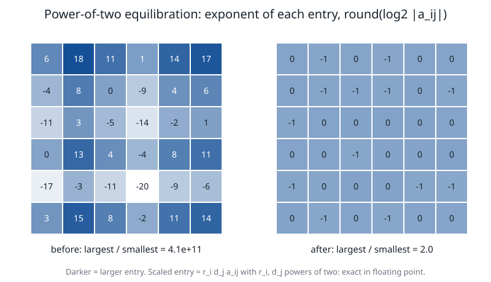

# Numerical stability: scaling, stopping tests, regularization

**Verified against** revision `1f2ddee` (`scaling.c`, `ipm.c`, `sdp.c`, `linalg.c`, `primal_optimize.c`) plus the
presolve correction `2c48c87`. The numbers below were produced by programs linked with the routines they quote.

## Learning objectives and prerequisites

After this chapter you can:

- explain why PRIMAL scales rows and columns by powers of two and show that the scaling is *exact* in floating point;
- run the four passes of `scale_equilibrate` on a small matrix by hand and unscale primal and dual solutions;
- state the three relative stopping measures, with the exact normalizers each engine uses, and the near-optimal acceptance rule;
- name the regularizations and the places where a reduced solve is checked against the original equations;
- say which numerical safeguards apply to which route.

Prerequisites: [interior point](interior-point.md) (residuals, the Newton system), [linear algebra](linear_algebra.md) (factorizations, Schur
complement), [SDP](semidefinite_programming.md) (the augmented KKT matrix).

## Why scale

An interior-point or simplex method sees the model through products with $A$ and solves with matrices built from it. If the entries of $A$ span many
orders of magnitude, absolute tolerances mean different things on different rows, pivot choices follow the units instead of the structure and
the Newton matrices are ill-conditioned for reasons that a change of units removes. A diagonal change of variables and rows

$$
A'=RAD,\quad b'=Rb,\quad c'=Dc,\quad x=Dx',\quad y=Ry',\quad Q'=DQD
$$

leaves the problem the same and the solution recoverable. The question is which $R$ and $D$.

## Equilibration with powers of two

[`scale_equilibrate`](../scaling.c#L73) performs **four passes**; each pass is a row step and a column step:

```text
SCALE-EQUILIBRATE(A, bounds, c, Q)                      # scaling.c, run before the standard form is built
 1  r <- 1,  d <- 1
 2  repeat 4 times:
 3      for each row i with entries:   f <- pow2( 1 / sqrt(mean_j a_ij^2) )      # rms over the stored entries
 4          if f != 1:  r_i <- r_i f;  row i of A and its bounds lc_i, uc_i  <- times f
 5      for each column j with entries:  f <- pow2( 1 / sqrt(mean_i a_ij^2) )     # rms of the CURRENT column
 6          if f != 1:  d_j <- d_j f;  column j of A and c_j  <- times f;  lx_j, ux_j  <- divided by f;
 7                      if Q present:  row j and column j of Q  <- times f
 8  return r, d                                           # pow2(x) = 2^round(log2 x), exponent clamped to [-24, 24]
```

The factor applied to an entry in a pass is the factor *of that pass*, not the accumulated $r_i$ (applying the accumulated factor once per pass
multiplies everything by $f_1f_2f_3f_4$, a different model). The cost is $O(\text{nnz}+n)$ per pass: one sweep of the column-wise store accumulates
the row sums of squares, one applies the factors. The objective is scaled by $d$ only (no row factor enters $c$), and $x_{\rm orig}=Dx'$,
$y_{\rm orig}=Ry'$.

**Why powers of two.** A factor $2^k$ changes only the exponent of an IEEE 754 double: $a=m\cdot2^e\Rightarrow a\cdot2^k=m\cdot2^{e+k}$ with the
same significand, so the scaling adds no rounding error (barring overflow or underflow, which the clamp $[2^{-24},2^{24}]$ prevents). An
arbitrary factor such as $1/\text{rms}$ is harmless in exact arithmetic and a perturbation in floating point. The route is on by default for LP and QP
(`PRIMAL_IPAR_SCALING`, [`primal.h`](../primal.h#L240)); in `PRIMAL_optimize` it runs after the redundant-row and bound-tightening steps and before the
standard form is built ([architecture](architecture.md)). It is a relative of the geometric scaling of Curtis and Reid and of Ruiz's equilibration, with
the rms in place of the maximum and the rounding to a power of two.

**Worked example.** $A=\begin{pmatrix}10^4&1\\1&10^{-3}\end{pmatrix}$ (entry ratio $10^7$). First row: $\text{rms}=\sqrt{(10^8+1)/2}=7071.07$,
$1/\text{rms}=1.414\cdot10^{-4}$, $\log_2=-12.79$, rounded to $-13$: the factor is $2^{-13}=1.2207\cdot10^{-4}$. After four passes
`scale_equilibrate` returns $r=(2^{-13},1)$ and $d=(1,2^{10})$, and

$$
A'=\begin{pmatrix}1.2207&0.125\\1&1.024\end{pmatrix},\qquad b'=Rb,\quad c'=(1,1024),
$$

with ratio of the largest to the smallest entry $9.77$ instead of $10^7$. The program checks that every scaled entry equals $r_id_ja_{ij}$ **exactly**
(bitwise equal doubles). Solving $\min x_1+x_2$ s.t. $10^4x_1+x_2=10001$, $x_1+10^{-3}x_2=1.001$ with `PRIMAL_optimize` gives $x=(1,1)$, objective 2 and
multipliers $(0.111,-1111)$ with scaling on and off, identical to nine digits: the exact solution of $A^\top y=c$ is $y=(-\tfrac19,1111)$ (public sign opposite).



*Figure: the binary exponent of every entry of a $6\times6$ matrix before and after `scale_equilibrate`. The matrix has the structure
$a_{ij}\approx2^{e_i+f_j}$ with random significands, so a diagonal scaling removes the spread: the exponents of the entries go from $-20$ to $18$
(largest over smallest $4.1\cdot10^{11}$) to $-1$ or $0$ (ratio $2.0$). The generator checks that every scaled entry is exactly $r_id_ja_{ij}$ and that each
factor is a power of two. Real matrices are not always so well behaved: scaling reduces the spread that a diagonal change of units can remove.
Computed by [`figures/make_figures.c`](figures/make_figures.c) at `1f2ddee`.*

## Stopping tests

Each engine measures the three relative quantities on the **scaled** model and compares them with the user's tolerances (default $10^{-8}$):

| engine | primal | dual | gap |
|---|---|---|---|
| dense and sparse LP/QP ([`ipm.c:410`](../ipm.c#L410)) | $\dfrac{\|Ax-b\|_\infty}{\max(1,\|b\|_\infty)}$ | $\dfrac{\|c+Qx-A^\top y-z\|_\infty}{\max(1,\|c\|_\infty,\|Q\|_\infty)}$ | $\dfrac{x^\top z}{1+|p|}$ |
| conic and SDP ([`ipm_quality`](../sdp.c#L568)) | $\dfrac{\|r_p\|_\infty}{1+\|b\|_\infty}$ | $\dfrac{\|r_d\|_\infty}{1+\|c\|_\infty}$ | $\dfrac{|p-d|}{1+|p|+|d|}$ |

with $p$ and $d$ the primal and dual objectives. The conic gap is computed from the two objectives, not from $\mu$, which closes the loop on the identity
$p-d=\langle x,s\rangle$ instead of assuming it. The LP engine also exits early when an objective cut proves the optimum lies beyond a bound set by the caller (a
branch-and-bound pruning device).

**Near-optimal acceptance.** On the conic and SDP route an iterate that misses the tolerances but meets them multiplied by `INTPNT_TOL_NEAR_REL` (default 1000) is
saved as a candidate; where no alternative route exists it is returned as the answer, otherwise the alternative runs first
([SDP](semidefinite_programming.md#the-fixed-diagonal-certificate-no-iteration) for where this fires). Rel_pri says nothing about the cones: a point outside a cone can have
rel_pri $=0$; membership is enforced by the step lengths and re-measured at the end (`ipm_cone_slacks`; the signed cone slacks of the published point).

## Augmented system equilibration and refinement (conic and SDP)

The conic KKT matrix mixes blocks whose size differs by $1/\mu$: the multiplier block $A\,\mathrm{diag}(x/s)A^\top$ is $O(1/(\sigma\mu))$, a cone row carries a Hessian
scaling $O(1/(\sigma\mu))$ while an arrow block is $O(1)$, and the coupling columns are the raw entries of $A$ — a spread that, as the comment in
[`sdp.c`](../sdp.c#L2502) records, reaches $10^{11}$ at $\mu\approx10^{-8}$. Before the dense LU every row and then every column is divided by its largest
modulus (**Jacobi equilibration**, arbitrary factors, not powers of two), applied when the model has an exponential/power or a PSD block; the SOC-only
path is validated as it stands. The comment records that on the exp/power cases it buys about two orders on the polish residuals.

**Iterative refinement**, at most three rounds, polish only: the LU is backward stable but its *solution* carries $\operatorname{cond}\cdot\varepsilon$, and deep on the central path
that limits progress. Each round solves $K\,\delta=r-K\hat v$ with the same factorization (compensated substitutions on the PSD/SOC path) and a round is **kept only if it
reduces the residual**; otherwise it is undone and refinement stops. Far from the path the exactly solved direction is more aggressive than the ratio test can use, so refinement is
not applied there. (There is no Wilkinson-type stopping rule in the code: the test is the observed decrease.)

## Regularization and where reduced solves are checked

- **Dense LP/QP**: the augmented or normal system is factored with a diagonal shift $\delta=10^{-8}$; if the factorization fails $\delta$ is multiplied by 100, up to
  five tries, then the iteration stops with `IPM_SINGULAR` ([`ipm.c:438`](../ipm.c#L438)).
- **Sparse LP**: the normal equations use $\delta=10^{-6}$ (primal and dual regularizers $\delta(1+\max x)$, $\delta(1+\max z)$), multiplied by 100 on failure up to $10^4$
  ([`ipm.c:1027`](../ipm.c#L1027)); the result is checked against the *unreduced* equations to $10^{-9}$ and refactored without the elimination if it fails
  ([interior point](interior-point.md)).
- **Dense LU**: `dmat_lu_factor` returns `NULL` only for an exactly zero pivot (below $10^{-300}$); near-singularity is the caller's business
  ([linear algebra](linear_algebra.md)). There is no $10^{-14}$ relative pivot floor.
- **SOCP**: a normal-equations matrix that fails Cholesky is repaired by the failing pivot (`spchol_factor_fail`), with shifts bounded by $10^{-4}\max|H|$ and
  per-iteration fallback to the sparse LU ([SOCP](conic-socp.md)).
- **SDP**: the primal-step check and the augmented rescue of [SDP](semidefinite_programming.md#recovery-near-a-singular-face).

A regularization changes the equations, so the residuals that decide acceptance are always measured on the *intended* system, not the shifted one.

## Costs, conditioning and failure modes

- Scaling costs $O(\text{nnz})$ and is exact; it cannot fix a model whose conditioning is intrinsic, and it is not a substitute for presolve
  ([presolve](presolve.md)). A scaled solution is unscaled exactly ($x=Dx'$, $y=Ry'$), so the user's tolerances are judged on the scaled model by a deliberate approximation:
  a bound violation of $10^{-8}$ in scaled units is $10^{-8}d_j$ in user units.
- The squared condition number of the normal equations and the $1/\mu$ growth of the multiplier block are the two reasons for the safeguards above; both worsen as the iterate approaches
  a degenerate face.
- A non-converged solve is never an infeasibility claim ([certificates](certificates.md)).

## Exercise

Compute the first-pass row factor of the first row $(10^4,1)$ of the example and say what the program returned for $r_1$ after four passes.

*Answer.* The rms is $\sqrt{(10^8+1)/2}=7071.07$, so $1/\text{rms}=1.4142\cdot10^{-4}$ and $\log_2=-12.79$; rounding to the nearest integer gives the
exponent $-13$ and the factor $2^{-13}=1.2207\cdot10^{-4}$. The program returns $r_1=2^{-13}$ after the four passes, so the later passes left this row
alone. The scaled right-hand side is $b_1\cdot2^{-13}=1.2207$, the entry printed for $b'$ above.

## References

- A. R. Curtis and J. K. Reid, [On the automatic scaling of matrices for Gaussian elimination](https://doi.org/10.1093/imamat/10.1.118), *IMA Journal of Applied Mathematics* 10(1):118–124, 1972.
- D. Ruiz, *A scaling algorithm to equilibrate both rows and columns norms in matrices*, Technical Report RAL-TR-2001-034, Rutherford Appleton Laboratory, 2001.
- N. J. Higham, [*Accuracy and Stability of Numerical Algorithms*](https://doi.org/10.1137/1.9780898718027), 2nd ed., SIAM, 2002.
- S. J. Wright, *Primal-Dual Interior-Point Methods*, SIAM, 1997.
