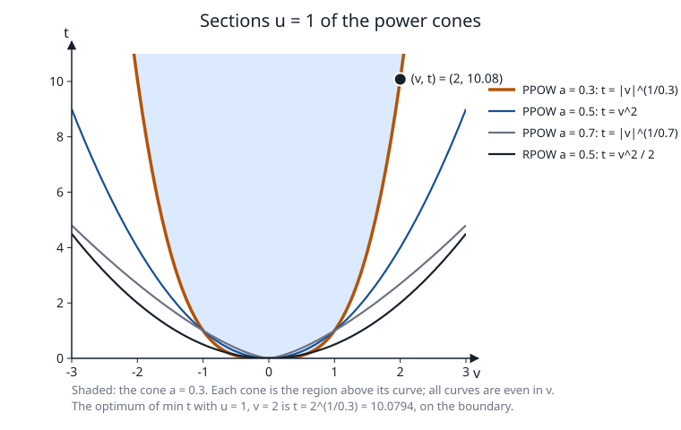

# The power cone and the rotated power cone

**Verified against** revision `1f2ddee` (`expcone.c`, `expcone.h`, `sdp.c`,
`primal_sdptask.c`). Numbers below were produced by programs linked with the
functions they quote.

## Learning objectives and prerequisites

After this chapter you can:

- state the power cone `PPOW` and the rotated power cone `RPOW`, their duals, and see that
  `RPOW` with exponent $\tfrac12$ is the rotated second-order cone;
- write the 3-self-concordant barrier $f=-\ln D-(1-\alpha)\ln t-\alpha\ln u$, its gradient and Hessian;
- derive the scalar equation in $\xi$ that gives the scaling point of a dual vector and check it numerically;
- say what PRIMAL shares with the exponential cone (the Newton row, the routes) and what differs.

Prerequisites: [the exponential cone](exponential_cone.md) (the Newton row, scaling point, routes),
[second-order cones](conic-socp.md).

## Definition

For an exponent $\alpha\in(0,1)$ the cones act on three members $(t,u,v)$
([`primal.h`](../primal.h#L190), [`expcone.h`](../expcone.h)):

$$
\texttt{PPOW}:\ t^{\alpha}u^{1-\alpha}\ge|v|,\ t,u\ge0;\qquad
\texttt{RPOW}:\ \sqrt2\,t^{\alpha}u^{1-\alpha}\ge|v|,\ t,u\ge0 .
$$

The interior is $D:=\text{rot}\cdot t^{2\alpha}u^{2(1-\alpha)}-v^2>0$, $t,u>0$ with $\text{rot}=1$
for `PPOW` and $2$ for `RPOW`. For $\alpha=\tfrac12$, `RPOW` reads $2tu\ge v^2$: the rotated second-order cone
(`RQUAD`). The generator of the figure below tests this equivalence on 50 points with `expcone_barrier`.

*Figure: the sections at $u=1$ of `PPOW` for $\alpha=0.3,0.5,0.7$ and of `RPOW` for $\alpha=\tfrac12$ (curves
$t=|v|^{1/\alpha}$ and $t=v^2/2$); each cone is the region above its curve and the shaded one is $\alpha=0.3$. The black point
is the optimum $t=2^{1/0.3}=10.0794$ of the example below. Analytic figure by
[`figures/make_figures.c`](figures/make_figures.c) at `1f2ddee`, which tests points on both sides of every curve with
`expcone_barrier` and checks the optimum against `PRIMAL_optimize`.*

## Barrier, gradient and Hessian

The barrier of [`ppow_core`](../expcone.c#L61) is

$$
f=-\ln D-(1-\alpha)\ln t-\alpha\ln u,\qquad \nu=2+(1-\alpha)+\alpha=3,
$$

since $D$ is homogeneous of degree 2. With $p=t^{2\alpha}u^{2(1-\alpha)}$:

$$
D_t=\text{rot}\,\frac{2\alpha p}{t},\quad D_u=\text{rot}\,\frac{2(1-\alpha)p}{u},\quad D_v=-2v,
$$

$$
g=\Bigl(-\tfrac{D_t}{D}-\tfrac{1-\alpha}{t},\ -\tfrac{D_u}{D}-\tfrac{\alpha}{u},\ \tfrac{2v}{D}\Bigr),\qquad
H=\frac{\nabla D\nabla D^\top}{D^2}-\frac{\nabla^2D}{D}+\operatorname{diag}\!\Bigl(\tfrac{1-\alpha}{t^2},\tfrac{\alpha}{u^2},0\Bigr),
$$

where $\nabla^2D$ has the entries $D_{tt}=\text{rot}\,2\alpha(2\alpha-1)p/t^2$, $D_{tu}=\text{rot}\,4\alpha(1-\alpha)p/(tu)$,
$D_{uu}=\text{rot}\,2(1-\alpha)(1-2\alpha)p/u^2$, $D_{vv}=-2$ and zeros elsewhere.

**Numbers.** At $z=(2,1,\tfrac12)$ with $\alpha=0.3$: $p=2^{0.6}=1.5157166$. For `PPOW`, $D=1.2657166$,
$f=-0.7208414$, $g=(-0.7092550,-1.9765232,0.7900663)$ and $\langle g,z\rangle=-3.0000000000$. For `RPOW`,
$D=2.7814331$, $f=-1.5081693$, $g=(-0.6769645,-1.8258344,0.3595269)$ and $\langle g,z\rangle=-3.0000000000$.
The identity $\langle g,z\rangle=-\nu$ holds for both, as for every logarithmically homogeneous barrier.

## Dual cone and scaling point

The dual of `PPOW` is again a power cone, in the scaled coordinates $s_0/\alpha$, $s_1/(1-\alpha)$:

$$
\mathcal K_\alpha^*=\Bigl\{s:\ \bigl(\tfrac{s_0}{\alpha}\bigr)^{\alpha}\bigl(\tfrac{s_1}{1-\alpha}\bigr)^{1-\alpha}\ge\gamma|s_2|,\ s_0,s_1\ge0\Bigr\},
$$

with $\gamma=1$ for `PPOW` and $\gamma=\sqrt2$ for `RPOW` ([`expcone_dual_in`](../expcone.c#L238), which divides $s$ by
$\|s\|_1$ first). The factor $\sqrt2$ is the scaling of the third coordinate: `RPOW` is `PPOW` in $(t,u,v/\sqrt2)$, and the pairing
$s_2v=\sqrt2s_2\cdot(v/\sqrt2)$.

**Scaling point.** For $s\in\operatorname{int}\mathcal K^*$ find $W\in\operatorname{int}\mathcal K$ with $-\nabla f(W)=s$.
Put $\xi=\text{rot}\,p/D>1$ ($D=\text{rot}\,p-v^2$, so $\xi>1$ whenever $v\ne0$). The first two rows give
$s_0=(2\alpha\xi+1-\alpha)/t$ and $s_1=(2(1-\alpha)\xi+\alpha)/u$, the third $v=-\tfrac12s_2D$. Hence

$$
t_w(\xi)=\frac{2\alpha\xi+1-\alpha}{s_0},\qquad u_w(\xi)=\frac{2(1-\alpha)\xi+\alpha}{s_1}.
$$

The relation $D=\text{rot}\,p-v^2$ with $v=-\tfrac12s_2D$ and $\text{rot}\,p=\xi D$ gives
$1=\xi-\tfrac14s_2^2D$, i.e. $D=4(\xi-1)/s_2^2$ and therefore

$$
\boxed{\ \text{rot}\;t_w(\xi)^{2\alpha}u_w(\xi)^{2(1-\alpha)}=\frac{4\xi(\xi-1)}{s_2^2}\ }\qquad(\xi>1).
$$

`pow_gap(`$\xi$`)` ([`expcone.c:204`](../expcone.c#L204)) is the logarithm of the ratio of the two sides; it is $+\infty$ at $\xi\to1^+$ and
decreases through zero. [`expcone_dual_point`](../expcone.c#L274) brackets the root (doubling $\xi$ from 2 if needed) and bisects
geometrically ($\sqrt{\text{lo}\cdot\text{hi}}$, 200 times), then sets $W=(t_w,u_w,-\tfrac12s_2D)$ with $D=\text{rot}\,p/\xi$, and finally evaluates
$\nabla f(W)+s$: the point is accepted only if that residual is below $10^{-6}(1+\|s\|_1)$.

**Check.** For $z=(2,1,\tfrac12)$ and $s=-g(z)$, `expcone_dual_point` returns $W=(2,1,0.5)=z$ to ten digits for both cones, with
$\xi=1.1975166$ (`PPOW`) and $1.0898817$ (`RPOW`), and the boxed identity holds: $p=1.5157166$ on the left and $4\xi(\xi-1)/(\text{rot}\,s_2^2)=1.5157166$
on the right in both cases.

## Newton row, routes and what differs from the exponential cone

The Newton row $\Theta_{\rm in}\Delta z+\Delta s/\text{scale}=r_t$, the scale $\langle z,s\rangle/3$ and the Hessian-NT chain are the same as for the exponential
cone ([exponential cone](exponential_cone.md#the-newton-row-of-a-cone-block)); `expcone_scaling` serves the three kinds. The differences:

- the chain is used when $s/\text{scale}\in\operatorname{int}\mathcal K^*$ and $W$ exists; otherwise the row is the barrier Hessian $H_z$
  (at a tight optimum $s$ is on the boundary of $\mathcal K^*$ and no $W$ exists). A conditioning gate on the chain was measured and removed: the
  comment in `expcone_scaling` records that at every finite threshold the oracles $\text{PEXP}(u=1,v=1)$, $\text{PEXP}(u=2,v=1)$ and
  $\text{PPOW}(0.3)$ fell back to the tangent cuts, while the chain never answered a case worse than $H_z$ did;
- the secant (Dahl–Andersen) scaling of the retry mode is built from the same barriers for `PEXP`, `PPOW` and `RPOW` alike;
- the higher-order correction of [`expcone_corrector.c`](../expcone_corrector.c) exists for `PEXP` only, and a model with power cones only
  uses the plain engine ([`primal_sdptask.c:568`](../primal_sdptask.c#L568));
- the routes are those of the exponential cone: native `sdp_ipm_run`, secant retry, then [tangent cuts](tangent-cuts.md).

## Worked example, solved

$$
\min t\quad\text{s.t.}\quad u=1,\ v=2,\ (t,u,v)\in\texttt{PPOW}(0.3).
$$

The cone requires $t^{0.3}\ge2$, so $t^\star=2^{1/0.3}=2^{10/3}=10.0793684$ with $(t,u,v)=(t^\star,1,2)$ on the boundary
(this instance is the third case of test `T79`, which also covers `PEXP` and `RPOW`).

*Optimality by substitution.* With rows $u=1$ (multiplier $y_1$) and $v=2$ ($y_2$) the dual slack is $s=c-A^\top y=(1,-y_1,-y_2)$ and must be in
$\mathcal K^*$ and complementary to $z$. On the boundary the dual vector is the inward normal of $\varphi=t^\alpha u^{1-\alpha}-v$ at $z$,
scaled to $s_0=1$: $s=(1,\ \tfrac{1-\alpha}{\alpha}t^\star,\ -\tfrac1\alpha t^{\star\,1-\alpha})$. With $t^{\star\,-\alpha}=\tfrac12$ this is
$s=(1,\ \tfrac73t^\star,\ -\tfrac53t^\star)=(1,\,23.51853,\,-16.79895)$, so $y=(-\tfrac73t^\star,\ \tfrac53t^\star)$.
Membership: $(1/0.3)^{0.3}\bigl(s_1/0.7\bigr)^{0.7}=1.4349\cdot11.70=16.799=|s_2|$ (on the boundary, as complementarity requires).
Complementarity: $\langle z,s\rangle=t^\star+\tfrac73t^\star-2\cdot\tfrac53t^\star=0$. The dual value is
$b^\top y=1\cdot(-\tfrac73t^\star)+2\cdot\tfrac53t^\star=t^\star$, equal to the primal value.

*PRIMAL.* `PRIMAL_optimize` takes the native route and returns $x=(10.0793684033,\ 1,\ 2)$, primal objective $10.079368403298$ and dual $10.079368396928$ against the exact
$10.079368399159$ (error $4\cdot10^{-9}$), and multipliers $y=(23.51854,\ -16.79895)$ — the public sign is the opposite of the $y$ above,
agreeing with $(\tfrac73t^\star,-\tfrac53t^\star)=(23.51853,-16.79895)$ to six digits. It needs 40 iterations: again an optimum on the boundary, with
$\mu$ not monotone near the end (it=37..39) and rel_pri $2.9\cdot10^{-8}$ at the last iterate before the final polish brings the three measures to
$1.7\cdot10^{-13}$, $2.7\cdot10^{-12}$, $3.0\cdot10^{-10}$.

## Costs and failure modes

- **Per iteration**: the $3\times3$ evaluations of the exponential cone plus the scalar bisection for $W$ (200 evaluations of `pow_gap`); the KKT
  factorization dominates ([SDP](semidefinite_programming.md)).
- **Boundary optima** are slow, as in the example, because $H_z$ blows up and the dual direction leaves $\operatorname{int}\mathcal K^*$.
- **Parameter range.** $\alpha$ must be strictly in $(0,1)$; the barrier, the membership tests and the scaling point reject anything else.
- **Not solved is not infeasible**: failures go to the secant retry and the cuts, never to an infeasibility claim without a measured
  certificate ([certificates](certificates.md)).
- `RPOW` with $\alpha=\tfrac12$ is also available as `RQUAD`; the SOC route (arrow KKT, barrier parameter 2) is the right one for it, not the $\nu=3$ power barrier.

## Exercise

Show that for $\alpha=\tfrac12$ the rotated power cone has the barrier $-\ln(2tu-v^2)-\tfrac12\ln t-\tfrac12\ln u$ with parameter $3$, while
the rotated second-order cone $2tu\ge v^2$ has the barrier $-\ln(2tu-v^2)$ with parameter $2$. Why does PRIMAL keep `RQUAD` on the SOC route?

*Answer.* With $\alpha=\tfrac12$, $\text{rot}=2$: $D=2\,t\,u-v^2$ and $-(1-\alpha)\ln t-\alpha\ln u=-\tfrac12\ln t-\tfrac12\ln u$; the parameter is
$2+\tfrac12+\tfrac12=3$ by the formula above. The function $-\ln(2tu-v^2)$ is homogeneous of degree 2 and is the standard barrier of the rotated Lorentz cone
(a Lorentz cone after the rotation $(t,u)\mapsto((t+u)/\sqrt2,(t-u)/\sqrt2)$), with parameter 2. A larger parameter means more iterations in theory, and the
symmetric cone keeps its direction usable at the boundary through the arrow-matrix KKT, where the NT scaling point diverges; see
[SOCP](conic-socp.md).

## References

- R. Chares, *Cones and interior-point algorithms for structured convex optimization involving powers and exponentials*, Ph.D. thesis, Université catholique de Louvain, 2009.
- Yu. Nesterov, [Towards non-symmetric conic optimization](https://doi.org/10.1080/10556788.2011.567270), *Optimization Methods and Software* 27(4–5):893–917, 2012.
- J. Dahl and E. D. Andersen, [A primal-dual interior-point algorithm for nonsymmetric exponential-cone optimization](https://doi.org/10.1007/s10107-021-01631-4), *Mathematical Programming* 194:341–370, 2022.
- A. Skajaa and Y. Ye, [A homogeneous interior-point algorithm for nonsymmetric convex conic optimization](https://doi.org/10.1007/s10107-014-0773-1), *Mathematical Programming* 150:391–422, 2015.
