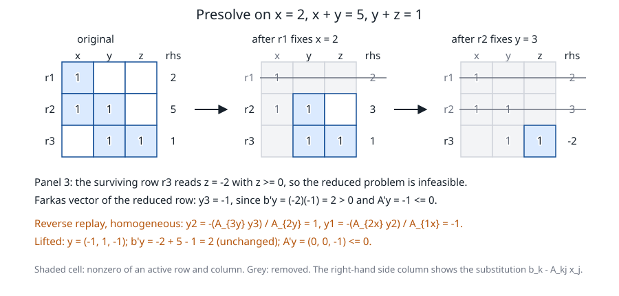

# Presolve

**Verified against** revision `1f2ddee` (`presolve.c`, `presolve.h`,
`primal_optimize.c`, `primal_verdict.c`, `stdform.c`) plus the correction of
[negative reduced right-hand sides](#right-hand-sides-that-become-negative), committed as
`2c48c87`.

## Learning objectives and prerequisites

After this chapter you can:

- name the four reductions PRIMAL applies before a solve, say where each one
  runs and which switch turns it off;
- derive the singleton elimination, its reverse (dual) recovery and the
  *homogeneous* lift that carries a Farkas vector back to the original rows;
- run both by hand on a small LP and check them by substitution;
- state the conditions under which a reduction is *not* applied, and what happens to a
  surviving row whose reduced right-hand side is negative.

Prerequisites: [problem formulations](problem_formulations.md) (standard form),
[LP duality](mathematical_foundations.md), and the idea of a certificate of
infeasibility ([certificates](certificates.md)).

## Four layers

"Presolve" in PRIMAL is not one routine. A model meets up to four reductions,
in this order (`opt_routes`, `primal_optimize.c`):

| Layer | Function | Applies to | Operates on | Off with |
|---|---|---|---|---|
| Redundant rows | `row_redundant` | LP, QP | the original rows | `GMB_NO_PRESOLVE_ROWS` |
| Bound tightening | `bound_tighten` | LP, QP, MIP root | the original variable bounds | `GMB_NO_BOUND_TIGHTEN` |
| LP presolve | `lp_presolve` | LP only (no quadratic objective) | the standard form $Ax=b$, $x\ge0$ | `PRIMAL_IPAR_PRESOLVE = 0` or `PRIMAL_IPAR_PRESOLVE_LEVEL = 0` |
| Conic presolve | `conic_presolve_apply` | models with cones | the original rows | `PRIMAL_IPAR_PRESOLVE = 0`, `GMB_NO_PRESOLVE_ROWS` |

`PRIMAL_IPAR_PRESOLVE` defaults to 1 and `PRIMAL_IPAR_PRESOLVE_LEVEL` to 1
(0 off, 1 empty rows, empty columns and singleton rows, 2 also duplicate rows and
columns). All reductions are exact: the reduced problem has the same optimal
value, and the original primal and dual solutions are recovered from the
reduced ones.

### Redundant rows and bound tightening

For a row $l\le a^\top x\le u$ with variable bounds $l_x\le x\le u_x$, the activity
$a^\top x$ lies between $t_{\min}=\sum_{a_j>0}a_jl_{x,j}+\sum_{a_j<0}a_ju_{x,j}$ and
$t_{\max}$ (the same sum with the bounds swapped).

- **Redundant row.** If $t_{\max}\le u$ (within $10^{-9}$ relative) the upper side
  can never bind, so it is removed (set to $+\infty$); the same for the lower side with
  $t_{\min}\ge l$. A removed row has dual 0, so removing it is *dual safe*:
  the KKT conditions of the original model still hold.
- **Bound tightening.** For each $a_{ij}\ne0$ let $s_{\min}$, $s_{\max}$ be the extreme
  activity of the other terms. Then $a_{ij}x_j\le u_i-s_{\min}$ and
  $a_{ij}x_j\ge l_i-s_{\max}$ give implied bounds on $x_j$ (infinite terms are
  counted, not summed, so a free variable does not spoil the bound of the others and can
  itself receive one). Only the *local* arrays are tightened; the model the user sees
  does not change. For every tightened bound PRIMAL records the row and coefficient that
  implied it, and if that bound is active at the solution the bound multiplier is moved
  onto the row (`ymin[i] += z/a_ij`), so the published duals are those of the original
  model.

Both skip equality rows (tightening one "moves the infeasibility from the constraint to
the bound and the Farkas vector, which lives on the rows, no longer measures") and rows
with quadratic or PSD terms. For integer variables an opt-in switch,
`GMB_MIP_IMPLIED_BOUND`, rounds the implied bound.

These two layers also change the *shape* of the problem the engines see: tightened
bounds become `VARUB` rows of the standard form, which is why the LP of the
[simplex chapter](simplex.md) has 4 rows instead of 2.

### Conic presolve

For a model with cones, the rows that `row_redundant` finds are hidden for the
duration of the conic solve (their key is set to free) and restored afterwards, so
`getconbound` still returns the user's rows. This is the same dual-safe removal, not
bound tightening.

## LP presolve on the standard form

`lp_presolve` works on $\min c^\top x$, $Ax=b$, $x\ge0$ with $A$ in compressed columns,
repeating sweeps until nothing changes (level $\ge1$):

```text
LP-PRESOLVE(A, b, c, tol, level)
 1  repeat
 2      for each live row i:
 3          if i has no live entry and |b_i| <= tol:      drop i                       # empty row, y_i = 0
 4          elif i has one live entry A_ij, |A_ij| >= 1e-12 and b_i / A_ij >= -tol:
 5               x_j <- max(0, b_i / A_ij);  b_k <- b_k - A_kj x_j for every live row k
 6               drop row i and column j; log (i, j, A_ij, c_j, rows k, A_kj)    # singleton row
 7      for each live column j with no live entry and c_j >= -tol:
 8          x_j <- 0; drop j                                                    # empty column
 9      if level >= 2:
10          drop a row proportional to an earlier row with a consistent right-hand side   # y = 0
11          of two columns with the same pattern and values, drop the dearer one (x = 0)
12  until a sweep changes nothing
```

A case that does not meet these conditions is **left to the solver**: $b_i\ne0$ in an
empty row, a singleton value below $-\text{tol}$, a column with $c_j<-\text{tol}$ and no
rows (which would be unbounded), or a pivot below $10^{-12}$. Presolve is not allowed to
declare infeasibility or unboundedness on a doubtful case. The tolerance `tol` is
$10^{-9}$ in `opt_routes`.

### Singleton elimination and the primal postsolve

If row $i$ is $a_{ij}x_j=b_i$ then $x_j=b_i/a_{ij}$ is forced. Substitute it everywhere:
every other row $k$ touching column $j$ gets $b_k\leftarrow b_k-A_{kj}x_j$, and the
term $c_jx_j$ becomes a constant of the objective (the objective value is recomputed from
the original model afterwards). Row $i$ and column $j$ disappear. The
postsolve puts $x_j$ back: kept columns take the value of the reduced solution,
removed columns their recorded value (the forced value, or 0 for an empty or duplicate
column).

### The dual recovery

Row $i$ is an equality, so its multiplier $y_i$ is free, and it is chosen so that column
$j$ has reduced cost zero, $z_j=0$ (this satisfies $z_j\ge0$ and $x_jz_j=0$). Stationarity
of column $j$ reads $c_j-\sum_kA_{kj}y_k-z_j=0$, that is

$$
y_i=\frac{c_j-\sum_{k\ne i}A_{kj}y_k}{A_{ij}} ,
$$

where the sum runs over the rows $k$ that were still alive when row $i$ was reduced.
Replaying the log in *reverse* makes all those $y_k$ available. A dropped empty or
duplicate row gets $y=0$.

### The homogeneous lift

A Farkas vector is not a solution: there is no objective in it. Lifting it with the
formula above would pull in the term $c_j$, which a witness must not inherit. The
**homogeneous** lift drops it:

$$
y_i=-\frac{\sum_{k\ne i}A_{kj}y_k}{A_{ij}} .
$$

Because the reduced right-hand side is $b_k-A_{kj}x_j$, this value pays back exactly
$y_ib_i$, so $b^\top y$ is the same before and after: if $b^\top y>0$ and $A^\top y\le0$
hold on the reduced system, they hold on the original. The lift has to *name the
removed rows*, otherwise the certificate does not describe the user's model.

## Worked example 1: elimination

Minimize $x+3y$ subject to $2x=4$, $x+y=5$, $x,y\ge0$.

1. Row 1 is a singleton: $x=4/2=2$. Row 2 becomes $y=5-2=3$.
2. Row 2 is now a singleton: $y=3$. Nothing remains: $m=n=0$, which `opt_routes` reads
   as "all fixed: optimal" (a reduced problem with rows left and no columns is read as
   infeasible; one with columns and no rows, as unbounded).
3. **Reverse replay.** Row 2 (column $y$): $y_2=(c_y-0)/A_{2y}=3/1=3$. Row 1 (column $x$,
   with row 2 alive at the time): $y_1=(c_x-A_{2x}y_2)/A_{1x}=(1-1\cdot3)/2=-1$.

**Check.** $A^\top y=(2\cdot(-1)+1\cdot3,\ 1\cdot3)=(1,3)=c$ and
$b^\top y=4(-1)+5\cdot3=11$, equal to the objective $2+3\cdot3=11$. `lp_presolve`
returns exactly this: reduced size $0\times0$, $x=(2,3)$, $y=(-1,3)$.

## Worked example 2: lifting a Farkas vector

Take $x=2$, $x+y=5$, $y+z=1$, all variables $\ge0$. It is infeasible: the first two rows
force $y=3$, but $y+z=1$ with $z\ge0$ gives $y\le1$.

Rows 1 and 2 reduce as above ($x=2$, then $y=3$). Row 3 becomes $z=1-3=-2$, whose forced
value is below $-\text{tol}$, so it **stays**: the reduced problem is the single row
$z=-2$, $z\ge0$ (stored as $-z=2$, see below). A Farkas vector of that row is $y_3=-1$:
$b^\top y=(-2)(-1)=2>0$ and $A^\top y=-1\le0$. Now replay in reverse **without the objective**:

$$
y_2=-\frac{A_{3y}y_3}{A_{2y}}=-\frac{1\cdot(-1)}{1}=1,\qquad
y_1=-\frac{A_{2x}y_2}{A_{1x}}=-\frac{1\cdot1}{1}=-1 .
$$

**Check on the original model.** $y=(-1,1,-1)$ gives $b^\top y=-2+5-1=2>0$, the same as
on the reduced row, and $A^\top y=(y_1+y_2,\ y_2+y_3,\ y_3)=(0,0,-1)\le0$. So $y$ is a
Farkas vector of the original system. `presolve_postsolve_dir` returns exactly
$(-1,1,-1)$ from $y_{\rm red}=-1$.



*Figure: the constraint matrix of example 2 in three states. A shaded cell is a
nonzero of an active row and column, a grey cell is removed. The first singleton row
fixes $x$, the second fixes $y$, and the single surviving row $z=-2$ is infeasible.
The right-hand-side column shows $b_k-A_{kj}x_j$ after each substitution; the bottom
lines replay the log in reverse to get the multipliers on the original rows. Computed
by [`figures/make_figures.c`](figures/make_figures.c) at `1f2ddee`, which runs
`lp_presolve` and `presolve_postsolve_dir` and checks the numbers.*

## Level 2: duplicates

Minimize $x+2y$ subject to $x+y=3$, $2x+2y=6$. At level 1 nothing is reduced (no empty
or singleton row, no empty column). At level 2 the second row is proportional to the
first with a consistent right-hand side and is dropped (dual 0), and the two columns have the
same entries, so the dearer one ($y$, cost 2) is dropped with $y=0$. The remaining row is a
singleton, $x=3$. Recovered: $x=(3,0)$, $y=(1,0)$, objective 3, $A^\top y=(1,1)\le c=(1,2)$.
Rows are compared after dividing by their first entry, so proportional rows collide;
columns are compared exactly.

## PRIMAL implementation and limits

`opt_routes` calls `lp_presolve` only for an LP that is not a QP, and skips the warm start
whenever presolve changed the problem. When presolve reduces the problem to nothing it
answers itself: no rows and no columns is optimal; rows left and no columns is
infeasible, with the sign of the first nonzero right-hand side as the Farkas vector;
columns left and no rows is unbounded, with a column of negative cost as the recession
direction. Otherwise the engine solves the reduced problem and `presolve_postsolve` maps
the point and the duals back; if the solve was not optimal, the rays are lifted with
`presolve_postsolve_dir`, and the caller re-measures them in the full space, so a ray that
needs a removed column costs publication, never correctness. `T85` case I checks that a model whose duplicate rows presolve really
reduces is declared infeasible, with a ray that measures, both with and without presolve.

Costs: each sweep is $O(\text{nnz})$; the duplicate tests hash rows and columns and
compare equal hashes exactly. A tiny singleton coefficient can amplify rounding in the
substitution, which is why a pivot below $10^{-12}$ is never used.

Not done: substitution of a variable out of several rows, clique and
dominated-variable detection, probing, objective-bound propagation. Convexity
detection is not part of presolve; a non-convex quadratic row is refused when it is
encoded ([quadratic programming](quadratic_programming.md)).

### Right-hand sides that become negative

Substituting a singleton can leave a surviving row with a **negative** reduced right-hand
side: in example 2 the last row reads $z=-2$. The engines require $b\ge0$, so
`lp_presolve` negates every surviving row with $b<0$ when it builds the reduced problem and
records the sign per row. Both postsolves multiply the reduced multiplier of that row by the
same sign, which is why the lifted vector above is still a Farkas vector of the *original*
rows: the reduced row $-z=2$ has the vector $y=1$ ($b^\top y=2>0$, $A^\top y=-1\le0$), and
the sign turns it into $y_3=-1$. Through `PRIMAL_optimize` example 2 returns
`PRIMAL_RES_ERR_INFEASIBLE`, status `PRIM_INFEAS_CER` and the dual ray $(-1,1,-1)$ at every
presolve level, and a feasible model with a reduced row $-y+z=-2$ gives the same point, objective
and duals with presolve on and off (`T305`). Before this correction, example 2 was answered
`OPTIMAL` with the point $x=(2,3,-2)$ and a feasible model of the same shape could be
answered wrongly (8 of 20 000 random feasible LPs), because the negative right-hand side
reached the engine unchanged.

## Exercise

Run the elimination by hand on: minimize $2x+y$ subject to $x=1$, $x+y=3$, $x,y\ge0$.
Give the primal solution, the multipliers by reverse replay, and check $b^\top y=c^\top x$.

*Answer.* Row 1: $x=1$; row 2 becomes $y=2$, a singleton: $y=2$. Replay: $y_2=(c_y-0)/1=1$;
$y_1=(c_x-A_{2x}y_2)/A_{1x}=(2-1)/1=1$. Check: $A^\top y=(y_1+y_2,\ y_2)=(2,1)=c$ and
$b^\top y=1\cdot1+3\cdot1=4=c^\top x=2+2$.

## References

- S. Boyd and L. Vandenberghe, [*Convex Optimization*](https://web.stanford.edu/~boyd/cvxbook/), Cambridge University Press, 2004, section 4.1.3 (equivalent problems) and chapter 5.
- E. D. Andersen and K. D. Andersen, [Presolving in linear programming](https://doi.org/10.1007/BF01586000), *Mathematical Programming* 71(2):221–245, 1995.
- T. Achterberg, R. E. Bixby, Z. Gu, E. Rothberg and D. Weninger, [Presolve reductions in mixed integer programming](https://doi.org/10.1287/ijoc.2018.0857), *INFORMS Journal on Computing* 32(2):473–506, 2020.
