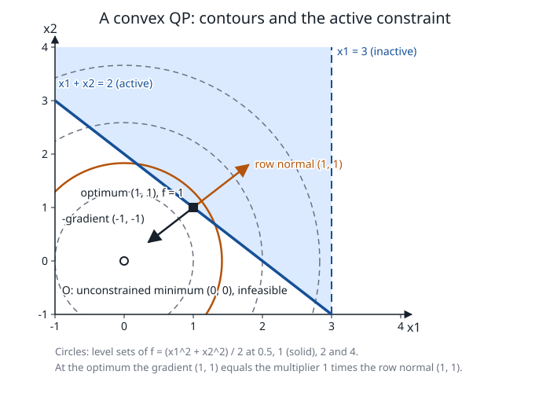

# Quadratic programming

**Verified against** revision `1f2ddee` (`ipm.c`, `primal_std.c`,
`primal_optimize.c`, `primal_quad.c`, `stdform.c`).

## Learning objectives and prerequisites

After this chapter you can:

- state a convex QP, derive its optimality conditions and its Newton system,
  and explain why the Hessian must be positive semidefinite;
- derive the elimination of one private slack per row and reconstruct the
  eliminated components;
- say which of PRIMAL's QP engines runs for a given model and what each costs;
- say how a convex quadratic *constraint* is rewritten, and what PRIMAL does
  with a QP whose Hessian is not convex.

Prerequisites: [interior point for LP](interior-point.md) (this chapter changes
only the linear algebra of that iteration), eigenvalues of symmetric matrices,
[problem formulations](problem_formulations.md).

## The convex QP and its optimality conditions

$$
\min_x\ \tfrac12x^\top Qx+c^\top x\quad\text{s.t.}\quad Ax=b,\ x\ge0,
\qquad Q=Q^\top\succeq0 .
$$

The objective is convex exactly when $Q\succeq0$: its Hessian is $Q$ and a
function is convex iff its Hessian is positive semidefinite everywhere. For a
convex problem the KKT conditions are necessary and sufficient. With multipliers
$y$ for $Ax=b$ and $z\ge0$ for $x\ge0$,

$$
Qx+c-A^\top y-z=0,\qquad Ax=b,\qquad x_jz_j=0,\qquad x,z\ge0 .
$$

If $Q$ is *not* positive semidefinite a KKT point need not be a minimizer. The
last section shows what PRIMAL does with such a model.

## The Newton system

The interior-point iteration of [the LP chapter](interior-point.md) is unchanged
except for the dual residual, $r_d=Qx+c-A^\top y-z$, and the linear system.
Linearizing the first KKT equation and eliminating $\Delta z=X^{-1}(q-Z\Delta x)$
as before gives, with $D=X^{-1}Z$ and $M=Q+D$,

$$
M\,\Delta x-A^\top\Delta y=u,\qquad A\,\Delta x=-r_p,\qquad
u=X^{-1}q-r_d ,
$$

where $q=-x\odot z$ for the predictor and
$q=\sigma\mu\mathbf1-x\odot z-\Delta x_a\odot\Delta z_a$ for the corrector. Then
$\Delta z=Q\Delta x-A^\top\Delta y+r_d$. $M$ is positive definite whenever
$Q\succeq0$ and $x,z>0$.

**What PRIMAL regularizes.** The sparse engine (`ipm_solve_qp_csc`) uses
$D_{jj}=(z_j+d_d)/(x_j+d_p)$ with $d_p=\delta(1+\bar x)$, $d_d=\delta(1+\bar z)$ and
$\delta=10^{-6}$, and replaces the second equation by $A\Delta x+\delta\Delta y=-r_p$.
The dense engine (`ipm_solve_std`) factors the augmented matrix
$\begin{pmatrix}-(Q+D+\delta I)&A^\top\\A&-\delta I\end{pmatrix}$ with
$\delta=10^{-8}$ (raised by a factor of 100 if the factorization fails). The two
engines solve slightly different regularized systems.

**Two ways to solve the sparse system.**

1. *Schur complement.* Factor $M$ by Cholesky, form $W=M^{-1}A^\top$ and
   $K=AW+\delta I$ ($m\times m$), factor $K$, then
   $\Delta y=K^{-1}(-r_p-AM^{-1}u)$ and $\Delta x=M^{-1}u+W\Delta y$.
   If $Q$ has a dense block of at least 32 columns and at most 512
   (at least 80% of its lower triangle nonzero) `qp_chol_dense_block` factors
   that block densely.
2. *Condensing private slacks*, below, when every row has a private slack column.

## Condensing one private slack per row

After standard-form conversion an inequality row contains a **private slack**:
a column with one entry in $A$ and a diagonal entry in $Q$ (zero in the
objective, so $M$ carries only $D$ there). Order the variables so that the
structural ones come first and let $B$ be the structural part of $A$, so that
$A=[B\;\operatorname{diag}(a)]$ with the private slacks aligned to the rows.
Let $p$ be the structural step, $s$ the private steps, and $m_i$ the diagonal of
$M$ at private slack $i$. The equations for slack $i$ are

$$
m_is_i-a_i\Delta y_i=u_i,\qquad
a_is_i+\delta\Delta y_i=-r_{p,i}-B_ip .
$$

Solving this $2\times2$ system for $(s_i,\Delta y_i)$ with
$q_i=a_i^2+\delta m_i$:

$$
s_i=\frac{a_i(-r_{p,i}-B_ip)+\delta u_i}{q_i},\qquad
\Delta y_i=\frac{m_i(-r_{p,i}-B_ip)-a_iu_i}{q_i}.
$$

Substituting $\Delta y$ into the structural equation $M_{\rm struct}p-B^\top\Delta y=u_{\rm struct}$
leaves a system in $p$ alone,

$$
\bigl(M_{\rm struct}+B^\top\operatorname{diag}(w)B\bigr)p
=u_{\rm struct}+B^\top\!\left(-w\odot r_p-(a/q)\odot u_{\rm private}\right),
\qquad w_i=\frac{m_i}{q_i},
$$

whose matrix is positive definite when $M_{\rm struct}\succ0$ and every $w_i>0$.
`qp_factor_condensed` forms it densely (adding $w_i\,B_i^\top B_i$ row by row,
$O(\sum_ik_i^2)$ work) and factors it by dense Cholesky, $O(d^3)$ for $d$
structural variables; `qp_solve_condensed` solves and reconstructs $s$ and $\Delta y$.

**The residual check.** The reduced step is used only after the *original*
regularized equations, $M\Delta x-A^\top\Delta y=u$ and $A\Delta x+\delta\Delta y=-r_p$,
hold for the reconstructed vector: row residuals at most $10^{-9}(1+|r_{p,i}|)$ and
the stationarity residual at most $10^{-9}\max(1,\|u\|_\infty)$. If either fails, or a weight
$w_i$ is not positive and finite, that iteration uses the Schur complement route above.

**Eligibility** (in `ipm_solve_qp_csc`): the Hessian block test above (extent between 32
and 512, at least 80% of its lower triangle nonzero), with extent e d=n-m \le512
and for each row the *last* nonzero in its CSR row is a column of index $\ge d$, with a
single nonzero in $A$ and a single (diagonal) nonzero in $Q$, while the entry
before it is structural.

## Worked example 1: a condensed direction

Take $M_{\rm struct}=2$, one row with $m_1=3$, $B_1=1$, $a_1=1$, $r_p=1$,
$u=(u_{\rm struct},u_{\rm private})=(4,2)$ and, for hand calculation, $\delta=0$.
Then $q_1=a_1^2=1$ and $w_1=m_1/q_1=3$, and the reduced equation is

$$
(2+3\cdot1)\,p=4+1\cdot\bigl(-3\cdot1-\tfrac11\cdot2\bigr)=-1\ \Rightarrow\ p=-\tfrac15 .
$$

Then $s=1\cdot(-1+\tfrac15)=-\tfrac45$ and $\Delta y=3(-1+\tfrac15)-1\cdot2=-\tfrac{22}{5}$.
**Check in the original equations.** Structural:
$2p-B\Delta y=-\tfrac25+\tfrac{22}{5}=4=u_{\rm struct}$. Private:
$m_1s-a_1\Delta y=-\tfrac{12}{5}+\tfrac{22}{5}=2=u_{\rm private}$. Row:
$Bp+a_1s=-\tfrac15-\tfrac45=-1=-r_p$. All three hold.

## Worked example 2: a QP with an active constraint

$$
\min\ \tfrac12(x_1^2+x_2^2)\quad\text{s.t.}\quad x_1+x_2\ge2,\ x_1\le3 .
$$

Here $Q=I$, $c=0$. The unconstrained minimizer $(0,0)$ violates the row, so the
row is active at the optimum. Stationarity of the Lagrangian with multiplier
$\lambda\ge0$ for the row gives $(x_1,x_2)=\lambda(1,1)$, and $x_1+x_2=2$ gives
$\lambda=1$ and $x=(1,1)$ with objective 1. **KKT by substitution:** the
gradient $(1,1)$ equals $\lambda\cdot(1,1)$ with $\lambda=1\ge0$, the row holds with
equality, $x_1=1<3$ so the bound is inactive (multiplier 0), and the objective is
convex because $Q=I\succeq0$. `PRIMAL_optimize` returns exactly this: $x=(1,1)$,
objective 1, and the reported multiplier of the row has magnitude 1 (it prints
$y=-1$ for a row active at its lower bound; sign conventions are in the
[API guide](../docs/api.md)). Its route is the dense interior point,
$n=2\le150$.

*Figure: circular level sets of $f=\tfrac12(x_1^2+x_2^2)$ (dashed; the solid one
is $f=1$), the feasible region (shaded: above the line $x_1+x_2=2$ and left of
$x_1=3$), and the optimum $(1,1)$. The level set $f=1$ touches the line there,
the first contact between the contours and the feasible region. At the optimum
the negative gradient $(-1,-1)$ points out of the feasible region and is
parallel to the row normal $(1,1)$ with multiplier 1. The constraint $x_1=3$
is inactive. Analytic figure produced by
[`figures/make_figures.c`](figures/make_figures.c) at `1f2ddee`, which checks the
optimum, the objective and the multiplier against PRIMAL.*

## PRIMAL implementation

### Routing

`std_route_method` (`primal_std.c`) sends a model with a quadratic objective to

- the **sparse QP engine** `ipm_solve_qp_csc` if $n>150$, $m\le600$ and the caller
  did not select a simplex optimizer; if the Hessian of the standard form is dense
  (more than 30% of the lower triangle) that route hands the model to the dense engine
  instead (`solve_std_routed_impl`, method 3);
- the **dense engine** `ipm_solve_std` otherwise (method 1).

Inside the dense route, `small_qp_condensable` (`primal_std.c`, since `6aecdf2`) is
tested first when the corrector count is left at its default and no simplex
optimizer was selected: for $n\le150$, $m>0$, $d=n-m\ge32$, with each private
slack as above and a dense structural Hessian (extent $\ge32$, at least 80% of its
lower triangle nonzero), the model is first solved by the sparse engine (which
then condenses it). If that run does not converge the dense engine runs. The
simplex is never used for a QP.

Other details: the dense engine can eliminate zero-Hessian columns with at most
one equality entry before factoring (`qp_kkt_reduce`, for $n\ge16$ and a quadratic
objective), checks the reconstructed solution with the same $10^{-9}$ test, and falls
back to the full factorization. The default tolerances for a QP are the QO set
(`PRIMAL_DPAR_INTPNT_QO_TOL_*`), distinct from the LP set. `T304` checks an
analytic bounded QP at two sizes and compares routes; `T273` a separable QP on
the sparse engine; `T9`, `T13`, `T29` and `T71` small cases and cross-validation.

### Convex QCQP: rewriting into rotated cones

A convex quadratic *row* is not solved by these engines. `quad_encode_task`
(`primal_quad.c`) rewrites each quadratic entity exactly. For a symmetric $Q$
with eigendecomposition $Q=V\Lambda V^\top$ (dense Jacobi,
`dmat_eig_jacobi`) and eigenvalues $\lambda_r>10^{-10}$,

$$
\tfrac12x^\top Qx=\tfrac12\sum_r(\sqrt{\lambda_r}\,v_r^\top x)^2=\tfrac12\sum_rz_r^2 ,
\qquad z_r=\sqrt{\lambda_r}\,v_r^\top x .
$$

PRIMAL adds a variable $z_r$ and an equality $z_r-\sqrt{\lambda_r}v_r^\top x=0$ for each
retained eigenvalue, an auxiliary $u\ge0$ with the row's linear part extended by $u$,
and the rotated cone $2u\cdot1\ge\sum_rz_r^2$ over $(u,\,1,\,z_1,\dots,z_R)$, where the
$1$ is one shared variable fixed at 1. The rotated cone is exactly
$u\ge\tfrac12\sum z_r^2$. An objective $\min\tfrac12x^\top Qx$ becomes $\min u$; a
row $\tfrac12x^\top Qx+\dots\le b$ becomes $u+\dots\le b$. The sign needed is: positive
semidefinite for a minimized objective and for a $\le$ row, negative semidefinite for a
maximized objective and for a $\ge$ row. A violation larger than
$\mathtt{PRIMAL\_DPAR\_SEMIDEFINITE\_TOL\_APPROX}\cdot\max(1,\max_r|\lambda_r|)$ (default
$10^{-10}$) refuses the whole model with an argument error and no point
(`T87`); eigenvalues with magnitude below $10^{-10}$ are dropped as numerical rank
deficiency. The encoded task is solved by the conic route
([SOCP](conic-socp.md)). Cost: one dense $n\times n$ eigendecomposition per
quadratic entity, $O(n^3)$ per Jacobi sweep.

A pure QP is *not* sent through this encoder by default: a comment in `primal_optimize.c` records the dense route as 40 to 180 times
faster on the `qp_*` benchmark (n = 50: 0.0016 s dense against 0.061 s conic), and
`GMB_QP_CONIC` makes the encoder opt-in for $n\le400$. A QP with cones, or any
quadratic row, always uses it ([problem formulations](problem_formulations.md)).
`T48` and `T49` check quadratic rows of both signs.

## Costs and failure modes

- **Dense factor** on $d$ structural variables: $O(d^3)$ work and $O(d^2)$ storage.
  Forming the update costs about $\sum_iO(k_i^2)$ for $k_i$ nonzeros in structural row
  $i$. The saving depends on how many slacks disappear and on the cost of the Schur
  matrix it replaces.
- **Small denominators.** A very small $q_i$ or a cancellation during the
  reconstruction can make the reduced direction unusable; that is why the residual
  check exists and why the fallback is automatic.
- **Not convex.** The interior-point QP routes do not test $Q\succeq0$. Measured at
  `1f2ddee`: minimizing $-\tfrac12x^2+x$ on $[0,2]$ (a concave function, minimum
  value 0 at $x=0$ and $x=2$) returns `OPTIMAL` at $x=1$ with objective $0.5$, the
  *maximum*, because $x=1$ satisfies the KKT conditions. For $-\tfrac12x^2+cx$ with
  $c=0.2$ and $0.6$ the answer is the global minimizer $x=2$, and for $c=1.4$ it is
  $x\approx0$ (the global minimizer); the outcome is a property of the
  stationary point reached, not a verified global optimum. Model convexity is the
  caller's responsibility on this route; the QCQP encoder is the only place PRIMAL
  checks it.
- **Iteration cap and stalls** are reported as for the LP
  ([interior point](interior-point.md)).

## Exercise

Replace the objective of example 2 by $\tfrac12(x_1^2+4x_2^2)$, keeping the
constraints. Find the optimum and the multiplier from the KKT conditions.

*Answer.* The row is active: $(x_1,4x_2)=\lambda(1,1)$ gives $x_1=\lambda$,
$x_2=\lambda/4$, and $x_1+x_2=2$ gives $\lambda=1.6$, $x=(1.6,0.4)$,
objective $\tfrac12(2.56+0.64)=1.6$; $x_1=1.6<3$ so the bound is inactive.
`PRIMAL_optimize` returns $x=(1.6,0.4)$, objective 1.6 and $|y|=1.6$.

## References

- J. Nocedal and S. J. Wright, [*Numerical Optimization*](https://doi.org/10.1007/978-0-387-40065-5), 2nd ed., Springer, 2006, chapter 16 (quadratic programming; section 16.6 for the interior-point method).
- S. Boyd and L. Vandenberghe, [*Convex Optimization*](https://web.stanford.edu/~boyd/cvxbook/), Cambridge University Press, 2004, chapters 4 and 10.
- S. J. Wright, [*Primal–Dual Interior-Point Methods*](https://doi.org/10.1137/1.9781611971453), SIAM, 1997.
- R. J. Vanderbei, [Symmetric quasidefinite matrices](https://doi.org/10.1137/0805005), *SIAM Journal on Optimization* 5(1):100–113, 1995.
