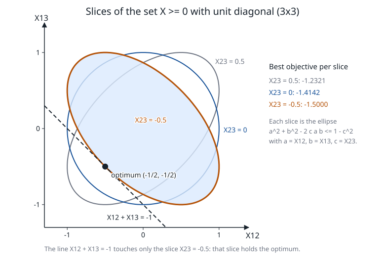

# Semidefinite programming

**Verified against** revision `1f2ddee` (`sdp.c`, `sdp.h`, `sdp_progress.h`,
`primal_sdptask.c`, `primal_optimize.c`). The numbers below were produced by
programs run against that revision; the programs that make the figure and the
two reference tables are [`figures/make_figures.c`](figures/make_figures.c) and the
public API calls quoted in the text.

## Learning objectives and prerequisites

After this chapter you can:

- state the PSD cone, its dual, the primal–dual SDP pair and the optimality
  conditions, and check an optimal pair by substitution;
- derive the Nesterov–Todd (NT) scaling $W$ and the Schur complement
  $M_{ij}=\operatorname{tr}(A_iWA_jW)$ of the Newton system, and carry one
  predictor step out by hand;
- follow one iteration of `sdp_ipm_run`: scaling, Schur system, predictor,
  centring parameter, corrector, step lengths, merit test;
- say when PRIMAL does *not* run the interior point on an SDP (the fixed-diagonal
  certificate), what it falls back to, and what the recovery paths added in the
  recent commits do.

Prerequisites: [foundations](mathematical_foundations.md) (cones, duality),
[interior point for LP](interior-point.md) (the predictor–corrector loop),
[linear algebra](linear_algebra.md) (Schur complements, LU).

## The cone and its dual

Let $\mathbb S^n$ be the symmetric $n\times n$ matrices with the trace inner
product $\langle A,B\rangle=\operatorname{tr}(AB)=\sum_{ij}A_{ij}B_{ij}$ and
$\mathbb S^n_+=\{X:v^\top Xv\ge0\ \forall v\}$ the PSD cone. It is self-dual:
if $Z\succeq0$ and $X=\sum_i\lambda_iq_iq_i^\top\succeq0$ then
$\operatorname{tr}(ZX)=\sum_i\lambda_i\,q_i^\top Zq_i\ge0$; if $Z$ had an
eigenvector $v$ with $v^\top Zv<0$, then $X=vv^\top$ would give
$\operatorname{tr}(ZX)<0$.

The $2\times2$ case is a second-order cone. For $X=\begin{pmatrix}a&c\\c&b\end{pmatrix}$,
$X\succeq0\iff a,b\ge0,\ ab\ge c^2$. With $a=(t+u)/\sqrt2$, $b=(t-u)/\sqrt2$ this is
$t\ge\|(u,\sqrt2\,c)\|_2$: a Lorentz cone in the coordinates $(t,u,\sqrt2c)$
([second-order cones](conic-socp.md)). The factor $\sqrt2$ on the off-diagonal is the same
one that makes the packed vector of a symmetric matrix isometric to the matrix.

## The primal–dual pair

PRIMAL's solver works on

$$
\min\ \sum_j\langle C_j,X_j\rangle+c^\top x\quad\text{s.t.}\quad
\sum_j\langle A_{kj},X_j\rangle+a_k^\top x=b_k\ (k=1..m),\qquad X_j\succeq0,\ x\ge0,
$$

with the dual $\max\ b^\top y$ s.t. $S_j=C_j-\sum_ky_kA_{kj}\succeq0$,
$s=c-A^\top y\ge0$ ([`sdp.h`](../sdp.h)). Weak duality is a one-line identity,

$$
\langle C,X\rangle-b^\top y=\Bigl\langle S+\sum_ky_kA_k,\,X\Bigr\rangle-\sum_ky_k\langle A_k,X\rangle=\langle S,X\rangle\ge0,
$$

and if both problems have a strictly feasible point the gap closes and
$XS=0$ at the optimum (Slater, [foundations](mathematical_foundations.md)).
The solution is therefore characterized by $\mathcal A(X)=b$, $S=C-\mathcal A^*(y)$,
$X,S\succeq0$ and $XS=0$.

> **Sign.** The public API (`PRIMAL_gety`) reports multipliers with the convention of
> [`primal.h`](../primal.h), which is the opposite of the $y$ used here and inside
> `sdp.c`: on the example below the solver's internal $y=(-1,-1)$ is returned as
> $(1,1)$. This chapter uses the internal sign throughout.

## Where the solution is: the elliptope

The matrices with unit diagonal form the *elliptope*. For $3\times3$ it is the set of
$(a,b,c)=(X_{12},X_{13},X_{23})$ with $\det X=1+2abc-a^2-b^2-c^2\ge0$; fixing $c$ gives
the ellipse $a^2+b^2-2c\,ab\le1-c^2$. Take the cost $\langle C,X\rangle=X_{12}+X_{13}+X_{23}$
(the max-cut relaxation of a triangle, written as a minimization). Its minimum over the
slice $c$ is $c-\sqrt2\sqrt{1+c}$, which is smallest at $c=-\tfrac12$.



*Figure: the slices $X_{23}=0.5,\ 0,\ -0.5$ of the elliptope in the plane
$(X_{12},X_{13})$. The line $X_{12}+X_{13}=-1$ is tangent to the slice $X_{23}=-0.5$ at
$(-\tfrac12,-\tfrac12)$: the optimum of the whole problem is $-\tfrac32$, on the
boundary of the PSD cone (rank 2). Analytic figure; the generator solves the three slices with
`PRIMAL_optimize` and checks that the minima equal $-1.2321$, $-1.4142$, $-1.5000$
(`make_figures.c` at `1f2ddee`).*

An interior-point method does not walk on the boundary: it stays in the interior of the
elliptope and approaches this tangent point.

## Newton step and Nesterov–Todd scaling

The central path replaces $XS=0$ by $XS=\sigma\mu I$. Linearizing $X S=\sigma\mu I$
directly gives $\Delta X\,S+X\,\Delta S=\sigma\mu I-XS$, whose left side is
not symmetric even when $\Delta X,\Delta S$ are. The remedy is a *scaling*: a matrix $W\succ0$
with $W S W=X$, so that the congruences $\hat X=W^{-1/2}XW^{-1/2}$ and $\hat S=W^{1/2}SW^{1/2}$
are the same matrix (indeed $W^{-1/2}(WSW)W^{-1/2}=W^{1/2}SW^{1/2}$), so primal and dual are seen through one
object. For $X,S\succ0$ there is exactly one such
$W$ (the NT point, the geometric mean of $X$ and $S^{-1}$):

$$
\boxed{W=X^{1/2}\bigl(X^{1/2}SX^{1/2}\bigr)^{-1/2}X^{1/2}},\qquad WSW=X,\quad W^{-1}XW^{-1}=S .
$$

(Check: $WSW=X^{1/2}M^{-1/2}\,(X^{1/2}SX^{1/2})\,M^{-1/2}X^{1/2}=X$ with $M=X^{1/2}SX^{1/2}$.)
In the scaled variables the linearized complementarity equation reads
$\Delta X+W\,\Delta S\,W=-X+\sigma\mu S^{-1}$, using $WX^{-1}W=S^{-1}$.

**Eliminating $\Delta X$ and $\Delta S$.** Dual feasibility fixes
$\Delta S=C-S-\mathcal A^*(y+\Delta y)$. Substituting into the scaled equation,

$$
\Delta X=W\bigl(\mathcal A^*(\Delta y)+e\bigr)W,\qquad e=\mathcal A^*(y)-C+\sigma\mu X^{-1}
$$

(the code's `g`/`e` block). The primal rows $\mathcal A(\Delta X)=-r_p$,
$r_p=\mathcal A(X)-b$, then give the **Schur complement system**

$$
\boxed{M\,\Delta y=-r_p-\mathcal A(WeW)},\qquad M_{kl}=\operatorname{tr}\bigl(A_k\,W A_l W\bigr).
$$

$M$ is symmetric positive definite when the $A_k$ are linearly independent. PRIMAL forms
$WA_lW$ once per constraint and block (the array `MTQ`), then each $M_{kl}$ is an
inner product with $A_k$ ([`sdp.c:2161`](../sdp.c#L2161)). The scalar variables $x\ge0$
add $A\,\mathrm{diag}(x/s)A^\top$; second-order and exponential/power blocks are *not*
scaled by $W$: they enter an augmented KKT matrix instead ([SOCP](conic-socp.md),
[exponential cone](exponential_cone.md)), whose header comment in
[`sdp.c`](../sdp.c#L26) explains that the NT point of a Lorentz block diverges at the cone
boundary.

## One iteration of `sdp_ipm_run`

[`sdp_ipm_run`](../sdp.c#L1789) is the loop; the PSD-only case is

```text
SDP-ITERATION(X, S, y)                         # X, S in the interior; y free
 1  rp <- A(X) - b;  rd <- S - C + A*(y);  mu <- <X,S> / ntot        # ntot = sum of block orders
 2  if rel_pri, rel_dual, rel_gap all <= tol  (or <= near_rel * tol, see below): stop OPTIMAL
 3  for each block j:                                                 # W depends on (X, S) only
 4      W <- X^(1/2) (X^(1/2) S X^(1/2))^(-1/2) X^(1/2);   W^-1;  X^-1
 5      MTQ_kj <- W A_kj W                                            # one per constraint touching block j
 6  M <- [ <A_k, MTQ_l> ]  (plus the scalar and conic blocks);  factor M   # dense LU or sparse KKT
 7  PREDICTOR (sigma = 0):  solve M dy = -rp - A(W e W);  dX <- W (A*(dy)+e) W;  dS <- C - S - A*(y+dy)
 8  ap, ad <- largest steps keeping X + ap dX and S + ad dS PSD (<= 1)
 9  mu_aff <- <X + ap dX, S + ad dS> / ntot
10  sigma <- (mu_aff / mu)^3, then sigma <- max(sigma, 0.1)  [0.3 if the largest block has order >= 8;
                                                              0 if >= 22]
11  CORRECTOR: same factor, right side with sigma*mu*X^-1:  new dy, dX, dS
12  rescue if the corrector breaks the primal rows (see below)
13  ap, ad <- steps as in 8, times tau = clamp(1 - 0.01 mu, 0.90, 0.999)
14  backtrack (x 1/2, up to 60 times) until X, S stay PSD and the l1 merit
        |rp| + |rd| + |mu_trial - sigma mu|  is <= its largest value over the last 4 iterates
15  X <- X + ap dX;  y <- y + ad dy;  S <- S + ad dS
```

*Details of the code.* Step 4 uses six symmetric eigendecompositions per block per iteration
(`sym_fun`, the cyclic Jacobi method `dmat_eig_jacobi` of [`linalg.c`](../linalg.c)); the
two Mehrotra passes share $W$, $W^{-1}$ and $X^{-1}$, so only the right side and the
back-substitution change, and the corrector reuses the predictor's factorization when the
assembled matrix is identical. $\Delta X$ is symmetrized after $WeW$; $\Delta S$ is taken from
dual feasibility rather than from $-W^{-1}\Delta XW^{-1}$, which avoids a second ill-conditioned
congruence near a rank-deficient face. The test of step 14 is a non-monotone merit window
(`MWIN`=4); a step that is rejected sixty times means the direction is spent and the best iterate so far is
returned if it satisfies the near-optimality gate. $\mu$ is measured as $\langle X,S\rangle/n_{\rm tot}$,
so for a single block of order $d$ the starting point $X=S=I$ has $\mu=1$.

**Acceptance.** The solver measures three relative numbers on every iterate
([`ipm_quality`](../sdp.c#L568)):

$$
\text{rel\_pri}=\frac{\|r_p\|_\infty}{1+\|b\|_\infty},\quad
\text{rel\_dual}=\frac{\|r_d\|_\infty}{1+\|c\|_\infty},\quad
\text{rel\_gap}=\frac{|p-d|}{1+|p|+|d|},
$$

with $p=\langle C,X\rangle$, $d=b^\top y$. The defaults are $10^{-8}$ each. A point that
misses them but meets them multiplied by `INTPNT_TOL_NEAR_REL` (default 1000) is saved as a
near-optimal candidate and returned if the alternative route (the tangent cuts, below) also fails
([`sdp.h`](../sdp.h), the `fb_ok` note in `sdp.c`). Neither measure checks that $X,S$ are in the cone; cone membership is
enforced by the step-length rules, and the final point is also checked
(`ipm_cone_slacks`) before an answer is published.

**Step to the boundary.** For a PSD block the largest $\alpha$ with $X+\alpha\Delta X\succeq0$
is $1/(-\lambda_{\min}(X^{-1/2}\Delta XX^{-1/2}))$ when that eigenvalue is negative.
[`psd_step_limit`](../sdp.c#L369) tests it without an eigensolver when it can: it tries a
Cholesky factorization of $A+I/\alpha-\varepsilon I$ for $A=X^{-1/2}\Delta XX^{-1/2}$; if it
succeeds the step $\alpha$ is already feasible, and only if it fails does it compute
$\lambda_{\min}$ (`min_eig_sign`). This shortcut is used on pure-PSD problems only.

## Worked example: one predictor step by hand

Take $\min\langle C,X\rangle$ s.t. $X_{11}=1$, $X_{22}=1$, $X\succeq0$ with
$C=\begin{pmatrix}0&-1\\-1&0\end{pmatrix}$, so $A_1=e_1e_1^\top$, $A_2=e_2e_2^\top$, $b=(1,1)$.
Feasible matrices are $\begin{pmatrix}1&x\\x&1\end{pmatrix}$ with $|x|\le1$ and the objective
is $-2x$: the optimum is $x=1$, value $-2$.

*Optimality by substitution.* $X^\star=\begin{pmatrix}1&1\\1&1\end{pmatrix}\succeq0$,
$y^\star=(-1,-1)$, $S^\star=C-y_1A_1-y_2A_2=\begin{pmatrix}1&-1\\-1&1\end{pmatrix}\succeq0$,
$X^\star S^\star=0$, and $p=-2=b^\top y^\star=d$.

*A step from an interior pair.* Start at $X=I$ and $y=(-2,-2)$, so
$S=\begin{pmatrix}2&-1\\-1&2\end{pmatrix}\succ0$ (eigenvalues 3 and 1), $r_p=0$, $r_d=0$,
$\mu=\langle X,S\rangle/2=2$. Since $X=I$, $W=S^{-1/2}$:
$W=\begin{pmatrix}0.788675&0.211325\\0.211325&0.788675\end{pmatrix}$ and for these $A_k$ the
Schur matrix is $M_{kl}=W_{kl}^2$,

$$
M=\begin{pmatrix}0.622008&0.044658\\0.044658&0.622008\end{pmatrix}.
$$

Predictor ($\sigma=0$): $e=\mathcal A^*(y)-C=-S$, so $WeW=-X=-I$ and $M\,\Delta y=-\mathcal A(WeW)=(1,1)$.
Because $(1,1)$ is an eigenvector of $M$ with eigenvalue $W_{11}^2+W_{12}^2=\tfrac23$,
$\Delta y=(1.5,1.5)$. Then $\Delta S=-\mathcal A^*(\Delta y)=-1.5\,I$ and

$$
\Delta X=-X-W\Delta SW=-I+1.5\,W^2=-I+1.5\,S^{-1}=\begin{pmatrix}0&\tfrac12\\\tfrac12&0\end{pmatrix}
$$

(note $\mathcal A(\Delta X)=0$). The largest steps keeping both matrices PSD are
$\alpha_p=2$ (the matrix $\begin{pmatrix}1&\alpha/2\\\alpha/2&1\end{pmatrix}$ is PSD up to
$\alpha=2$) and $\alpha_d=\tfrac23$ (the eigenvalue $1-1.5\alpha$ of $S+\alpha\Delta S$ hits 0). With the steps
capped at 1, $\alpha_p=1$, $\alpha_d=\tfrac23$: $X+\Delta X=\begin{pmatrix}1&\frac12\\\frac12&1\end{pmatrix}$
and $S+\tfrac23\Delta S=\begin{pmatrix}1&-1\\-1&1\end{pmatrix}=S^\star$, so
$\mu_{\rm aff}=\tfrac12\operatorname{tr}\bigl((X+\Delta X)(S+\tfrac23\Delta S)\bigr)=0.5$,
$\mu_{\rm aff}/\mu=0.25$ and $\sigma=0.25^3=0.015625$, which the floor raises to $0.1$.
The predictor already lands the dual at the optimum $S^\star$ — the dual step stops at the
boundary $\alpha_d=\tfrac23$, which is why the corrector and the fraction-to-boundary factor
$\tau\le0.999$ exist. These numbers were reproduced with `dmat_eig_jacobi` from
[`linalg.c`](../linalg.c) (the same kernel `sym_fun` uses): $W$, $M$, $\Delta y=(1.5,1.5)$,
$\Delta X$ above, $\alpha_p^{\max}=2$, $\alpha_d^{\max}=0.666667$, $\mu_{\rm aff}=0.5$ and
$\sigma=0.015625$.

**What PRIMAL does on this problem.** Not this. It has one PSD block, only diagonal
equalities ($m=d=2$, $n=0$) and a cost whose off-diagonal signs can be made $\le0$ by flipping
the sign of a row and column. `sdp_ipm_csr` recognizes that and returns the answer at once
([next section](#the-fixed-diagonal-certificate-no-iteration)); the debug trace of the run prints
`[route] fixed-diagonal PSD certificate`, no iteration, $X^\star$ as above, objective $-2$ for
primal and dual.

## The fixed-diagonal certificate: no iteration

A common SDP is $\min\langle C,X\rangle$ with $X_{ii}=\beta_i>0$ fixed (max-cut and
correlation relaxations). For $X\succeq0$, $|X_{ij}|\le\sqrt{X_{ii}X_{jj}}=u_iu_j$ with
$u_i=\sqrt{\beta_i}$, so

$$
\langle C,X\rangle\ \ge\ \sum_i C_{ii}\beta_i-\sum_{i\ne j}|C_{ij}|\,u_iu_j,
$$

and the bound is attained by $X=\hat u\hat u^\top$, $\hat u_i=s_iu_i$, exactly when the signs
$s_i\in\{\pm1\}$ satisfy $C_{ij}s_is_j\le0$ on every nonzero off-diagonal entry. That is a
two-colouring problem: [`sdp_fixed_diagonal`](../sdp.c#L2995) propagates signs by breadth-first search
and gives up (returns 0) if a nonzero entry demands contradictory signs (an odd cycle of
positive weights, for instance). When it succeeds it builds $X=\hat u\hat u^\top$, sets
$S=C$ with the diagonal replaced by $S_{ii}=-\sum_{j}C_{ij}\hat u_j/\hat u_i$ (so $S\hat u=0$:
$\operatorname{diag}(\hat u)S\operatorname{diag}(\hat u)$ is a weighted graph Laplacian, diagonally dominant
with non-positive off-diagonal entries, hence PSD), $y_k=(C_{ii}-S_{ii})/a_k$, and **measures** the
primal residual, dual residual and gap against the same tolerances as the iterative route.
Only if all three pass is the answer returned. Conditions
([`sdp_ipm_csr`](../sdp.c#L3113)): one PSD block, no scalar, SOC or exponential block, $m=d$
equalities each touching one diagonal entry once, no warm start, more than one iteration
allowed, and `GMB_SDP_HSD` unset.

On the elliptope example above the triangle with unit weights is the counter-case: entries
$C_{12}=C_{13}=C_{23}=\tfrac12>0$ ask for $s_1s_2=s_1s_3=s_2s_3=-1$, impossible. The test
fails, and PRIMAL runs the interior point.

| it | step lengths $(\alpha_p,\alpha_d)$ | rel_pri | rel_dual | rel_gap | $\mu$ |
|---:|---|---:|---:|---:|---:|
| 0 | start $X=S=I$ | 0 | 1 | 0 | 1 |
| 1 | (1, 0.714) | 0 | 0.293 | 0.472 | 1.35e-2 |
| 2 | (0.784, 1) | 2.4e-15 | 2.9e-4 | 3.3e-4 | 8.77e-4 |
| 3 | (1, 1) | 1.7e-13 | 2.9e-7 | 6.6e-5 | 8.85e-5 |
| 4 | (1, 1) | 4.0e-13 | 2.9e-10 | 6.7e-6 | 8.93e-6 |
| 5 | (1, 1) | 7.2e-12 | 2.9e-13 | 6.8e-7 | 9.01e-7 |
| 6 | (1, 1) | 2.7e-11 | 3.3e-16 | 6.8e-8 | 9.09e-8 |
| 7 | (1, 1) | 2.5e-10 | 0 | 6.8e-9 | 9.17e-9 |

*Table: the trace of `PRIMAL_optimize` on the triangle SDP (`GMB_DBG=1`, `1f2ddee`), i.e.
$\min X_{12}+X_{13}+X_{23}$ s.t. $X_{ii}=1$, $X\succeq0$. After the dual feasibility is
reached (iteration 2) $\mu$ falls by a factor 10 per iteration: $\sigma$ sits at its floor $0.1$
with full steps. At iteration 7 the check of step 12 fires
(`primal_step` 4.8e-9 against a budget of 2e-9) and the rescue solve below is used; the final
point has rel_pri $2.5\cdot10^{-13}$, rel_dual $1.1\cdot10^{-16}$, rel_gap $6.9\cdot10^{-10}$,
objective $-1.5$ and $X_{12}=X_{13}=X_{23}=-0.5$ to six digits, the minimum eigenvalue of $X$
being $6\cdot10^{-10}$.*

## Recovery near a singular face

At the optimum $X$ is rank-deficient (here rank 2 of 3) and $S$ has the complementary rank, so
$W$ and $M$ degrade: eliminating $\Delta X,\Delta S$ into $M$ can erase small directions and the
step then violates the primal rows it linearizes. The recent commits add four safeguards
(`adb7f74`, `314d4f0`, `1bf265c`, `bd53531`), all in [`sdp.c`](../sdp.c):

1. **Primal-step check** ([`sdp_primal_step_residual`](../sdp.c#L896)). After the corrector the solver
   evaluates $\max_k|r_{p,k}+\langle A_k,\Delta X\rangle+a_k^\top\Delta x|$. If it exceeds
   $0.1\cdot\text{rtol\_pri}(1+\|b\|_\infty)$ (or, with more than one PSD block, whenever the previous step made the
   feasibility measure grow by more than 5%) the direction is recomputed.
2. **Augmented rescue** ([`sdp_aug_direction`](../sdp.c#L991)). The unknowns $\Delta x$ and $\mathrm{svec}(\Delta X)$
   are kept in a symmetric-indefinite system $\begin{pmatrix}0&E\\E^\top&-H\end{pmatrix}$,
   $H=W^{-1}\otimes W^{-1}$, which retains $A\,\Delta X=-r_p$ exactly. svec uses $\sqrt2$ on
   off-diagonals so that it preserves the trace inner product. The matrix is equilibrated by max-norm rows and columns,
   solved by LU with compensated substitutions and up to three refinement rounds that are
   undone if they do not reduce the residual ([`sdp_aug_solve`](../sdp.c#L912)). If every row of $E$ is a
   singleton that fixes one packed entry, the system is split ([`sdp_aug_singletons`](../sdp.c#L934)) and
   the multipliers are recovered from the eliminated rows. The fixed workspace allows 512 rows;
   larger models keep the earlier behaviour. The dual increment is recovered from dual feasibility.
3. **Stop at verified accuracy** (`314d4f0`). After a repaired step the iteration stops as soon as
   the original equations and both cones pass: rel_pri, rel_dual within tolerance, rel_gap within half
   the tolerance, and nonnegative primal and dual cone slacks.
4. **Stall clock** ([`sdp_progress_stalled`](../sdp_progress.h)). The slow-crawl detector allows
   a full window of 16 iterations after every improvement of the violation by 1%; a short
   excursion does not count as a stall. Tests `T302` (the clock) and `T301` (rank-one correlation
   SDPs of order 14, 20, 21, 22 whose answers previously carried objective errors above $10^{-7}$
   with return code 0) check it.

The sparse formulation of the same KKT system (`sdp_sp_build`, used when the dense work estimate
$N^3+m^2\sum d_j^2$ reaches $4\cdot10^8$; override with `GMB_SDP_DENSE` / `GMB_SDP_SPARSE`) emits
the same entries one by one and produces the same iterates.

## How PRIMAL reaches this code, and where it goes if it fails

`PRIMAL_optimize` sends a task with bar variables to
[`optimize_sdp_ipm`](../primal_sdptask.c#L190) unless it also has quadratic rows or a
quadratic objective, which go through the rotated-cone encoder instead
([`primal_optimize.c`](../primal_optimize.c#L63)). The conversion packs each symmetric
coefficient matrix into its upper triangle, doubling the off-diagonal entries so that
$\langle A,X\rangle$ is a plain dot product (`bar_pack`, [`primal_sdptask.c:40`](../primal_sdptask.c#L40)).
A result of OK, infeasible or unbounded is final. Otherwise, with no cones present, the
tangent-cut outer approximation `optimize_sdp` runs
([`primal_sdptask.c:1129`](../primal_sdptask.c#L1129)): a polyhedral relaxation with box caps $\pm$`SDP_BIGM`
on the bar entries, refined by cuts from eigenvectors with negative eigenvalues. A point that sits on a
cap is *not* an answer of the model; `bar_cap_verdict`
([`primal_sdptask.c:1096`](../primal_sdptask.c#L1096)) publishes an unbounded verdict only if it can
measure a recession direction, otherwise no verdict at all. `GMB_NO_SDP_IPM` forces the cut route
for testing. With both bars and cones the model goes to the conic path.

## Costs, conditioning and failure modes

- **Per iteration**, with $m$ equality rows and PSD blocks of orders $d_j$: six
  $O(d_j^3)$ eigensolves per block, $m$ products $WA_kW$, the $m\times m$ Schur matrix
  (inner products over the sparsity of $A_k$) and its dense $O(m^3)$ factorization or its
  sparse equivalent. The Schur matrix is dense even when the $A_k$ are sparse, which is the
  usual limit of interior-point SDP.
- **Conditioning.** $\mu\to0$ drives $W$ to singular limits on a rank-deficient optimum;
  the safeguards above exist for this, and the near-optimality gate with its candidate
  point is the last resort.
- **Large blocks.** The comments in `sdp_ipm_run` record that a rank-one optimum of
  order $d\ge11$ froze at rel_gap $\approx5\cdot10^{-3}$ with the 0.1 floor on $\sigma$; the floor
  was raised to 0.3 for $d\ge8$ and removed for $d\ge22$. The thresholds are measured
  heuristics, not conditioning tests.
- **Not solved is not infeasible.** Reaching the iteration limit, a rejected line search or a stalled
  window gives *no certificate*: the route then returns the candidate if the near gate passes, or
  falls back to the cuts, or reports `UNKNOWN` ([certificates](certificates.md)).
- **Experimental.** `GMB_SDP_HSD` switches PSD-only models to a homogeneous self-dual
  embedding (with a double-double solve) that is not used by default.

## Exercise

Verify by substitution that the triangle SDP above has optimum $-\tfrac32$, giving $X^\star$,
$y^\star$ and $S^\star$, and show why this problem cannot be certified by the fixed-diagonal rule.

*Answer.* $X^\star=\tfrac32I-\tfrac12J$ ($J$ the all-ones matrix): diagonal 1, off-diagonal $-\tfrac12$,
eigenvalues $\tfrac32,\tfrac32,0$, so $X^\star\succeq0$ and $\langle C,X^\star\rangle=6\cdot\tfrac12\cdot(-\tfrac12)=-\tfrac32$.
With $y^\star=(-\tfrac12,-\tfrac12,-\tfrac12)$, $S^\star=C-\sum y_kE_{kk}=\tfrac12J\succeq0$, and
$b^\top y^\star=-\tfrac32$, so primal and dual objectives agree. Complementarity:
$X^\star S^\star=\tfrac12(\tfrac32J-\tfrac12J^2)=\tfrac12(\tfrac32J-\tfrac32J)=0$ because $J^2=3J$.
The fixed-diagonal rule needs signs with $C_{ij}s_is_j\le0$ on all three edges, i.e. $s_is_j=-1$ for all
pairs, which has no solution on an odd cycle: PRIMAL runs the interior point (table above).

## References

- E. de Klerk, [*Aspects of Semidefinite Programming*](https://doi.org/10.1007/b105286), Springer, 2002.
- M. J. Todd, [Semidefinite optimization](https://doi.org/10.1017/S0962492901000071), *Acta Numerica* 10:515–560, 2001.
- Yu. E. Nesterov and M. J. Todd, [Self-scaled barriers and interior-point methods for convex programming](https://doi.org/10.1287/moor.22.1.1), *Mathematics of Operations Research* 22(1):1–42, 1997.
- M. J. Todd, K. C. Toh and R. H. Tütüncü, [On the Nesterov–Todd direction in semidefinite programming](https://doi.org/10.1137/S105262349630060X), *SIAM Journal on Optimization* 8(3):769–796, 1998.
- M. X. Goemans and D. P. Williamson, [Improved approximation algorithms for maximum cut and satisfiability problems using semidefinite programming](https://doi.org/10.1145/227683.227684), *Journal of the ACM* 42(6):1115–1145, 1995.
