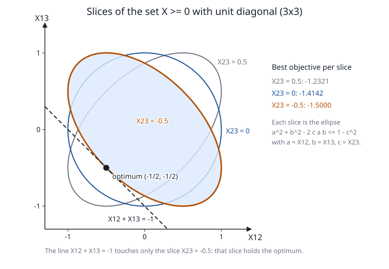

# Semidefinite programming

**Verified against** revision `1f2ddee` (`sdp.c`, `sdp.h`, `sdp_progress.h`,
`primal_sdptask.c`, `primal_optimize.c`). The numbers below were produced by
programs run against that revision; the programs that make the figure and the
two reference tables are [`figures/make_figures.c`](figures/make_figures.c) and the
public API calls quoted in the text.

## Learning objectives and prerequisites

After this chapter you can:

- state the PSD cone, its dual, the primal–dual SDP pair and the optimality
  conditions, and check an optimal pair by substitution;
- derive the Nesterov–Todd (NT) scaling $W$ and the Schur complement
  $M_{ij}=\mathrm{tr}(A_iWA_jW)$ of the Newton system, and carry one
  predictor step out by hand;
- follow one iteration of `sdp_ipm_run`: scaling, Schur system, predictor,
  centring parameter, corrector, step lengths, merit test;
- say when PRIMAL does *not* run the interior point on an SDP (the fixed-diagonal
  certificate), what it falls back to, and what the recovery paths added in the
  recent commits do.

Prerequisites: [foundations](mathematical_foundations.md) (cones, duality),
[interior point for LP](interior_point.md) (the predictor–corrector loop),
[linear algebra](linear_algebra.md) (Schur complements, LU).

## The cone and its dual

Let $\mathbb S^n$ be the symmetric $n\times n$ matrices with the trace inner
product $\langle A,B\rangle=\mathrm{tr}(AB)=\sum_{ij}A_{ij}B_{ij}$ and
$\mathbb S^n_+=\lbrace X:v^\top Xv\ge0\ \forall v\rbrace$ the PSD cone. It is self-dual:
if $Z\succeq0$ and $X=\sum_i\lambda_iq_iq_i^\top\succeq0$ then
$\mathrm{tr}(ZX)=\sum_i\lambda_i\,q_i^\top Zq_i\ge0$; if $Z$ had an
eigenvector $v$ with $v^\top Zv<0$, then $X=vv^\top$ would give
$\mathrm{tr}(ZX)<0$.

The $2\times2$ case is a second-order cone. For $X=\begin{pmatrix}a&c\\c&b\end{pmatrix}$,
$X\succeq0\iff a,b\ge0,\ ab\ge c^2$. With $a=(t+u)/\sqrt2$, $b=(t-u)/\sqrt2$ this is
$t\ge\|(u,\sqrt2\,c)\|_2$: a Lorentz cone in the coordinates $(t,u,\sqrt2c)$
([second-order cones](socp.md)). The factor $\sqrt2$ on the off-diagonal is the same
one that makes the packed vector of a symmetric matrix isometric to the matrix.

## The primal–dual pair

PRIMAL's solver works on

$$
\min\ \sum_j\langle C_j,X_j\rangle+c^\top x\quad\text{s.t.}\quad
\sum_j\langle A_{kj},X_j\rangle+a_k^\top x=b_k\ (k=1..m),\qquad X_j\succeq0,\ x\ge0,
$$

with the dual $\max\ b^\top y$ s.t. $S_j=C_j-\sum_ky_kA_{kj}\succeq0$,
$s=c-A^\top y\ge0$ ([`sdp.h`](../sdp.h)). Weak duality is a one-line identity,

$$
\langle C,X\rangle-b^\top y=\langle S+\sum_ky_kA_k,\,X\rangle-\sum_ky_k\langle A_k,X\rangle=\langle S,X\rangle\ge0,
$$

and if both problems have a strictly feasible point the gap closes and
$XS=0$ at the optimum (Slater, [foundations](mathematical_foundations.md)).
The solution is therefore characterized by $\mathcal A(X)=b$, $S=C-\mathcal A^*(y)$,
$X,S\succeq0$ and $XS=0$.

> **Sign.** The public API (`PRIMAL_gety`) reports multipliers with the convention of
> [`primal.h`](../primal.h), which is the opposite of the $y$ used here and inside
> `sdp.c`: on the example below the solver's internal $y=(-1,-1)$ is returned as
> $(1,1)$. This chapter uses the internal sign throughout.

## Where the solution is: the elliptope

The matrices with unit diagonal form the *elliptope*. For $3\times3$ it is the set of
$(a,b,c)=(X_{12},X_{13},X_{23})$ with $\det X=1+2abc-a^2-b^2-c^2\ge0$; fixing $c$ gives
the ellipse $a^2+b^2-2c\,ab\le1-c^2$. Take the cost $\langle C,X\rangle=X_{12}+X_{13}+X_{23}$
(the max-cut relaxation of a triangle, written as a minimization). Its minimum over the
slice $c$ is $c-\sqrt2\sqrt{1+c}$, which is smallest at $c=-\tfrac12$.



*Figure: the slices $X_{23}=0.5,\ 0,\ -0.5$ of the elliptope in the plane
$(X_{12},X_{13})$. The line $X_{12}+X_{13}=-1$ is tangent to the slice $X_{23}=-0.5$ at
$(-\tfrac12,-\tfrac12)$: the optimum of the whole problem is $-\tfrac32$, on the
boundary of the PSD cone (rank 2). Analytic figure; the generator solves the three slices with
`PRIMAL_optimize` and checks that the minima equal $-1.2321$, $-1.4142$, $-1.5000$
(`make_figures.c` at `1f2ddee`).*

An interior-point method does not walk on the boundary: it stays in the interior of the
elliptope and approaches this tangent point.

## Newton step and Nesterov–Todd scaling

The central path replaces $XS=0$ by $XS=\sigma\mu I$. Linearizing $X S=\sigma\mu I$
directly gives $\Delta X\,S+X\,\Delta S=\sigma\mu I-XS$, whose left side is
not symmetric even when $\Delta X,\Delta S$ are. The remedy is a *scaling*: a matrix $W\succ0$
with $W S W=X$, so that the congruences $\hat X=W^{-1/2}XW^{-1/2}$ and $\hat S=W^{1/2}SW^{1/2}$
are the same matrix (indeed $W^{-1/2}(WSW)W^{-1/2}=W^{1/2}SW^{1/2}$), so primal and dual are seen through one
object. For $X,S\succ0$ there is exactly one such
$W$ (the NT point, the geometric mean of $X$ and $S^{-1}$):

$$
\boxed{W=X^{1/2}(X^{1/2}SX^{1/2})^{-1/2}X^{1/2}},\qquad WSW=X,\quad W^{-1}XW^{-1}=S .
$$

(Check: $WSW=X^{1/2}M^{-1/2}\,(X^{1/2}SX^{1/2})\,M^{-1/2}X^{1/2}=X$ with $M=X^{1/2}SX^{1/2}$.)
In the scaled variables the linearized complementarity equation reads
$\Delta X+W\,\Delta S\,W=-X+\sigma\mu S^{-1}$, using $WX^{-1}W=S^{-1}$.

**Eliminating $\Delta X$ and $\Delta S$.** Dual feasibility fixes
$\Delta S=C-S-\mathcal A^*(y+\Delta y)$. Substituting into the scaled equation,

$$
\Delta X=W(\mathcal A^*(\Delta y)+e)W,\qquad e=\mathcal A^*(y)-C+\sigma\mu X^{-1}
$$

(the code's `g`/`e` block). The primal rows $\mathcal A(\Delta X)=-r_p$,
$r_p=\mathcal A(X)-b$, then give the **Schur complement system**

$$
\boxed{M\,\Delta y=-r_p-\mathcal A(WeW)},\qquad M_{kl}=\mathrm{tr}(A_k\,W A_l W).
$$

$M$ is symmetric positive definite when the $A_k$ are linearly independent. PRIMAL forms
$WA_lW$ once per constraint and block (the array `MTQ`), then each $M_{kl}$ is an
inner product with $A_k$ ([`sdp.c:2161`](../sdp.c#L2161)). The scalar variables $x\ge0$
add $A\,\mathrm{diag}(x/s)A^\top$; second-order and exponential/power blocks are *not*
scaled by $W$: they enter an augmented KKT matrix instead ([SOCP](socp.md),
[exponential cone](exponential_cone.md)), whose header comment in
[`sdp.c`](../sdp.c#L26) explains that the NT point of a Lorentz block diverges at the cone
boundary.

## One iteration of `sdp_ipm_run`

[`sdp_ipm_run`](../sdp.c#L1789) is the loop; the PSD-only case is

```text
SDP-ITERATION(X, S, y)                         # X, S in the interior; y free
 1  rp <- A(X) - b;  rd <- S - C + A*(y);  mu <- <X,S> / ntot        # ntot = sum of block orders
 2  if rel_pri, rel_dual, rel_gap all <= tol  (or <= near_rel * tol, see below): stop OPTIMAL
 3  for each block j:                                                 # W depends on (X, S) only
 4      W <- X^(1/2) (X^(1/2) S X^(1/2))^(-1/2) X^(1/2);   W^-1;  X^-1
 5      MTQ_kj <- W A_kj W                                            # one per constraint touching block j
 6  M <- [ <A_k, MTQ_l> ]  (plus the scalar and conic blocks);  factor M   # dense LU or sparse KKT
 7  PREDICTOR (sigma = 0):  solve M dy = -rp - A(W e W);  dX <- W (A*(dy)+e) W;  dS <- C - S - A*(y+dy)
 8  ap, ad <- largest steps keeping X + ap dX and S + ad dS PSD (<= 1)
 9  mu_aff <- <X + ap dX, S + ad dS> / ntot
10  sigma <- (mu_aff / mu)^3, then sigma <- max(sigma, 0.1)  [0.3 if the largest block has order >= 8;
                                                              0 if >= 22]
11  CORRECTOR: same factor, right side with sigma*mu*X^-1:  new dy, dX, dS
12  rescue if the corrector breaks the primal rows (see below)
13  ap, ad <- steps as in 8, times tau = clamp(1 - 0.01 mu, 0.90, 0.999)
14  backtrack (x 1/2, up to 60 times) until X, S stay PSD and the l1 merit
        |rp| + |rd| + |mu_trial - sigma mu|  is <= its largest value over the last 4 iterates
15  X <- X + ap dX;  y <- y + ad dy;  S <- S + ad dS
```

*Details of the code.* Step 4 uses six symmetric eigendecompositions per block per iteration
(`sym_fun`, the cyclic Jacobi method `dmat_eig_jacobi` of [`linalg.c`](../linalg.c)); the
two Mehrotra passes share $W$, $W^{-1}$ and $X^{-1}$, so only the right side and the
back-substitution change, and the corrector reuses the predictor's factorization when the
assembled matrix is identical. $\Delta X$ is symmetrized after $WeW$; $\Delta S$ is taken from
dual feasibility rather than from $-W^{-1}\Delta XW^{-1}$, which avoids a second ill-conditioned
congruence near a rank-deficient face. The test of step 14 is a non-monotone merit window
(`MWIN`=4); a step that is rejected sixty times means the direction is spent and the best iterate so far is
returned if it satisfies the near-optimality gate. $\mu$ is measured as $\langle X,S\rangle/n_{\rm tot}$,
so for a single block of order $d$ the starting point $X=S=I$ has $\mu=1$.

**Acceptance.** The solver measures three relative numbers on every iterate
([`ipm_quality`](../sdp.c#L568)):

$$
\rho_p=\frac{\|r_p\|_\infty}{1+\|b\|_\infty},\quad
\rho_d=\frac{\|r_d\|_\infty}{1+\|c\|_\infty},\quad
\rho_g=\frac{|p-d|}{1+|p|+|d|},
$$

with $p=\langle C,X\rangle$, $d=b^\top y$. The code stores these measures as
`rel_pri`, `rel_dual` and `rel_gap`, respectively. The default tolerances are
$10^{-8}$ each. A point that
misses them but meets them multiplied by `INTPNT_TOL_NEAR_REL` (default 1000) is saved as a
near-optimal candidate and returned if the alternative route (the tangent cuts, below) also fails
([`sdp.h`](../sdp.h), the `fb_ok` note in `sdp.c`). Neither measure checks that $X,S$ are in the cone; cone membership is
enforced by the step-length rules, and the final point is also checked
(`ipm_cone_slacks`) before an answer is published.

**Step to the boundary.** For a PSD block the largest $\alpha$ with $X+\alpha\Delta X\succeq0$
is $1/(-\lambda_{\min}(X^{-1/2}\Delta XX^{-1/2}))$ when that eigenvalue is negative.
[`psd_step_limit`](../sdp.c#L369) tests it without an eigensolver when it can: it tries a
Cholesky factorization of $A+I/\alpha-\varepsilon I$ for $A=X^{-1/2}\Delta XX^{-1/2}$; if it
succeeds the step $\alpha$ is already feasible, and only if it fails does it compute
$\lambda_{\min}$ (`min_eig_sign`). This shortcut is used on pure-PSD problems only.

## Worked example: one predictor step by hand

Take $\min\langle C,X\rangle$ s.t. $X_{11}=1$, $X_{22}=1$, $X\succeq0$ with
$C=\begin{pmatrix}0&-1\\-1&0\end{pmatrix}$, so $A_1=e_1e_1^\top$, $A_2=e_2e_2^\top$, $b=(1,1)$.
Feasible matrices are $\begin{pmatrix}1&x\\x&1\end{pmatrix}$ with $|x|\le1$ and the objective
is $-2x$: the optimum is $x=1$, value $-2$.

*Optimality by substitution.* $X^\star=\begin{pmatrix}1&1\\1&1\end{pmatrix}\succeq0$,
$y^\star=(-1,-1)$, $S^\star=C-y_1A_1-y_2A_2=\begin{pmatrix}1&-1\\-1&1\end{pmatrix}\succeq0$,
$X^\star S^\star=0$, and $p=-2=b^\top y^\star=d$.

*A step from an interior pair.* Start at $X=I$ and $y=(-2,-2)$, so
$S=\begin{pmatrix}2&-1\\-1&2\end{pmatrix}\succ0$ (eigenvalues 3 and 1), $r_p=0$, $r_d=0$,
$\mu=\langle X,S\rangle/2=2$. Since $X=I$, $W=S^{-1/2}$:
$W=\begin{pmatrix}0.788675&0.211325\\0.211325&0.788675\end{pmatrix}$ and for these $A_k$ the
Schur matrix is $M_{kl}=W_{kl}^2$,

$$
M=\begin{pmatrix}0.622008&0.044658\\0.044658&0.622008\end{pmatrix}.
$$

Predictor ($\sigma=0$): $e=\mathcal A^*(y)-C=-S$, so $WeW=-X=-I$ and $M\,\Delta y=-\mathcal A(WeW)=(1,1)$.
Because $(1,1)$ is an eigenvector of $M$ with eigenvalue $W_{11}^2+W_{12}^2=\tfrac23$,
$\Delta y=(1.5,1.5)$. Then $\Delta S=-\mathcal A^*(\Delta y)=-1.5\,I$ and

$$
\Delta X=-X-W\Delta SW=-I+1.5\,W^2=-I+1.5\,S^{-1}=\begin{pmatrix}0&\tfrac12\\\tfrac12&0\end{pmatrix}
$$

(note $\mathcal A(\Delta X)=0$). The largest steps keeping both matrices PSD are
$\alpha_p=2$ (the matrix $\begin{pmatrix}1&\alpha/2\\\alpha/2&1\end{pmatrix}$ is PSD up to
$\alpha=2$) and $\alpha_d=\tfrac23$ (the eigenvalue $1-1.5\alpha$ of $S+\alpha\Delta S$ hits 0). With the steps
capped at 1, $\alpha_p=1$, $\alpha_d=\tfrac23$: $X+\Delta X=\begin{pmatrix}1&\frac12\\\frac12&1\end{pmatrix}$
and $S+\tfrac23\Delta S=\begin{pmatrix}1&-1\\-1&1\end{pmatrix}=S^\star$, so
$\mu_{\rm aff}=\tfrac12\mathrm{tr}((X+\Delta X)(S+\tfrac23\Delta S))=0.5$,
$\mu_{\rm aff}/\mu=0.25$ and $\sigma=0.25^3=0.015625$, which the floor raises to $0.1$.
The predictor already lands the dual at the optimum $S^\star$ — the dual step stops at the
boundary $\alpha_d=\tfrac23$, which is why the corrector and the fraction-to-boundary factor
$\tau\le0.999$ exist. These numbers were reproduced with `dmat_eig_jacobi` from
[`linalg.c`](../linalg.c) (the same kernel `sym_fun` uses): $W$, $M$, $\Delta y=(1.5,1.5)$,
$\Delta X$ above, $\alpha_p^{\max}=2$, $\alpha_d^{\max}=0.666667$, $\mu_{\rm aff}=0.5$ and
$\sigma=0.015625$.

**What PRIMAL does on this problem.** Not this. It has one PSD block, only diagonal
equalities ($m=d=2$, $n=0$) and a cost whose off-diagonal signs can be made $\le0$ by flipping
the sign of a row and column. `sdp_ipm_csr` recognizes that and returns the answer at once
([next section](#the-fixed-diagonal-certificate-no-iteration)); the debug trace of the run prints
`[route] fixed-diagonal PSD certificate`, no iteration, $X^\star$ as above, objective $-2$ for
primal and dual.

## The fixed-diagonal certificate: no iteration

A common SDP is $\min\langle C,X\rangle$ with $X_{ii}=\beta_i>0$ fixed (max-cut and
correlation relaxations). For $X\succeq0$, $|X_{ij}|\le\sqrt{X_{ii}X_{jj}}=u_iu_j$ with
$u_i=\sqrt{\beta_i}$, so

$$
\langle C,X\rangle\ \ge\ \sum_i C_{ii}\beta_i-\sum_{i\ne j}|C_{ij}|\,u_iu_j,
$$

and the bound is attained by $X=\hat u\hat u^\top$, $\hat u_i=s_iu_i$, exactly when the signs
$s_i\in\lbrace \pm1\rbrace$ satisfy $C_{ij}s_is_j\le0$ on every nonzero off-diagonal entry. That is a
two-colouring problem: [`sdp_fixed_diagonal`](../sdp.c#L2995) propagates signs by breadth-first search
and gives up (returns 0) if a nonzero entry demands contradictory signs (an odd cycle of
positive weights, for instance). When it succeeds it builds $X=\hat u\hat u^\top$, sets
$S=C$ with the diagonal replaced by $S_{ii}=-\sum_{j}C_{ij}\hat u_j/\hat u_i$ (so $S\hat u=0$:
$\mathrm{diag}(\hat u)S\mathrm{diag}(\hat u)$ is a weighted graph Laplacian, diagonally dominant
with non-positive off-diagonal entries, hence PSD), $y_k=(C_{ii}-S_{ii})/a_k$, and **measures** the
primal residual, dual residual and gap against the same tolerances as the iterative route.
Only if all three pass is the answer returned. Conditions
([`sdp_ipm_csr`](../sdp.c#L3113)): one PSD block, no scalar, SOC or exponential block, $m=d$
equalities each touching one diagonal entry once, no warm start, more than one iteration
allowed, and `GMB_SDP_HSD` unset.

On the elliptope example above the triangle with unit weights is the counter-case: entries
$C_{12}=C_{13}=C_{23}=\tfrac12>0$ ask for $s_1s_2=s_1s_3=s_2s_3=-1$, impossible. The test
fails, and PRIMAL runs the interior point.

| it | step lengths $(\alpha_p,\alpha_d)$ | rel_pri | rel_dual | rel_gap | $\mu$ |
|---:|---|---:|---:|---:|---:|
| 0 | start $X=S=I$ | 0 | 1 | 0 | 1 |
| 1 | (1, 0.714) | 0 | 0.293 | 0.472 | 1.35e-2 |
| 2 | (0.784, 1) | 2.4e-15 | 2.9e-4 | 3.3e-4 | 8.77e-4 |
| 3 | (1, 1) | 1.7e-13 | 2.9e-7 | 6.6e-5 | 8.85e-5 |
| 4 | (1, 1) | 4.0e-13 | 2.9e-10 | 6.7e-6 | 8.93e-6 |
| 5 | (1, 1) | 7.2e-12 | 2.9e-13 | 6.8e-7 | 9.01e-7 |
| 6 | (1, 1) | 2.7e-11 | 3.3e-16 | 6.8e-8 | 9.09e-8 |
| 7 | (1, 1) | 2.5e-10 | 0 | 6.8e-9 | 9.17e-9 |

*Table: the trace of `PRIMAL_optimize` on the triangle SDP (`GMB_DBG=1`, `1f2ddee`), i.e.
$\min X_{12}+X_{13}+X_{23}$ s.t. $X_{ii}=1$, $X\succeq0$. After the dual feasibility is
reached (iteration 2) $\mu$ falls by a factor 10 per iteration: $\sigma$ sits at its floor $0.1$
with full steps. At iteration 7 the check of step 12 fires
(`primal_step` 4.8e-9 against a budget of 2e-9) and the rescue solve below is used; the final
point has rel_pri $2.5\cdot10^{-13}$, rel_dual $1.1\cdot10^{-16}$, rel_gap $6.9\cdot10^{-10}$,
objective $-1.5$ and $X_{12}=X_{13}=X_{23}=-0.5$ to six digits, the minimum eigenvalue of $X$
being $6\cdot10^{-10}$.*

## Recovery near a singular face

At the optimum $X$ is rank-deficient (here rank 2 of 3) and $S$ has the complementary rank, so
$W$ and $M$ degrade: eliminating $\Delta X,\Delta S$ into $M$ can erase small directions and the
step then violates the primal rows it linearizes. The recent commits add four safeguards
(`adb7f74`, `314d4f0`, `1bf265c`, `bd53531`), all in [`sdp.c`](../sdp.c):

1. **Primal-step check** ([`sdp_primal_step_residual`](../sdp.c#L896)). After the corrector the solver
   evaluates $\max_k|r_{p,k}+\langle A_k,\Delta X\rangle+a_k^\top\Delta x|$. If it exceeds
   $0.1\varepsilon_p(1+\|b\|_\infty)$, where $\varepsilon_p$ is the primal
   tolerance (`rtol_pri`), the direction is recomputed. With more than one PSD
   block the solver also recomputes it if the previous step increased the
   feasibility measure by more than 5%.
2. **Augmented rescue** ([`sdp_aug_direction`](../sdp.c#L991)). The unknowns $\Delta x$ and $\mathrm{svec}(\Delta X)$
   are kept in a symmetric-indefinite system $\begin{pmatrix}0&E\\E^\top&-H\end{pmatrix}$,
   $H=W^{-1}\otimes W^{-1}$, which retains $A\,\Delta X=-r_p$ exactly. svec uses $\sqrt2$ on
   off-diagonals so that it preserves the trace inner product. The matrix is equilibrated by max-norm rows and columns,
   solved by LU with compensated substitutions and up to three refinement rounds that are
   undone if they do not reduce the residual ([`sdp_aug_solve`](../sdp.c#L912)). If every row of $E$ is a
   singleton that fixes one packed entry, the system is split ([`sdp_aug_singletons`](../sdp.c#L934)) and
   the multipliers are recovered from the eliminated rows. The fixed workspace allows 512 rows;
   larger models keep the earlier behaviour. The dual increment is recovered from dual feasibility.
3. **Stop at verified accuracy** (`314d4f0`). After a repaired step the iteration stops as soon as
   the original equations and both cones pass: rel_pri, rel_dual within tolerance, rel_gap within half
   the tolerance, and nonnegative primal and dual cone slacks.
4. **Stall clock** ([`sdp_progress_stalled`](../sdp_progress.h)). The slow-crawl detector allows
   a full window of 16 iterations after every improvement of the violation by 1%; a short
   excursion does not count as a stall. Tests `T302` (the clock) and `T301` (rank-one correlation
   SDPs of order 14, 20, 21, 22 whose answers previously carried objective errors above $10^{-7}$
   with return code 0) check it.

The sparse formulation of the same KKT system (`sdp_sp_build`, used when the dense work estimate
$N^3+m^2\sum d_j^2$ reaches $4\cdot10^8$; override with `GMB_SDP_DENSE` / `GMB_SDP_SPARSE`) emits
the same entries one by one and produces the same iterates.

## Equilibrating an affine matrix inequality

Some models link every entry of a PSD block to an affine function of free
scalars, so the constraint is $X=F(x)$ and $X\succeq0$. A diagonal
congruence replaces it by $\widehat X=D F(x) D$ and
$\widehat X\succeq0$. For positive diagonal $D$, these feasible sets have
the same scalar points, since
$v^\top D X D v=(Dv)^\top X(Dv)$.

For each coordinate $p$, PRIMAL computes the largest absolute coefficient
$m_p$ across the affine entries in row $p$ of $F$, including constants. It
uses $D_{pp}=1/\sqrt{m_p}$ when an eligible block has at least a $64$-fold
spread in these magnitudes. The auxiliary solve keeps the single-entry
coefficient of the bar fixed and scales the scalar coefficients and right
side of that equality by $D_{pp}D_{qq}$.

For example, $X=\begin{pmatrix}4096x&64\\64&1\end{pmatrix}$ becomes
$\widehat X=\begin{pmatrix}x&1/8\\1/8&1/64\end{pmatrix}$.
Both determinants are nonnegative exactly when $x\ge1$. The auxiliary
solve leaves $x$ in its original units. PRIMAL rebuilds $X=F(x)$ from the
original rows and maps the auxiliary row multipliers back through the same
positive scaling. The corresponding dual slack is $Z=D\widehat ZD$.
Rebuilding the primal block avoids magnifying the scaled equality error
by dividing the computed block by small factors.

The shortcut checks the original equalities, both PSD cones, scalar
stationarity and the relative objective gap before returning the result.
The ordinary route handles a rejected result. Test `T319` checks the
original entries and both objectives on the example above.
[`sdp_affine_solve`](../primal_sdptask.c)

## Solving an affine matrix inequality in dual form

Let one PSD block have order $d$, and let $x$ contain $n$ free scalar
variables. Collect the coefficients of $x_j$ into a symmetric matrix
$A_j$ and the right sides of the entrywise equalities into $B$. Then
$X=\sum_j x_j A_j-B$. Put $\bar c=s c$, where $s=1$ for minimization
and $s=-1$ for maximization. The following derivation uses minimization
with cost $\bar c$, omitting the constant term.

Pair the PSD constraint with a PSD matrix $Z$ in the Lagrangian:

$$
L(x,Z)=\bar c^\top x-\left\langle\sum_j x_j A_j-B,Z\right\rangle
      =\langle B,Z\rangle+\sum_j x_j(\bar c_j-\langle A_j,Z\rangle).
$$

Since $x_j$ is free, its coefficient must vanish for the infimum to be
finite. This gives the dual SDP

$$
\max_{Z\succeq0}\ \langle B,Z\rangle
\qquad
\text{subject to}\quad \langle A_j,Z\rangle=\bar c_j
\quad (j=1,\dots,n).
$$

The entrywise formulation has $d(d+1)/2$ linking rows. The dual has $n$
equality rows for the same PSD block, so the Schur system is smaller when
$n$ is small relative to the triangle size. The matrix coefficients of the
dual equalities can also retain the sparsity of the original columns.
On SDPLIB's `theta1`, the PSD order is 50 and the row count drops from
1,275 to 104. [Measured solve](../BENCHMARKS.md#verifica-mirata-del-2026-11-23)

PRIMAL tries this form for one bar of order at most 64 with at least
512 complete entrywise links and at least eight links per free scalar.
The auxiliary solve returns $Z$ as its primal matrix and recovers $x$ from
its equality multipliers. In PRIMAL's original equality convention
$c+A^\top y=0$, the multiplier is $y_i=-sZ_{pp}$ for row $(p,p)$
and $y_i=-2sZ_{pq}$ for row $(p,q)$ with $p\ne q$. The factor two in
the second formula comes from the two symmetric entries in the trace
product. The entries of $A_j$ and $B$ themselves are the coefficients
and right sides of the original links.

For a worked example, let $X$ have diagonal $x$ except for its first
two entries $x-2$, and let its only off-diagonal pair be $x/4-1$.
The first two coordinates give eigenvalues $5x/4-3$ and $3x/4-1$, so
minimizing $x$ gives $x=12/5$. At that point $u=(1,1,0,\dots,0)^\top$ is
a null vector of $X$. The dual choice $Z=\tfrac25 uu^\top$ satisfies
$\langle A_1,Z\rangle=1$ and $\langle B,Z\rangle=12/5$. The link for the
off-diagonal entry has multiplier $-4/5$ in minimization. Test `T320`
checks the same model in both objective senses.

The lift rebuilds $X$ from the original equalities and checks those rows,
both PSD blocks, scalar stationarity and the objective gap against the
task tolerances. If the reconstructed pair fails a check, the dispatcher
continues with the existing SDP routes.
[`sdp_affine_dual_solve` and `sdp_affine_lift`](../primal_sdptask.c)

## Clique certificates for graph theta problems

The Lovász theta bound of a graph can be computed by minimizing $t$
subject to $tI+\sum_{ij\in E} u_{ij}F_{ij}-ee^\top\succeq0$, where
$e$ is the all-ones vector and $F_{ij}$ places ones at the symmetric
positions of an edge. The coefficients $u_{ij}$ are free.

Suppose the graph has an independent set $S$ of size $k$ and a
partition into $k$ cliques. Let $v$ indicate $S$ and $b_i$ indicate
clique $i$. A primal and dual pair is

$$
X=k\sum_{i=1}^k b_i b_i^\top-ee^\top,
\qquad Z=vv^\top/k.
$$

The diagonal parameter is $t=k$. Each entry changed by a clique
lies on an edge, and Cauchy–Schwarz gives
$k\sum_i (b_i^\top w)^2\ge (e^\top w)^2$ for all $w$, so $X$ is PSD.
The dual matrix is PSD, has trace one and vanishes on edges because
$S$ is independent. Its objective is $e^\top Ze=k$. Both objectives
therefore agree.

PRIMAL recognizes the complete affine entrywise formulation for a
single PSD block of order at most 64. It searches a bounded number
of graph states for an independent set, then uses its vertices as
clique anchors. Every remaining vertex must share a clique with
exactly one adjacent anchor. Two nonadjacent vertices assigned to
the same anchor would violate the clique condition, so their shared
anchor is removed during propagation. The solver rebuilds the original
PSD blocks and checks the original rows, stationarity and gap.

For a triangle, an edge and an isolated vertex, taking one vertex
from each component proves $t=3$. A five-cycle has independent sets
of size two and needs three cliques. Test `T338` checks that the
general SDP route handles the latter. The SDPLIB instance `theta1`
has a certificate with $k=23$.
[`sdp_affine_theta_solve`](../primal_sdptask.c) ·
[Measurements](../BENCHMARKS.md#verifica-exp-e-sdp-del-2026-11-28)

## Rank-one certificates for binary moment SDPs

Consider an affine SDP with $X=\sum_j x_j A_j-B\succeq0$ and dual
constraints $\langle A_j,Z\rangle=c_j$. Some binary moment formulations
include the equalities $Z_{ii}=Z_{ia}$ for an anchor index $a$.
If we try a rank-one dual matrix $Z=vv^\top$ with $v_a=1$, these
equalities give $v_i^2=v_i$, so the remaining coordinates are Boolean.
A constraint on the sum of the entries away from the anchor fixes
the number of selected indices, since that sum is $(\sum_{i\ne a}v_i)^2$.
Each constraint $Z_{ij}=0$ forbids selecting both $i$ and $j$.

PRIMAL searches a bounded number of these supports, checking the
original equalities for each candidate that improves the dual objective.
For example, if the support has one selected index and the only nonzero
entries of $B$ are trailing diagonal weights $(3,2,1)$, choosing the
index with weight 3 yields dual value 3. Optimality follows once the
solver finds a primal feasible block with the same value.

For a verified $v$, imposing $Xv=0$ gives linear equations in $x$.
The solver alternates two projections using Douglas–Rachford splitting.
The first is a Frobenius-norm least-squares projection onto the affine
space $X=\sum_j x_j A_j-B$, $Xv=0$. The affine factorization is reused.
The second projects a reflected iterate into the PSD cone on $v^\perp$
by setting its negative eigenvalues to zero. When an affine iterate
is PSD, $\langle X,Z\rangle=v^\top Xv=0$ gives zero duality gap.
PRIMAL checks both PSD blocks, stationarity and the gap in the
original model before publishing the result.

Test `T339` checks the certificate for the three-weight example and
the general SDP route when one Boolean moment equality changes.
On `qap5` a support with one anchor and five selected entries gives
the certified optimum $-436$.
[`sdp_affine_moment_solve`](../primal_sdptask.c) ·
[Measurements](../BENCHMARKS.md#verifica-sdplib-qap5-del-2026-11-28)

## Shared diagonals in 2 by 2 PSD blocks

Suppose a model minimizes $a u+c^\top z$ with $a>0$ and imposes

$$
\begin{pmatrix}v&A_i z\\A_i z&u\end{pmatrix}\succeq 0
\quad\text{for every }i,\qquad v\le V,\qquad V>0.
$$

The matrix is PSD exactly when $u,v\ge0$ and $(A_i z)^2\le uv$.
Since $v$ has zero cost, choosing $v=V$ preserves every feasible
choice of $u,z$. Write $r=\sqrt{uV}$. The LP
$\min\{c^\top \hat z: |A_i\hat z|\le1\}$ gives a value $-\kappa$.
At radius $r$ the linear term is therefore $-r\kappa$, and the
objective becomes $a r^2/V-r\kappa$. Its minimum for $\kappa>0$
is at $r=V\kappa/(2a)$, with $u=r^2/V$ and $z=r\hat z$.

If $\mu_i$ is the signed LP row multiplier, a nonzero $\mu_i$
corresponds to $A_i z$ equal to $r$ or $-r$. The dual PSD block is

$$
Z_i=\frac{|\mu_i|}{2r}
\begin{pmatrix}u&-A_i z\\-A_i z&V\end{pmatrix}.
$$

This block has zero inner product with the primal block. The LP
equality $\sum_i|\mu_i|=\kappa$ makes the sum of the dual entries
associated with $u$ equal to $a$. The multiplier of $v\le V$
balances the remaining diagonal entries. PRIMAL maps these blocks
to the original equality rows and checks primal and dual feasibility
and the gap before returning the result.

For $a=V=1$, two off-diagonals $z$ and $2z$ and linear cost $-2z$,
the LP gives $\hat z=1/2$ and $\kappa=1$. The resulting
$r=1/2$ gives $u=z=1/4$ and objective $-1/4$. Test `T340` checks this
example and the general SDP route when $v$ has a cost.
[`sdp_shared_diagonal_solve`](../primal_sdptask.c) ·
[SDPLIB `truss1`](../BENCHMARKS.md#verifica-sdplib-truss1-del-2026-11-28)

## A log-det barrier for a free diagonal

Suppose $X$ has fixed off-diagonal entries and its diagonal entries $v_i$
are free. The normalized objective is $w^\top v$ plus a constant, with
$w_i>0$. In PRIMAL this form can arise from complete links
$a_j x_j-X_{ii}=b_{ii}$ with a distinct $x_j$ for each $i$. Substituting
the link gives $w_i=s c_j/a_j$ for objective sense $s$.

A positive, strictly diagonally dominant $X$ is an interior start. For
$\mu>0$, apply Newton's method to the barrier objective

$$
w^\top v-\mu\log\det X(v).
$$

Writing $W=X^{-1}$, its gradient is $w_i-\mu W_{ii}$ and its Hessian has
entries $\mu W_{ij}^2$. These follow by differentiating the inverse
$dW=-W(dX)W$ where $dX$ is diagonal. The Newton system has order $d$.
PRIMAL uses a Cholesky factorization to compute $W$, backtracks to keep
$X$ positive definite and lower the barrier objective, and decreases
$\mu$ between stages.

A positive definite $X$ already gives a useful dual candidate. Set
$D_{ii}=\sqrt{w_i/W_{ii}}$ and $Z=DWD$. It is positive semidefinite by
congruence and satisfies $Z_{ii}=w_i$, the stationarity condition for the
free diagonal. PRIMAL maps $Z$ into the original row multipliers and
checks both PSD matrices, the link equalities, stationarity and the
objective gap. The same test applies to minimization and maximization
after objective-sense normalization.

For example, a $4\times4$ matrix with all off-diagonal entries equal
to $-1$ must have trace at least 12, since the quadratic form on the
all-ones vector is the trace minus 12. A diagonal of 3 attains the bound
with $X=4I-\mathbf1\mathbf1^\top$, and
$Z=\mathbf1\mathbf1^\top$ certifies the bound. Test `T323` also checks
shifted and scaled diagonal links. For SDPLIB's `mcp100`, the system
has order 100 with 5,050 linking equalities eliminated.
[`sdp_affine_diagonal_solve`](../primal_sdptask.c)

## A log-det barrier for small affine blocks

Write the PSD blocks as one block-diagonal matrix
$X(x)=\sum_j x_j A_j-B$. If the independent matrices $A_j$ span the
identity, solving the Gram system for that identity gives
$\sum_j v_j A_j=I$. Then $x=(1+\|B\|_\infty)v$ makes $X(x)$ positive
definite, where $\|B\|_\infty$ is the maximum absolute row sum.
PRIMAL checks the identity reconstruction and the initial Cholesky factor.

For small multiple-block models the solver can also start with
$X(x)+\tau I$, using a common scalar shift $\tau$ on every block.
The auxiliary problem minimizes $\tau$ inside the shifted cones. When
the solver finds $\tau<0$ with $X(x)+\tau I\succ0$, the original
$X(x)$ is positive definite and the original objective can take over.
Test `T325` covers this case with two blocks and a known minimum.

Let $X=LL^\top$. Form a matrix $M$ whose $j$th column stores the symmetric
triangle of $L^{-1}A_j L^{-\top}$, multiplying off-diagonal entries by
$\sqrt{2}$. This preserves the trace inner product in the Euclidean
dot product. The Hessian of $-\mu\log\det X(x)$ is $\mu M^\top M$.
PRIMAL computes $M=QR$ with a second orthogonalization pass and solves
two triangular systems. Forming the normal matrix $M^\top M$ would square
the condition number and can lose the small directions near a PSD face.

The barrier objective includes a trace term proportional to $\mu$ to
control growth along directions of constant original cost. Its coefficient
is $\mu/(1+\|B\|_\infty)$ for one block and uses a denominator of at least
$10^4$ for multiple blocks. When recovering a dual, PRIMAL uses the original normalized
cost $\bar c$. With $W=X^{-1}$ and a Newton direction $\Delta x$ computed
from the original gradient $\bar c_j-\mu\langle A_j,W\rangle$, the
dual candidate is

$$
Z=\mu\left(W-W\left(\sum_j \Delta x_j A_j\right)W\right).
$$

The Newton equation makes $\langle A_j,Z\rangle=\bar c_j$ in exact
arithmetic. PRIMAL evaluates this correction through the QR factors and
the Cholesky congruence. It checks original stationarity, both PSD
conditions, the link equalities and the objective gap before publishing.
A failed factorization or quality check leaves the usual SDP routes available.

The route requires complete entrywise links and total PSD order at
most 32. For a single block it accepts up to 160 free scalars and
requires the identity start. For multiple blocks it accepts up to 32
free scalars. `qap5` uses a block of order 26 and 136 free scalars.
`hinf1` uses three blocks of orders 4, 4 and 6 with 13 free scalars.
Test `T324` verifies the identity start and QR recovery on a model with
two coupled principal minors.
[`sdp_affine_barrier_solve`](../primal_sdptask.c) ·
[SDPLIB measurements](../BENCHMARKS.md#verifica-sdplib-del-2026-11-24)

## Detecting infeasibility on coordinate faces

A PSD matrix satisfies $X_{ii}\ge0$ and
$|X_{ij}|^2\le X_{ii}X_{jj}$ for every pair of indices, by the
nonnegativity of its $2\times2$ principal minors. When an equality
$\sum_i a_i X_{ii}=0$ has $a_i>0$ on its support, each of those diagonal
entries must vanish. The minor inequality then forces the corresponding
full rows and columns to vanish. The PSD constraint is now restricted
to the face supported on the other coordinates.

For example, suppose $X_{11}=0$, $X_{22}+2X_{12}=0$ and
$X_{33}+2X_{23}=-1$. The first equality forces $X_{12}=0$, so the
second gives $X_{22}=0$. It follows that $X_{23}=0$ and the last
equality requires $X_{33}=-1$, which contradicts $X\succeq0$.
This conclusion also holds when the equalities are supplied in reverse
order. Revisiting the rows after a reduction exposes the contradiction.

PRIMAL applies the test to pure SDP equality models with a single bar
of order at most 64 and one sparse matrix term per equality. It checks
for a one-sign diagonal after removing retired coordinates, treating
entries and zero right sides exactly. A contradictory right side must
exceed the task's primal feasibility tolerance in magnitude. If each
scan removes at least one coordinate, there can be at most $d$ such
scans. A scan with no reduction or contradiction returns control to the
usual SDP solver.

The sequence of restricted faces proves infeasibility, including in
cases where an ordinary separating dual ray is unavailable. In this
route the problem status is `PRIM_INFEAS`, the solution status is
`UNKNOWN`, and the solver publishes neither a point nor a ray. Test
`T321` checks the deduction and two feasible variants.
[`sdp_coordinate_infeasible`](../primal_sdptask.c)

## How PRIMAL reaches this code, and where it goes if it fails

`PRIMAL_optimize` sends a task with bar variables to
[`optimize_sdp_ipm`](../primal_sdptask.c#L190) unless it also has quadratic rows or a
quadratic objective, which go through the rotated-cone encoder instead
([`primal_optimize.c`](../primal_optimize.c#L63)). The conversion packs each symmetric
coefficient matrix into its upper triangle, doubling the off-diagonal entries so that
$\langle A,X\rangle$ is a plain dot product (`bar_pack`, [`primal_sdptask.c:40`](../primal_sdptask.c#L40)).
A result of OK, infeasible or unbounded is final. Otherwise, with no cones present, the
tangent-cut outer approximation `optimize_sdp` runs
([`primal_sdptask.c:1129`](../primal_sdptask.c#L1129)): a polyhedral relaxation with box caps $\pm$`SDP_BIGM`
on the bar entries, refined by cuts from eigenvectors with negative eigenvalues. A point that sits on a
cap is *not* an answer of the model; `bar_cap_verdict`
([`primal_sdptask.c:1096`](../primal_sdptask.c#L1096)) publishes an unbounded verdict only if it can
measure a recession direction, otherwise no verdict at all. `GMB_NO_SDP_IPM` forces the cut route
for testing. With both bars and cones the model goes to the conic path.

## Costs, conditioning and failure modes

- **Per iteration**, with $m$ equality rows and PSD blocks of orders $d_j$: six
  $O(d_j^3)$ eigensolves per block, $m$ products $WA_kW$, the $m\times m$ Schur matrix
  (inner products over the sparsity of $A_k$) and its dense $O(m^3)$ factorization or its
  sparse equivalent. The Schur matrix is dense even when the $A_k$ are sparse, which is the
  usual limit of interior-point SDP.
- **Conditioning.** $\mu\to0$ drives $W$ to singular limits on a rank-deficient optimum;
  the safeguards above exist for this, and the near-optimality gate with its candidate
  point is the last resort.
- **Large blocks.** The comments in `sdp_ipm_run` record that a rank-one optimum of
  order $d\ge11$ froze at rel_gap $\approx5\cdot10^{-3}$ with the 0.1 floor on $\sigma$; the floor
  was raised to 0.3 for $d\ge8$ and removed for $d\ge22$. The thresholds are measured
  heuristics, not conditioning tests.
- **Not solved is not infeasible.** Reaching the iteration limit, a rejected line search or a stalled
  window gives *no certificate*: the route then returns the candidate if the near gate passes, or
  falls back to the cuts, or reports `UNKNOWN` ([certificates](certificates.md)).
- **Experimental.** `GMB_SDP_HSD` switches PSD-only models to a homogeneous self-dual
  embedding (with a double-double solve) that is not used by default.

## Exercise

Verify by substitution that the triangle SDP above has optimum $-\tfrac32$, giving $X^\star$,
$y^\star$ and $S^\star$, and show why this problem cannot be certified by the fixed-diagonal rule.

*Answer.* $X^\star=\tfrac32I-\tfrac12J$ ($J$ the all-ones matrix): diagonal 1, off-diagonal $-\tfrac12$,
eigenvalues $\tfrac32,\tfrac32,0$, so $X^\star\succeq0$ and $\langle C,X^\star\rangle=6\cdot\tfrac12\cdot(-\tfrac12)=-\tfrac32$.
With $y^\star=(-\tfrac12,-\tfrac12,-\tfrac12)$, $S^\star=C-\sum y_kE_{kk}=\tfrac12J\succeq0$, and
$b^\top y^\star=-\tfrac32$, so primal and dual objectives agree. Complementarity:
$X^\star S^\star=\tfrac12(\tfrac32J-\tfrac12J^2)=\tfrac12(\tfrac32J-\tfrac32J)=0$ because $J^2=3J$.
The fixed-diagonal rule needs signs with $C_{ij}s_is_j\le0$ on all three edges, i.e. $s_is_j=-1$ for all
pairs, which has no solution on an odd cycle: PRIMAL runs the interior point (table above).

## References

- E. de Klerk, [*Aspects of Semidefinite Programming*](https://doi.org/10.1007/b105286), Springer, 2002.
- M. J. Todd, [Semidefinite optimization](https://doi.org/10.1017/S0962492901000071), *Acta Numerica* 10:515–560, 2001.
- Yu. E. Nesterov and M. J. Todd, [Self-scaled barriers and interior-point methods for convex programming](https://doi.org/10.1287/moor.22.1.1), *Mathematics of Operations Research* 22(1):1–42, 1997.
- M. J. Todd, K. C. Toh and R. H. Tütüncü, [On the Nesterov–Todd direction in semidefinite programming](https://doi.org/10.1137/S105262349630060X), *SIAM Journal on Optimization* 8(3):769–796, 1998.
- M. X. Goemans and D. P. Williamson, [Improved approximation algorithms for maximum cut and satisfiability problems using semidefinite programming](https://doi.org/10.1145/227683.227684), *Journal of the ACM* 42(6):1115–1145, 1995.
