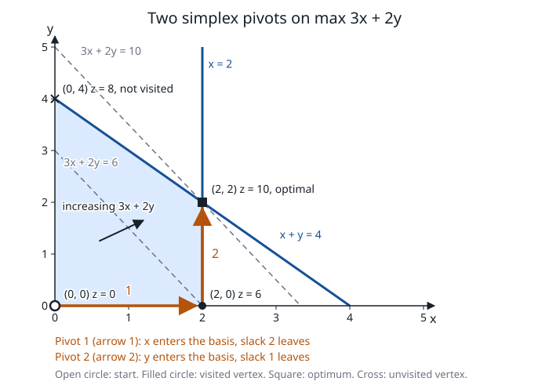
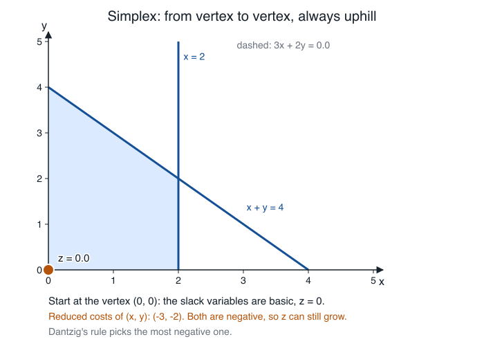

# Simplex for linear programming

**Verified against** revision `1f2ddee` (`simplex.c`, `primal_std.c`,
`primal_optimize.c`, `primal_quad.c`).

## Learning objectives and prerequisites

After this chapter you can:

- explain what a basis, a reduced cost and a pivot are, and derive the ratio
  test from the requirement $x_B\ge0$;
- run the tableau method by hand, including phase I and a degenerate pivot,
  and check each step by substitution;
- say which simplex engine PRIMAL runs for a given LP, what each engine costs,
  and which one can produce a Farkas vector or a recession direction;
- describe the anti-cycling rule PRIMAL implements, and the engine that has none.

Prerequisites: matrix inverse and rank, the LP form
$\min c^\top x$, $Ax=b$, $x\ge0$ (see [mathematical foundations](mathematical_foundations.md)
and [problem formulations](problem_formulations.md)).

## Basis, reduced cost and pivot

Take $A\in\mathbb{R}^{m\times n}$ with full row rank. A *basis* is a set $B$
of $m$ columns that form a nonsingular matrix; $N$ are the other columns.
Setting $x_N=0$ gives

$$
x_B=B^{-1}b .
$$

The basis is *feasible* when $x_B\ge0$. Solve $B^\top y=c_B$. For a nonbasic
column $A_j$ the **reduced cost** is $\bar c_j=c_j-A_j^\top y$.

**Why $\bar c_j$ is the rate of change.** Raise one nonbasic variable $x_j$ by
$\theta\ge0$ and keep the other nonbasic variables at zero. To stay on
$Ax=b$ the basic variables must move by $x_B(\theta)=x_B-\theta v$, with
$v=B^{-1}A_j$. The objective becomes

$$
c_B^\top(x_B-\theta v)+c_j\theta=c_B^\top x_B+\theta\,(c_j-c_B^\top B^{-1}A_j)
=c_B^\top x_B+\theta\,\bar c_j .
$$

If every $\bar c_j\ge0$ no step improves the objective and, by duality, $x$ is
optimal: $y$ satisfies $A^\top y\le c$, and $b^\top y=c_B^\top x_B$.

**Ratio test.** Feasibility requires $x_B-\theta v\ge0$. Only entries with
$v_i>0$ limit $\theta$:

$$
\theta^*=\min_{i:\,v_i>0}\frac{(x_B)_i}{v_i}.
$$

The row that attains the minimum leaves the basis. If no $v_i$ is positive,
$\theta$ is unbounded: the direction $d$ with $d_j=1$, $d_B=-v$ satisfies
$Ad=0$, $d\ge0$ and $c^\top d=\bar c_j<0$. It is a *recession direction*
that proves the LP unbounded (see [certificates](certificates.md)).

## The algorithm

```text
SIMPLEX(A, b, c)                         # min c'x, Ax = b, x >= 0, b >= 0
 1  phase I: find a feasible basis, or prove there is none
 2  loop:
 3      compute reduced costs c_bar_j for the nonbasic columns
 4      if every c_bar_j >= -RED_EPS:  return the basis (optimal)
 5      choose an entering column j with c_bar_j < -RED_EPS        # pricing rule
 6      v <- B^-1 A_j
 7      if no v_i > PIV_EPS:  return the recession direction (unbounded)
 8      choose the leaving row by the minimum ratio test            # tie rule
 9      pivot; update the basis
10      if the objective did not change: count a stalled pivot
```

Phase I adds one artificial variable $a_i\ge0$ per row, so that
$Ax+a=b$ has the obvious feasible basis $\{a_i\}$, and minimizes $\sum a_i$.
If the minimum is positive the original system is infeasible; the phase-I
multipliers are a Farkas vector. A zero minimum gives a feasible basis;
artificials still in the basis at value zero are pivoted out, and a row where
that is impossible is redundant.

## Worked example 1: the polygon

Maximize $3x+2y$ subject to $x+y\le4$, $x\le2$, $x,y\ge0$. Adding slacks
$s_1,s_2$ and minimizing $-3x-2y$ gives the standard form
$x+y+s_1=4$, $x+s_2=2$, with the slack basis $\{s_1,s_2\}$ feasible at
$(x,y)=(0,0)$. The tableau holds $[\,B^{-1}A\mid B^{-1}b\,]$ with the reduced
costs below it; the last entry of the cost row is $-z$.

| | $x$ | $y$ | $s_1$ | $s_2$ | rhs |
|---|---:|---:|---:|---:|---:|
| row $s_1$ | 1 | 1 | 1 | 0 | 4 |
| row $s_2$ | 1 | 0 | 0 | 1 | 2 |
| $\bar c$ | **−3** | −2 | 0 | 0 | 0 |

Pivot 1: $x$ has the most negative $\bar c_j$ (Dantzig's rule). The ratios are
$4/1$ and $2/1$, so $s_2$ leaves and the vertex is $(2,0)$.

| | $x$ | $y$ | $s_1$ | $s_2$ | rhs |
|---|---:|---:|---:|---:|---:|
| row $s_1$ | 0 | 1 | 1 | −1 | 2 |
| row $x$ | 1 | 0 | 0 | 1 | 2 |
| $\bar c$ | 0 | **−2** | 0 | 3 | 6 |

Pivot 2: $y$ enters. Only the first row has a positive entry, with ratio
$2/1$, so $s_1$ leaves and the vertex is $(2,2)$.

| | $x$ | $y$ | $s_1$ | $s_2$ | rhs |
|---|---:|---:|---:|---:|---:|
| row $y$ | 0 | 1 | 1 | −1 | 2 |
| row $x$ | 1 | 0 | 0 | 1 | 2 |
| $\bar c$ | 0 | 0 | 2 | 1 | 10 |

All reduced costs are nonnegative: optimal, $z=-10$, so the maximum of
$3x+2y$ is 10. The multipliers are $y=-\bar c_{\text{slack}}=(-2,-1)$ in the
minimization form, that is $(2,1)$ for the original maximization. By
substitution, $2(x+y)+1\cdot x=3x+2y\le2\cdot4+1\cdot2=10$, which matches.



*Figure: the feasible polygon (shaded) with its four vertices, two level sets
of $3x+2y$ (dashed) and the two pivots (numbered arrows) from $(0,0)$ to
$(2,0)$ to $(2,2)$. Each pivot moves along an edge to a neighbouring vertex
with a better objective; the vertex $(0,4)$ is never visited. Analytic figure,
produced by [`figures/make_figures.c`](figures/make_figures.c) at `1f2ddee`,
which also checks that PRIMAL reports the optimum $(2,2)$ with objective 10.*



*Animation: the same two pivots, step by step. The orange point moves along an
edge until the leaving variable reaches zero; the dashed line is the level set
$3x+2y=z$ through the current point and sweeps outward. The captions show the
entering variable, the ratio test that chooses the leaving one and, at the end,
the reduced costs of the slacks, which are the dual multipliers $(2,1)$. Frames
computed from the tableau run by [`figures/make_animations.c`](figures/make_animations.c)
at `1f2ddee`; the final point is checked against the optimum PRIMAL reports.*

The two pivots above are the sequence that `simplex_solve_std_slack` follows
from the slack basis (it prints the same entering and leaving columns).
`PRIMAL_optimize` does not take this path on this LP; see
[the next section](#what-primal_optimize-does-on-this-lp).

## Worked example 2: phase I

Minimize $x_1+2x_2$ subject to $x_1+x_2=3$, $x_1-x_2=1$, $x\ge0$. There is
no slack column to start from, so phase I adds $a_1,a_2$ (cost 1). The phase-I
reduced cost of a structural column is $-$ (its column sum), so
$\bar c=(-2,0)$ and the objective is $z_1=4$.

1. $x_1$ enters. Ratios $3/1$ and $1/1$: $a_2$ leaves. Now
   $x_1=1$, row 1 reads $2x_2-a_2+a_1=2$, and $\bar c_{x_2}=-2$, $z_1=2$.
2. $x_2$ enters. Only row 1 has a positive entry (ratio $2/2$): $a_1$ leaves.
   Now $x=(2,1)$ and $z_1=0$.

Phase I ends with a feasible basis $\{x_1,x_2\}$. In phase II the reduced costs
are $\bar c=(1,2)-(1,2)=0$, so the basis is already optimal: $z=4$ and
$y=(3/2,-1/2)$. Check: $y_1+y_2=1=c_1$ and $y_1-y_2=2=c_2$.

## Worked example 3: a degenerate pivot

Minimize $-x_1-x_2$ with $x_1-x_2+s_1=0$, $x_2+s_2=1$. The slack basis is
feasible but $s_1=0$: the vertex $(0,0)$ is *degenerate*, because a basic
variable is zero.

1. Both reduced costs equal $-1$; the first column, $x_1$, enters. The only
   positive entry is in row 1, with ratio $0/1=0$. The pivot changes the basis
   and moves nowhere: **a step of length zero**, objective unchanged.
2. Now $\bar c_{x_2}=-2$ and $x_2$ enters with ratio $1/1$; $s_2$ leaves and
   $x=(1,1)$, $z=-2$ is optimal, $y=(-1,-2)$.

A degenerate pivot can change the basis without changing the point. A rule
that can return to a basis it has already visited *cycles*, and the method
never ends. The next section says how PRIMAL prevents it.

## PRIMAL implementation

### Engines

| Engine | Function | Basis start | What it provides |
|---|---|---|---|
| Two-phase tableau | `simplex_solve_std`, `simplex_solve_std_tab` | artificials, phase I | optimal $x,y$; Farkas vector; recession direction; the final tableau (for Gomory cuts) |
| Slack-basis phase II | `simplex_solve_std_slack` | the last $m$ columns | optimal $x,y$ only; used by MIP relaxations ([MIP](mixed_integer_optimization.md)) |
| Revised | `simplex_revised_solve_std` | a given feasible basis | optimal $x,y$ only |
| Dual | `simplex_dual_solve_std` | a given dual-feasible basis | optimal $x$, and $y$ by an LU solve |

`simplex_crash_basis` finds $m$ independent columns by Gaussian elimination
with complete pivoting (a pivot below $10^{-9}$ means rank $<m$). It is a
basis, not a feasible one.

**Tableau** (`simplex.c`). One dense array of $(m+1)\times(n+m+1)$ entries.
Each pivot (`tab_pivot`) normalizes the pivot row and eliminates the entering
column from all other rows: $O(m(n+m))$ time. Pricing is Dantzig's rule: the
most negative reduced cost below $-10^{-9}$ (`enter_col`). Setting
`GMB_SIMPLEX_STEEPEST` replaces it by the maximum of
$\bar c_j^{\,2}/(1+\|\text{column}_j\|^2)$. Phase I restricts entering columns
to structural ones. The infeasibility test is $z_1>10^{-7}\max(1,\|b\|_\infty)$,
and the Farkas vector is $y_r=1-\bar c_{n+r}$. On unboundedness the direction
$\rho$ has $\rho_j=1$ for the entering column and $\rho_{B_i}=-v_i$.

**Anti-cycling** (`run_phase`, `leave_row`). The pivot threshold is
$\mathrm{PIV\_EPS}=10^{-9}$. At tied minimum ratios (within $10^{-12}$) the
**larger pivot wins**, because a tiny pivot multiplies the tableau by a large
factor (a netlib `blend` case went from phase-I cost $6.2\cdot10^4$ to
$5.8\cdot10^{13}$). Progress is counted by the change of the objective: if
$|\Delta z|\le10^{-11}(1+|z|)$ the pivot is stalled. After 40 consecutive stalled
pivots PRIMAL switches to **Bland's rule**: the entering column is the
smallest index with a negative reduced cost, and among tied rows of comparable
pivot size (within a factor 1.5) the smallest basis index leaves. After 120 stalled
pivots the tie-break becomes pure Bland (smallest basis index, regardless of pivot
size). A pivot that improves the objective resets the counter. Bland's rule
cannot cycle in exact arithmetic; with rounding, the pivot-size guard is what
protects the numerics, which is why pure Bland is the last resort. `T8`
runs Beale's cycling example.

**Revised** (`simplex_revised_solve_std`). It keeps the explicit inverse
$B^{-1}$ ($m\times m$), formed once by Gauss–Jordan on $[B\mid I]$ in $O(m^3)$,
and updates it after each pivot by one elementary matrix, $O(m^2)$:
$B^{-1}\leftarrow E\,B^{-1}$. Each iteration recomputes $y=c_B^\top B^{-1}$,
the reduced costs of all nonbasic columns ($O(mn)$), $v=B^{-1}A_j$ and
$x_B=B^{-1}b$. It uses Dantzig pricing and the first minimum ratio. **It has no
stall counter and no Bland fallback**; only the iteration cap stops a cycle. It
returns 1 immediately if the starting basis has some $x_B<-10^{-7}$. It does not
compute a recession direction, so `solve_std_routed_impl` maps every non-optimal
revised outcome to "not solved" and reruns the tableau, which has the rays.

**Dual** (`simplex_dual_solve_std`). From a dual-feasible basis it forms the
dense tableau $B^{-1}[A\mid b]$ once ($O(m^2n)$) and then pivots like the
tableau method, but chooses the *leaving* row first (the most negative
$x_{B_i}<-10^{-9}$) and then the entering column by the minimum of
$\bar c_j/(-T_{rj})$ over $T_{rj}<-10^{-9}$. The duals are recovered at the end
by one LU solve with $B^\top$ (`dmat_lu_factor`).

### Which engine runs

The route is decided in `opt_routes` and `std_route_method`
(`primal_optimize.c`, `primal_std.c`):

- An LP with $m\cdot n>2000$ and $m\le2000$ goes to the **sparse interior
  point** unless the caller selected a simplex optimizer; a smaller LP goes to
  the **simplex** (method 0). `PRIMAL_IPAR_OPTIMIZER` set to a simplex value forces the
  simplex at any size ([interior point](interior_point.md)).
- Method 0 first tries `simplex_crash_basis` and the revised method. If the
  crash basis is infeasible, singular or the revised method stops, it runs the
  two-phase tableau. `GMB_SIMPLEX_TABLEAU` skips the crash attempt.
- With `PRIMAL_IPAR_NUM_THREADS > 1`, and when the route chose the simplex or the
  dense interior point (method 0 or 1), four engines race on the same standard
  form: the tableau, the dense and the sparse interior point and the dual simplex
  (`solve_std_conc`). Unless `concurrent_time` is set the winner is
  deterministic: the first of that order that reaches an optimum.
- `PRIMAL_solvebasis` re-optimizes from a basis supplied by the caller: the
  revised method if that basis is primal feasible, the dual simplex if it is
  dual feasible, and a solve from scratch otherwise.
- A MIP relaxation that has a private slack column per row starts phase II
  from the slack basis ([MIP](mixed_integer_optimization.md#the-relaxation-solver-and-the-slack-basis-start)).
- After any solved LP, `intpnt_identify_basis` (`primal_verdict.c`) assigns a status
  key (basic, at lower, at upper bound) to every variable and row from the published
  point, with a relative tolerance of ^{-7}1 This is a classification of the
  point, not the final basis of the simplex engine.

### What `PRIMAL_optimize` does on this LP

`PRIMAL_optimize` ([architecture](architecture.md)) does not solve the standard
form of the polygon LP above. Before the standard form is built, `bound_tighten`
tightens the variable bounds from the rows (here to \le2 \le420 20 12 61 79 80 81 702 33 98 100 204 250 395 398 399 400 701, and
`stdform_build` turns every finite upper bound on a variable with a finite lower
bound into an extra row `x_shifted + s = u - l` (`stdform.c`). That adds two rows
and two columns. Measured at `1f2ddee` on this LP:

| Setting | Standard form | Path | Pivots |
|---|---|---|---|
| default | $m=4,\ n=6$ | crash basis $\{x,y,s_2,s_1\}$ has $x_B=(2,4,0,-2)$: infeasible, so the tableau runs | 6, phase I included |
| `GMB_NO_BOUND_TIGHTEN` | $m=2,\ n=4$ | crash basis $\{x,y\}$ has $x_B=(2,2)\ge0$ and is already optimal | 0 |

The count comes from `PRIMAL_CALLBACK_PRIMAL_SIMPLEX` events (code 93), one per
loop test plus one at the end of the solve, and from a trace line per pivot
added in a scratch copy. The answer is the same in both cases: $x=(2,2)$,
objective 10. The textbook picture is therefore a model of the method, not a
trace of the library; use it to understand what a pivot does.

## Costs, degeneracy and failure modes

- **Tableau**: $O(m(n+m))$ per pivot and a dense $(m+1)(n+m+1)$ array. It is
  the only engine that returns rays.
- **Revised**: $O(m^2+mn)$ per iteration and $m^2$ memory, but no anti-cycling.
- **Number of pivots.** Not bounded polynomially in the worst case. In practice it
  grows with degeneracy and with poor scaling; PRIMAL scales rows and columns by
  powers of two before building the standard form
  ([numerical stability](numerical_stability.md)).
- **Stalling.** Long runs of zero-length pivots are the symptom; the stall
  counter above is the response.
- **Iteration cap.** `PRIMAL_IPAR_SIMPLEX_MAX_ITERATIONS`. A run that hits it
  returns `TRM_MAX_ITER` and publishes no point.
- A stopped run proves nothing about feasibility: infeasibility is reported with
  a certificate only when phase I ends with $z_1>0$ and the vector measures
  ([certificates](certificates.md)).

## Exercise

Maximize $2x+3y$ on the polygon of example 1, starting from the slack basis.
Predict, with Dantzig's rule, which variable enters, which leaves, the vertex
and the objective. Then explain why the unvisited vertex of the figure is the
answer.

*Answer.* $y$ has the most negative reduced cost ($-3$); the only positive
entry in its column is in the first row (ratio $4/1$), so $s_1$ leaves. After
one pivot the reduced costs are $(1,0,3,0)\ge0$: the optimum is $(0,4)$ with
$z=12$. The same call as above, with $c=(-2,-3,0,0)$, prints one pivot.

## References

- G. B. Dantzig, *Linear Programming and Extensions*, Princeton University Press, 1963.
- R. G. Bland, [New finite pivoting rules for the simplex method](https://doi.org/10.1287/moor.2.2.103), *Mathematics of Operations Research* 2(2):103–107, 1977.
- E. M. L. Beale, [Cycling in the dual simplex algorithm](https://doi.org/10.1002/nav.3800020406), *Naval Research Logistics Quarterly* 2(4):269–275, 1955.
- V. Chvátal, *Linear Programming*, W. H. Freeman, 1983.
