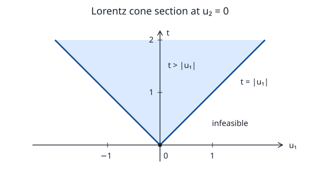

# Second-order cone programming

A second-order cone bounds the Euclidean norm of a vector by a scalar.
For example, $\sqrt{x^2+y^2}\le t$ describes the cone whose section at
$t=5$ is a disk of radius 5. Fixing $(x,y)=(3,4)$ and minimizing $t$ gives
$t=5$, so the shortest admissible bound lies on the surface. In a model,
$(x,y)$ can be an affine function of many decision variables, such as the
residual vector of a least-squares fit.

The [SOCP chapter](conic-socp.md) derives the rotated form and scaling,
works through a Newton step, and describes how PRIMAL chooses a solver path.
