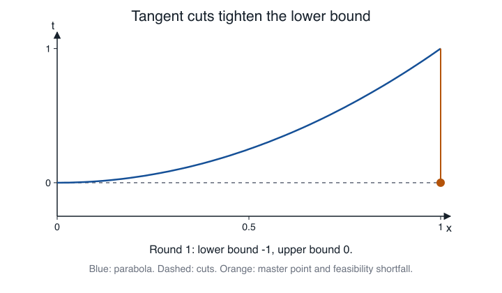

# Tangent cuts (outer approximation)

**Source:** [`primal_conicopt.c`](../primal_conicopt.c),
[`primal_sdptask.c`](../primal_sdptask.c), [`expcone.c`](../expcone.c)

An outer approximation replaces a curved feasible set by an intersection of
half-spaces that contains it. Each new half-space removes trial points that
violate the original constraints. PRIMAL uses this approach as a fallback
for exponential, power and semidefinite blocks.

After this chapter you can derive a supporting cut, solve a sequence of
relaxations by hand, and explain which quantities PRIMAL checks before
returning a solution. Prerequisites are
[convexity and supporting hyperplanes](mathematical_foundations.md) and
[linear programming](simplex.md). The cone examples introduce their own
membership conditions.

## The method

For a differentiable convex function $f$, the first-order inequality is

$$
f(x)\ge f(a)+\nabla f(a)^\top(x-a).
$$

An epigraph constraint $t\ge f(x)$ therefore implies the linear inequality
$t\ge f(a)+\nabla f(a)^\top(x-a)$. Keep tangents from successive trial
points and solve the resulting LP after each addition. Its optimum is a lower
bound in minimization whenever the master contains the original feasible set.
A point feasible for the original model supplies an upper bound. The two
bounds certify optimality when they agree. A cut limit, a stalled sequence or
a restricted master can leave the method without such a certificate.

More generally, a convex constraint $F(x)\le0$ and a subgradient $g$ of $F$
at a trial point $a$ give the cut $F(a)+g^\top(x-a)\le0$. The subgradient
inequality makes this necessary for every feasible point. At $x=a$ the left
side is $F(a)$, so the cut separates $a$ whenever $F(a)>0$.

### Worked example

Minimize $t-x$ subject to $0\le x\le1$ and $t\ge x^2$. A tangent at
$x=a$ gives $t\ge2ax-a^2$. Evaluating the quadratic at a trial $x$ gives a
feasible point $(x,x^2)$ and its upper bound.

| Active approximation | One minimizing master point | Lower bound | Best feasible upper bound |
|---|---|---:|---:|
| $t\ge0$ | $(1,0)$ | $-1$ | $0$ |
| Add $t\ge2x-1$ | $(1/2,0)$ | $-1/2$ | $-1/4$ |
| Add $t\ge x-1/4$ | $(1/2,1/4)$ | $-1/4$ | $-1/4$ |

In the last master the new inequality directly bounds $t-x$. Evaluate the
original constraint at the displayed point to see the bound is attained.
The original objective reduces to $(x-1/2)^2-1/4$, which independently
checks the answer.



*Each frame adds one tangent. The orange marker is a minimizing point of
the master. The orange segment reaches the parabola directly above it,
showing how far the point falls short of the original constraint.*

## Cuts for exponential and power cones

For the [exponential cone](exponential_cone.md), write
$f(u,v)=u e^{v/u}$ for $u>0$. At the tangent point $(\bar u,\bar v)$,
let $w=\bar v/\bar u$. Differentiation gives $f_u=e^w(1-w)$ and $f_v=e^w$.
The constant term cancels, since $f=f_u\bar u+f_v\bar v$. The supporting cut is

$$
t\ge e^w(1-w)u+e^w v.
$$

For $u=1$ and $v=1$, the cut at $w=0$ only enforces $t\ge2$.
The cut at $w=1$ enforces $t\ge e$ and meets the true boundary there.
A cut chosen at a different ratio can leave a sizeable gap on the same
slice. `expp_add_cut` restricts the tangent anchor to $\bar u\ge10^{-2}$
and $w\le10$ for this cone.

For the [ordinary power cone](power_cone.md) the cut is taken on the
epigraph $t\ge f(u,v)=|v|^{1/\alpha}u^{1-1/\alpha}$ for $u>0$.
Let $q=1/\alpha$. At nonzero $v$, $f_u=(1-q)f/u$ and $f_v=qf/v$.
For the rotated version the code linearizes the concave function
$g(t,u)=\sqrt2 t^\alpha u^{1-\alpha}$. Its tangent is an upper
bound, so it supplies one inequality for $v$ and one for $-v$.
The sign bounds on $t,u$ are retained as separate rows where required.

Stopping uses the more direct power-cone expression
$|v|-\gamma t^\alpha u^{1-\alpha}$, where $\gamma$ is $1$ or $\sqrt2$.
For example, at $\alpha=2/3$, $u=1$, $v=0.01$, the exact boundary is
$t=0.001$. Taking $t=0$ gives an epigraph shortfall of $0.001$ and a
slack violation of $0.01$ before the code's numerical floors and
normalization. They measure different quantities. In the implementation
negative coordinate violations are included explicitly, and the largest
violation in each block is divided by $1+\max(|t|,|u|,|v|)$.

## An eigenvector cut for a PSD block

Every positive semidefinite matrix satisfies $h^\top Xh\ge0$ for every
vector $h$. If a trial $X_0$ has minimum eigenvalue $\lambda<0$, choose
a corresponding unit eigenvector $h$. Then
$\langle hh^\top,X_0\rangle=\lambda<0$, whereas the inequality
$\langle hh^\top,X\rangle\ge0$ is valid on the entire PSD cone.
This is a supporting cut for the convex function $-\lambda_{\min}(X)$.
A repeated minimum eigenvalue still permits any normalized eigenvector in
its eigenspace.

For example, minimize $a+b$ with $X=\begin{pmatrix}a&1\\1&b\end{pmatrix}
\succeq0$. Begin with the diagonal constraints $a,b\ge0$. The master gives
$(a,b)=(0,0)$, where $\lambda=-1$ and $h=(1,-1)^\top/\sqrt2$.
The cut is $(a+b)/2-1\ge0$. It gives the lower bound 2, attained by the
original feasible point $(1,1)$. The off-diagonal contribution is
$2 h_1h_2 X_{12}$ because the solver stores the symmetric triangle once.
The `T89` regression solves this model through the cut route and checks
the primal and dual objectives, PSD membership and complementarity.
[`test_t89`](../test_primal.c#L4419)

## One round in PRIMAL

The continuous dispatcher may solve a model natively before calling a cut
fallback. The PSD-only fallback in
[`optimize_sdp_impl`](../primal_sdptask.c#L1649) solves an LP master.
The general fallback in [`optimize_conic_impl`](../primal_conicopt.c)
can retain exact second-order cone blocks, making its master conic.

```text
Build the master with the linear model, retained cones and initial cuts.
Repeat within the round budget:
    Solve the current master and check its status.
    Measure each excluded cone at the resulting trial point.
    If cone criteria pass, check any artificial cap and assemble the result.
    Otherwise append supporting rows and solve the enlarged master.
Return an iteration-limit status if the budget is exhausted.
```

`expp_add_cut` stores up to three coefficients per nonlinear row and scales
each row by its largest coefficient in absolute value. Dividing both sides
by a positive constant leaves the half-space unchanged. The mixed fallback
repeats nonlinear cuts whenever another round is needed and adds eigenvector
rows only for PSD blocks whose smallest eigenvalue is below its threshold.
The pure PSD master starts with bounded bar entries and checks any candidate
touching the artificial bound through `bar_cap_verdict`. A supported
recession witness can establish the model's unbounded status. When the cap is
active and the witness check fails, the result is an iteration limit.
[`bar_cap_verdict`](../primal_sdptask.c#L1605)

## Accuracy, cost and failure modes

- A nested sequence of exact master relaxations gives nondecreasing
  minimization bounds. The individual cone violations can increase when
  the next minimizer moves to a different part of the master.
- Each round solves a larger optimization problem. A nonlinear cut uses
  three entries. An eigenvector cut for a dense $d$-by-$d$ bar uses up to
  $d(d+1)/2$ entries, with an eigensolve to select their values. A Jacobi
  eigensweep costs $O(d^3)$. Nearly parallel cuts can leave many more rounds
  of work even when each separation is cheap.
- For a PSD block the public dual matrix is reconstructed from the original
  objective and constraints as $C_j-\sum_i y_i A_j^i$. The PSD example
  above checks the published matrix independently. An equality between
  reported objective values alone gives no check on dual cone membership.
- The conic master maps inequality multipliers by their original constraint
  indices. Its variable-bound multipliers use a separate column index. Test
  `T318` checks stationarity with an active constraint whose row index exceeds
  the number of variables. [Conic master and dual mapping](../primal_conicopt.c)
- The LP or conic master includes extra rows. Its raw infeasibility or
  recession vector cannot be passed straight through as an original-model
  [certificate](certificates.md). Inspect the model status and whether the
  solver published a separately validated vector.

## Exercise

Keep $u=1$ in the exponential example and change $v$ to $-1$. How strong
is the initial cut at $w=0$? It gives $t\ge0$. A cut evaluated at $w=-1$
gives $t\ge e^{-1}$ at this slice point, meeting the true boundary.

## References

- J. E. Kelley, Jr., [*The Cutting-Plane Method for Solving Convex Programs*](https://doi.org/10.1137/0108053), 1960.
- S. Boyd and L. Vandenberghe, [*Convex Optimization*](https://web.stanford.edu/~boyd/cvxbook/), `3.1 (first-order convexity) and `4.6 (semidefinite programming).
